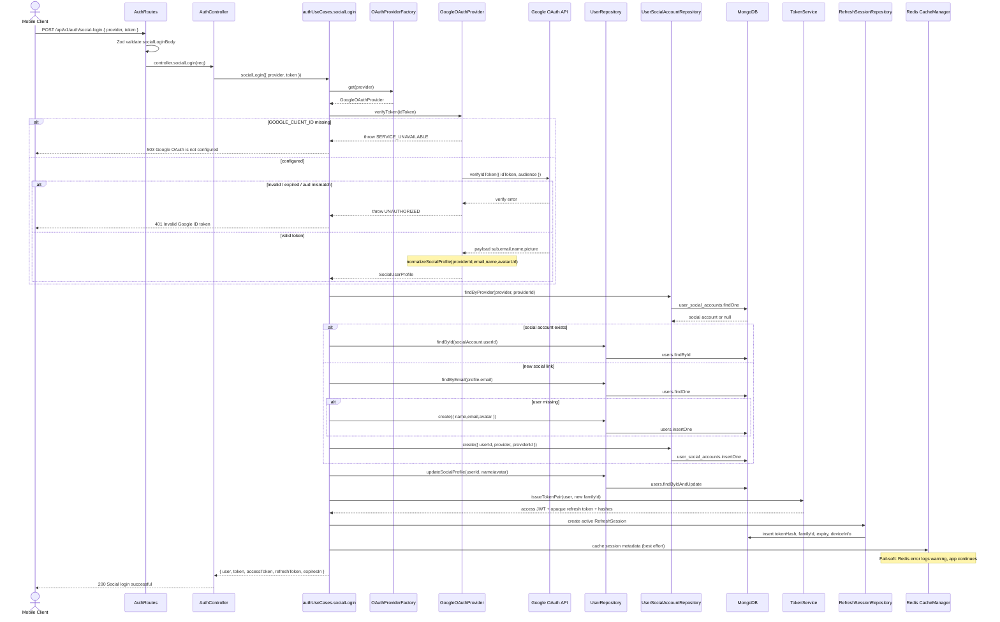
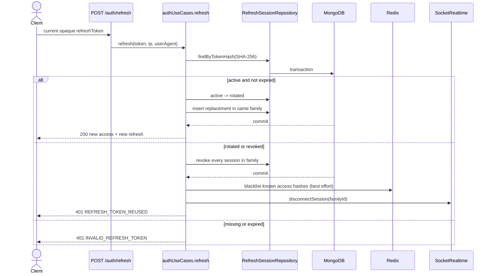
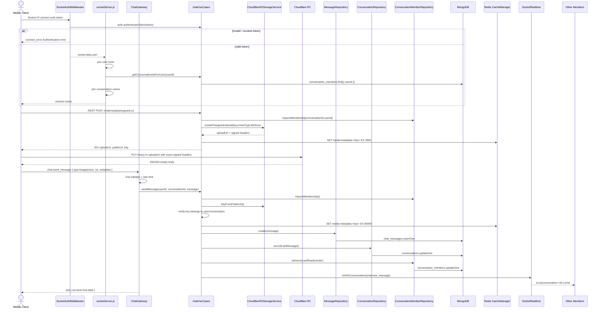
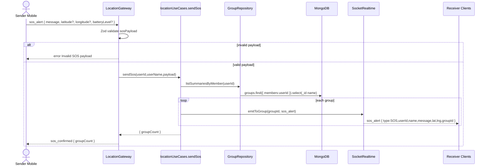

# Core Flows Backend

Tai lieu nay tong hop cac luong ky thuat cot loi phia server FamilyTracker: Node.js, Express, Socket.IO, MongoDB, Redis, Google OAuth va Cloudflare R2. Cac flow duoc viet theo Clean Architecture hien tai:

```text
presentation -> application -> infrastructure -> database/models
domain pure helpers
```

## 1. Google OAuth2 Authentication Flow

### 1.1 Bai toan nghiep vu va muc tieu ky thuat

Nguoi dung mobile dang nhap bang Google thay vi gui password len backend. Backend verify Google ID Token, upsert user, cap access JWT ngan han va opaque refresh token single-use. Refresh session duoc luu trong MongoDB; Redis chi cache metadata va blacklist access token.

Muc tieu ky thuat:

- Khong tin token tu client cho den khi `google-auth-library` verify thanh cong.
- `aud` cua ID Token phai khop `GOOGLE_CLIENT_ID`.
- User co the dang nhap lai bang social account hoac email da ton tai.
- Refresh session MongoDB co TTL index; plaintext refresh token khong bao gio duoc luu.
- Moi login tao `familyId`, toi da 10 active device families moi user.
- Loi cau hinh Google tra `503`, token sai tra `401`.

### 1.2 Sequence Diagram



### 1.3 Step-by-Step Breakdown

1. Client gui `provider=google` va Google ID Token den `POST /api/v1/auth/social-login`.
2. `authRoutes.js` validate payload bang Zod `socialLoginBody`.
3. `authController.socialLogin` chuyen DTO vao `authUseCases.socialLogin`.
4. Use case lay provider tu `oauthProviderFactory.get(provider)`.
5. `GoogleOAuthProvider.verifyToken` dung `OAuth2Client.verifyIdToken({ idToken, audience: clientId })`.
6. Google payload duoc chuan hoa thanh `SocialUserProfile`.
7. Use case uu tien tim social account theo `(provider, providerId)`.
8. Neu chua co social account, tim user theo email; neu user chua ton tai thi auto-register user moi.
9. Tao document `user_social_accounts` de lien ket Google account voi user.
10. Cap nhat name/avatar moi nhat tu Google.
11. `TokenService.issueTokenPair` tao access JWT co `familyId` va refresh token opaque 48 byte.
12. MongoDB luu duy nhat SHA-256 hash trong `refresh_sessions`; TTL index don token het han.
13. Redis cache metadata best effort, khong tham gia quyet dinh token hop le.
14. Response tra token pair va `expiresIn`; mobile thay ca hai token trong Keychain.

### 1.4 Code Snippet va ten file thuc te

`src/presentation/http/routes/authRoutes.js`

```js
router.post('/social-login', authLimiter, validate({ body: socialLoginBody }), controller.socialLogin);
```

`src/application/auth/authUseCases.js`

```js
async function socialLogin({ provider, token }) {
  const oauthProvider = oauthProviderFactory.get(provider);
  const profile = normalizeSocialProfile(await oauthProvider.verifyToken(token));
  const socialAccount = await userSocialAccountRepo.findByProvider(profile.provider, profile.providerId);
  // find/create user, link social account, update profile
  return issueSession(user, { ...requestContext, name: deviceName || null });
}
```

`src/infrastructure/oauth/googleOAuthProvider.js`

```js
ticket = await client.verifyIdToken({ idToken: token, audience: clientId });
```

`src/infrastructure/database/models/RefreshSession.js`

```js
refreshSessionSchema.index({ expiresAt: 1 }, { expireAfterSeconds: 0 });
refreshSessionSchema.index({ userId: 1, familyId: 1 });
```

### 1.5 Xu ly ngoai le va Edge Cases

- `GOOGLE_CLIENT_ID` thieu: provider throw `SERVICE_UNAVAILABLE`, HTTP `503`.
- Token Google het han/sai/audience mismatch: HTTP `401`.
- Email Google chua verified: HTTP `401`.
- Race condition tao user cung email: catch duplicate key `11000`, sau do find lai theo email.
- Social account ton tai nhung user bi xoa: HTTP `401`.
- Redis down: login va refresh van dung MongoDB source of truth; blacklist access JWT fail-open va co warning.
- Mobile gui access token Google thay vi ID token: backend verify fail `401`.

### 1.6 Goc phong van ky thuat - STAR

**Situation:** App can dang nhap Google tren mobile nhung backend van phai lam chu session va authorization.

**Task:** Thiet ke luong social login khong phu thuoc password, verify token ben thu ba, dong thoi van cap JWT noi bo va luu session.

**Action:** Toi tach OAuth provider thanh adapter, verify ID Token bang `google-auth-library`, upsert user/social account, sau do tao access JWT va opaque refresh token. MongoDB luu hash/session family trong transaction; Redis chi tang toc va blacklist.

**Result:** He thong verify dung audience, auto-register, rotate/revoke session theo thiet bi va co the them Apple/Facebook ma khong sua logic loi.

### 1.7 Refresh Token Rotation Flow



MongoDB transaction va conditional update dam bao hai request dong thoi chi mot request rotate thanh cong. Policy strict khong grace window: request con lai duoc xem la reuse va revoke toan family. Chi hash token duoc luu; so sanh hash dung `timingSafeEqual`.

## 2. Real-time Chat va Media Upload Flow

### 2.1 Bai toan nghiep vu va muc tieu ky thuat

Nguoi dung can chat realtime trong circle/direct conversation, gui text/image/voice. Binary media khong di qua Node.js de tranh ton RAM/CPU/bandwidth; backend chi cap pre-signed URL, client upload truc tiep len Cloudflare R2, sau do gui message co public URL. Message duoc luu MongoDB va broadcast qua Socket.IO room.

Muc tieu ky thuat:

- Xac thuc socket handshake bang JWT.
- Moi socket join room user/group/conversation dung membership.
- Validate payload voi Zod.
- Ghi message vao MongoDB, update last message/read cursor.
- Cache media metadata vao Redis, khong cache binary.
- Broadcast `chat:new_message` den cac thanh vien con lai.

### 2.2 Sequence Diagram



### 2.3 Step-by-Step Breakdown

1. Socket handshake doc token trong `socket.handshake.auth.token`.
2. `auth.authenticateToken` verify JWT, check Redis blacklist, load user.
3. Socket join `user:<userId>`, sau do lay group/conversation IDs de join rooms.
4. Media flow bat dau bang REST ticket: `POST /api/v1/chat/media/presigned-url`.
5. Use case check membership, validate MIME/extension/size, build key `chats/<conversation>/<user>/<uuid>.<ext>`.
6. R2 adapter tao pre-signed PUT URL voi signed headers `Content-Type` va `Content-Length`.
7. Client upload binary truc tiep len R2; backend khong nhan file bytes.
8. Client gui `chat:send_message` voi URL public/metadata.
9. Backend verify URL thuoc ticket cua user/conversation bang `keyFromPublicUrl`.
10. Message duoc insert MongoDB, conversation last message/read cursor duoc update.
11. Media metadata duoc cache Redis bang `media:metadata:<key>`.
12. `SocketRealtime.emitToConversation` broadcast `chat:new_message`.

### 2.4 Code Snippet va ten file thuc te

`src/presentation/socket/socketServer.js`

```js
io.use(async (socket, next) => {
  const token = socket.handshake.auth?.token;
  const user = await auth.authenticateToken(token);
  socket.data.user = { id: user._id.toString(), name: user.name, batteryLevel: user.batteryLevel };
  next();
});
```

`src/presentation/socket/gateways/chatGateway.js`

```js
on('chat:send_message', sendMessagePayload, (dto) =>
  chat.sendMessage({ userId: user.id, conversationId: dto.conversationId, message: dto, exceptSocketId: socket.id })
);
```

`src/application/chat/chatUseCases.js`

```js
const key = requireStorage().keyFromPublicUrl(message.attachmentUrl);
if (!isChatMediaUploadKeyOwnedBy(key, { conversationId, userId })) {
  throw Errors.badRequest('attachmentUrl must be the fileUrl of an upload ticket issued to you for this conversation.');
}
```

`src/infrastructure/realtime/socketRealtime.js`

```js
emitToConversation(conversationId, event, payload, { exceptSocketId } = {}) {
  to(rooms.conversation(conversationId), exceptSocketId).emit(event, payload);
}
```

### 2.5 Xu ly ngoai le va Edge Cases

- Handshake khong co token/sai/revoked: `connect_error Authentication error`.
- Non-member gui message: `403 FORBIDDEN`.
- Payload sai schema: ack `{ success:false, code: VALIDATION_ERROR }` hoac `chat:error`.
- Spam message: sliding window `20 messages / 10s`.
- Pre-signed upload URL het han: R2 tra 403/Signature error, client can xin ticket moi.
- `Content-Type`/`Content-Length` khong khop signed headers: R2 tra `SignatureDoesNotMatch`.
- URL public khong thuoc user/conversation: backend reject `400`.
- Redis down: media metadata cache skip, MongoDB va realtime van chay.

### 2.6 Goc phong van ky thuat - STAR

**Situation:** Chat can gui anh/voice realtime nhung server Node.js khong nen xu ly binary upload lon.

**Task:** Thiet ke luong upload an toan, realtime va scale tot.

**Action:** Toi dung pre-signed URL den Cloudflare R2 de client PUT file truc tiep, backend chi validate membership va cap signed URL. Khi gui message, backend verify public URL thuoc namespace da cap, luu MongoDB, cache metadata Redis va broadcast qua Socket.IO room.

**Result:** Backend tranh duoc memory/bandwidth bottleneck, message van co consistency trong MongoDB, realtime delivery nhanh, va media metadata co cache de toi uu doc sau nay.

## 3. Real-time Location Sharing va Battery/I/O Optimization Flow

### 3.1 Bai toan nghiep vu va muc tieu ky thuat

Ung dung can chia se vi tri realtime giua thanh vien circle. Neu moi ping GPS deu ghi MongoDB thi database se bi write-heavy. Backend can luu vi tri moi nhat vao Redis, broadcast realtime, va chi ghi MongoDB khi di chuyen >= 50m hoac da qua >= 30s. Ngoai ra can tinh stay duration va phat stay alert.

### 3.2 Sequence Diagram

```mermaid
sequenceDiagram
    actor Client as Mobile Socket Client
    participant Gateway as LocationGateway
    participant LocationUC as locationUseCases.updateLocation
    participant Redis as Redis CacheManager
    participant GroupRepo as GroupRepository
    participant UserRepo as UserRepository
    participant HistoryRepo as LocationHistoryRepository
    participant Mongo as MongoDB
    participant Realtime as SocketRealtime
    participant Room as Group Room Members

    Client->>Gateway: update_location { latitude, longitude, batteryLevel, recordedAt?, accuracy? }
    Gateway->>Gateway: Zod validate updateLocationPayload
    alt invalid payload
        Gateway-->>Client: error Invalid location payload
    else valid payload
        Gateway->>LocationUC: updateLocation(userId,userName,socketId,payload)
        LocationUC->>LocationUC: trackDuration(userId,lat,lng,now)
        LocationUC->>Redis: SET location:last:<userId> EX REDIS_LOCATION_TTL_SECONDS
        Note over Redis: In-memory last-known location; fail-soft on Redis errors
        LocationUC->>LocationUC: shouldSaveHistory(>=50m or >=30s)
        alt should persist
            LocationUC->>UserRepo: updateLastKnownLocation()
            UserRepo->>Mongo: users.updateOne
            LocationUC->>HistoryRepo: create({ userId, lat,lng,at })
            HistoryRepo->>Mongo: location_histories.insertOne
        else high-frequency ping
            Note over LocationUC: Skip MongoDB write to reduce I/O
        end
        LocationUC->>GroupRepo: listSummariesByMember(userId)
        GroupRepo->>Mongo: groups.find({ members:userId })
        loop each group
            LocationUC->>Realtime: emitToGroup(location_update)
            Realtime-->>Room: location_update payload
            alt new stay milestone
                LocationUC->>Realtime: emitToGroup(location_stay_alert)
                Realtime-->>Room: location_stay_alert
            end
        end
    end
```

### 3.3 Step-by-Step Breakdown

1. Client emit `update_location` qua Socket.IO.
2. `locationGateway` validate latitude/longitude/battery, ISO-8601 `recordedAt` va `accuracy >= 0` bang Zod.
3. Timestamp GPS trong khoang 24 gio qua den 60 giay tuong lai duoc dung; ngoai khoang fallback gio server va log counter khong kem toa do.
4. Use case tinh stay duration bang gio server trong in-memory `durationTracker`.
5. Vi tri moi nhat duoc ghi Redis `location:last:<userId>` voi `recordedAt`, `accuracy` va TTL.
6. `shouldSaveHistory` chi cho ghi MongoDB neu user di chuyen >= 50m hoac >= 30 giay.
7. Khi persist, chi update `User.lastKnownLocation` neu timestamp moi hon; `LocationHistory` dung timestamp GPS hop le.
8. Lay danh sach group user dang tham gia.
9. Broadcast `location_update` den room `group:<groupId>`, tru nguoi gui.
10. Neu user dung yen qua milestone 30/60/120/... phut thi emit `location_stay_alert`.

### 3.4 Code Snippet va ten file thuc te

`src/presentation/socket/gateways/locationGateway.js`

```js
socket.on('update_location', async (payload) => {
  const parsed = updateLocationPayload.safeParse(payload);
  await location.updateLocation({ userId: user.id, userName: user.name, ...parsed.data });
});
```

`src/application/location/locationUseCases.js`

```js
await cacheManager.setWithTTL(
  lastLocationKey(userId),
  { userId, name: userName, latitude, longitude, batteryLevel, durationMinutes, recordedAt: at.toISOString() },
  locationCacheTtlSeconds
);
```

`src/application/location/locationUseCases.js`

```js
if (shouldSaveHistory(userId, latitude, longitude, now)) {
  await userRepo.updateLastKnownLocation(userId, { latitude, longitude, batteryLevel, durationMinutes, at });
  await locationHistoryRepo.create({ userId, latitude, longitude, at });
}
```

### 3.5 Xu ly ngoai le va Edge Cases

- Payload sai: socket emit `error` va khong ghi Redis/Mongo.
- `recordedAt` qua cu/qua xa trong tuong lai: fallback gio server, khong loai bo ca diem.
- Diem offline den muon: van co timestamp dung trong history nhung khong ghi de `User.lastKnownLocation` moi hon.
- Redis down: warning, vi tri van co the broadcast va Mongo throttle van chay.
- MongoDB write fail: gateway catch va emit `error Failed to update location`.
- Nhieu device cung user: disconnect chi mark offline neu `realtime.countUserSockets(userId) == 0`.
- Multi-instance caveat: `lastSavedLocation` va `durationTracker` hien la in-memory single instance; khi scale nhieu instance nen chuyen state nay sang Redis/worker.
- User khong co group: update Redis/Mongo nhung khong broadcast den ai.

### 3.6 Goc phong van ky thuat - STAR

**Situation:** Location app co tan suat GPS ping cao, de gay qua tai MongoDB neu ghi moi event.

**Task:** Toi can giu realtime mượt nhung giam write I/O va van luu du history can thiet.

**Action:** Toi tach last-known location vao Redis voi TTL, broadcast Socket.IO ngay, va throttle MongoDB write bang distance/time threshold. Stay duration duoc tinh trong use case va emit stay alert khi dat milestone.

**Result:** UI van realtime, MongoDB chi nhan cac point co y nghia, cache Redis cung cap vi tri tuc thoi nhanh va he thong co du lieu history de phan tich journey.

## 4. Emergency SOS Alert Flow

### 4.1 Bai toan nghiep vu va muc tieu ky thuat

Nguoi dung bam SOS can phat canh bao khan cap den tat ca circle cua minh, kem vi tri/battery neu co. Backend khong can ghi DB trong flow hien tai; uu tien latency thap, validate payload, broadcast den group rooms va ack sender bang `sos_confirmed`.

### 4.2 Sequence Diagram



### 4.3 Step-by-Step Breakdown

1. Sender emit `sos_alert` qua Socket.IO.
2. `locationGateway` validate message/toa do/battery.
3. Use case `sendSos` lay danh sach group cua sender.
4. Payload SOS duoc build voi `type: "SOS"`, user info, message, timestamp.
5. Moi group nhan `sos_alert` qua room `group:<groupId>`.
6. Sender nhan `sos_confirmed` de UI co the dung loading/confirm thanh cong.

### 4.4 Code Snippet va ten file thuc te

`src/presentation/socket/gateways/locationGateway.js`

```js
socket.on('sos_alert', async (payload) => {
  const parsed = sosPayload.safeParse(payload);
  const { groupCount } = await location.sendSos({ userId: user.id, userName: user.name, ...parsed.data });
  socket.emit('sos_confirmed', { message: 'SOS alert sent to all your groups.', groupCount });
});
```

`src/application/location/locationUseCases.js`

```js
for (const group of groups) {
  realtime.emitToGroup(group._id, 'sos_alert', { ...payload, groupId: group._id, groupName: group.name });
}
```

### 4.5 Xu ly ngoai le va Edge Cases

- Payload sai: sender nhan socket `error`.
- Sender khong thuoc group nao: ack `groupCount: 0`, khong co receiver.
- Socket disconnected: mobile offline queue co the queue SOS, nhung emergency UX nen can canh bao user neu chua connected.
- Receiver app background: iOS `RealtimeNotificationBridge` len local notification neu app khong active.
- Push notification remote APNs chua la backend flow hien tai; hien chu yeu realtime socket/local notification.

### 4.6 Goc phong van ky thuat - STAR

**Situation:** SOS la tinh nang safety nen can latency thap va UI receiver phai thay ngay.

**Task:** Thiet ke flow socket don gian, it diem fail, broadcast den dung circle va ack sender.

**Action:** Toi dat SOS trong location gateway vi da co socket auth va group room. Backend validate payload, lay groups cua sender, emit `sos_alert` den tung group room va tra `sos_confirmed` cho sender.

**Result:** SOS khong phu thuoc vao REST round-trip hay ghi DB, receiver dang online nhan ngay banner, sender biet da gui den bao nhieu group, va luong co the mo rong APNs/audit log sau nay.
