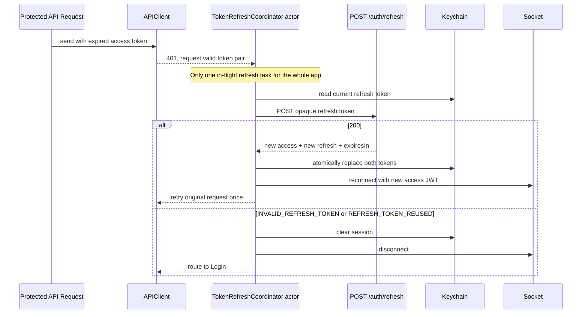
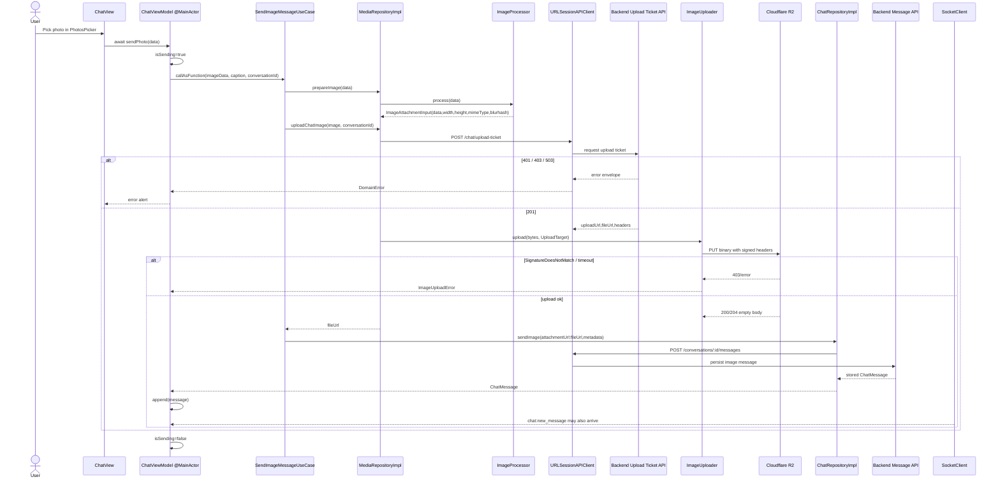
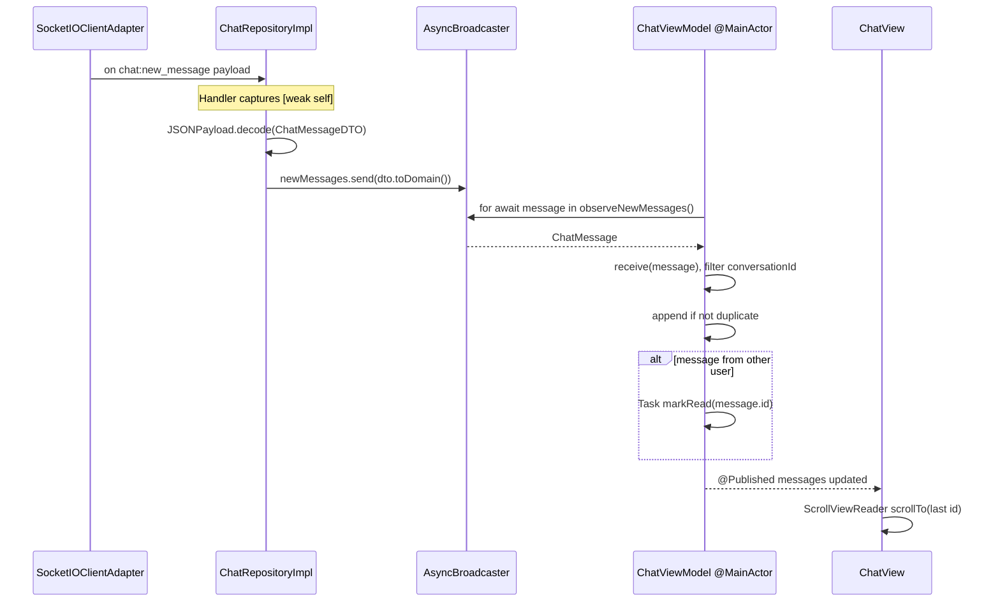
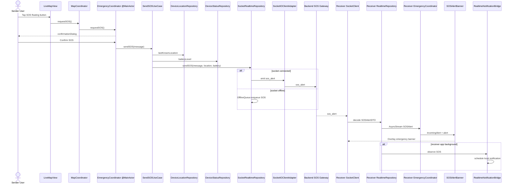

# Core Flows Mobile

Tai lieu nay mo ta cac luong ky thuat cot loi phia iOS Swift/SwiftUI/MVVM-C cua FamilyTracker. Mobile app hien co kien truc:

```text
SwiftUI View -> ViewModel (@MainActor) -> UseCase -> Repository -> APIClient / SocketClient / CoreLocation / Keychain
Coordinator quan ly dieu huong
AppContainer la composition root
```

## 1. Google OAuth2 Authentication Flow

### 1.1 Bai toan nghiep vu va muc tieu ky thuat

Nguoi dung iOS dang nhap bang Google. App phai hien Google Sign-In sheet, lay Google ID Token co `aud` khop Web Client ID backend, gui token den backend `/auth/social-login`, luu JWT app vao Keychain va chuyen tu Auth flow sang Main flow.

Muc tieu ky thuat:

- Google SDK nam trong Data service, khong ro ri vao Domain.
- `LoginViewModel` chay tren `@MainActor` de cap nhat UI an toan.
- Access JWT va opaque refresh token luu Keychain device-only.
- Sau login thanh cong, socket realtime connect bang JWT.
- Coordinator doi root state tu unauthenticated sang authenticated.

### 1.2 Sequence Diagram

```mermaid
sequenceDiagram
    actor User as User
    participant View as LoginView
    participant VM as LoginViewModel @MainActor
    participant GoogleUC as GoogleSignInUseCase
    participant GoogleService as GoogleSignInService
    participant GoogleSDK as GoogleSignIn SDK
    participant AuthRepo as AuthRepositoryImpl
    participant API as URLSessionAPIClient
    participant Backend as Backend /auth/social-login
    participant Keychain as KeychainSessionRepository
    participant Socket as SocketRealtimeRepository
    participant AuthCoord as AuthCoordinator
    participant AppCoord as AppCoordinator

    User->>View: Tap GoogleSignInButton
    View->>VM: Task { await signInWithGoogle() }
    VM->>VM: isLoading=true, errorMessage=nil
    VM->>VM: find root UIViewController
    alt no presenting VC
        VM-->>View: errorMessage = Cannot open Google Sign-In
    else has presenting VC
        VM->>GoogleUC: callAsFunction(presentingViewController)
        Note over VM,GoogleUC: VM is @MainActor; UI state changes stay on main actor
        GoogleUC->>GoogleService: signIn(presentingViewController)
        GoogleService->>GoogleSDK: GIDSignIn.signIn(withPresenting)
        alt user cancels
            GoogleSDK-->>VM: NSError com.google.GIDSignIn -5
            VM-->>View: return silently
        else success
            GoogleSDK-->>GoogleService: idToken.tokenString
            GoogleService-->>GoogleUC: Google ID Token
            GoogleUC->>AuthRepo: socialLogin(idToken)
            AuthRepo->>API: send(AuthEndpoint.googleLogin)
            API->>Backend: POST /api/v1/auth/social-login
            alt 401 / 503 / network
                Backend-->>API: error envelope or network error
                API-->>VM: DomainError/APIError
                VM-->>View: friendlyError(error)
            else 200
                Backend-->>API: user + accessToken + refreshToken
                API-->>AuthRepo: AuthDataDTO
                AuthRepo-->>GoogleUC: AuthSession
                GoogleUC->>Keychain: save(AuthSession)
                Note over Keychain: Store access + refresh token and user in Keychain
                GoogleUC->>Socket: connect(token: session.token)
                GoogleUC-->>VM: User
                VM->>AuthCoord: onAuthenticated(user)
                AuthCoord->>AppCoord: showMain(for:user)
                AppCoord-->>User: MainTabView
            end
        end
    end
    VM->>VM: isLoading=false
```

### 1.3 Step-by-Step Breakdown

1. `LoginView` render `GoogleSignInButton` va goi `Task { await viewModel.signInWithGoogle() }`.
2. `LoginViewModel` tim root `UIViewController` de present Google sheet.
3. `GoogleSignInUseCase` goi `GoogleSignInService.signIn`.
4. `GoogleSignInService` cau hinh `GIDConfiguration(clientID: iOSClientID, serverClientID: webClientID)`.
5. Google SDK tra `idToken.tokenString`.
6. `AuthRepositoryImpl.socialLogin` goi `AuthEndpoint.googleLogin`.
7. `URLSessionAPIClient` gui `POST /auth/social-login`, decode response/error envelope.
8. Use case luu `AuthSession` vao `KeychainSessionRepository`.
9. `SocketRealtimeRepository.connect(token:)` mo Socket.IO session.
10. `onAuthenticated(user)` day flow ve `AppCoordinator.showMain`.

### 1.4 Code Snippet va ten file thuc te

`Mobile/FamilyTracker/Presentation/Scenes/Auth/Login/LoginView.swift`

```swift
GoogleSignInButton(isLoading: viewModel.isLoading) {
    Task { await viewModel.signInWithGoogle() }
}
```

`Mobile/FamilyTracker/Data/Services/GoogleSignInService.swift`

```swift
let config = GIDConfiguration(
    clientID: Self.iOSClientID,
    serverClientID: Self.webClientID
)
GIDSignIn.sharedInstance.configuration = config
```

`Mobile/FamilyTracker/Domain/UseCases/Auth/AuthUseCases.swift`

```swift
let idToken = try await googleSignIn.signIn(presentingViewController: presentingViewController)
let result = try await auth.socialLogin(idToken: idToken)
session.save(result)
realtime.connect(token: result.token)
```

`Mobile/FamilyTracker/Data/Local/Keychain/KeychainStore.swift`

```swift
func save(_ session: AuthSession) {
    keychain.set(session.token, for: Key.token)
    keychain.set(session.user.id, for: Key.userId)
}
```

### 1.5 Xu ly ngoai le va Edge Cases

- Khong tim thay root view controller: show error.
- User huy Google sheet: catch `NSError` domain `com.google.GIDSignIn`, code `-5`, khong hien loi.
- Backend `503`: UI hien "Dich vu Google OAuth chua duoc cau hinh".
- Backend `401`: UI hien "Token Google khong hop le hoac da het han".
- Network fail: map thanh message mat mang.
- API `401` voi protected request: mobile can dung mot shared single-flight refresh task, atomic replace ca hai token, sau do retry request mot lan.
- Keychain save that bai khong throw trong implementation hien tai; nen can monitoring neu production can stricter guarantee.

### 1.6 Goc phong van ky thuat - STAR

**Situation:** Mobile can dang nhap Google nhung backend van phai lam chu JWT va session.

**Task:** Toi can tich hop Google SDK vao SwiftUI/MVVM-C ma khong de SDK leak vao domain.

**Action:** Toi boc Google SDK trong `GoogleSignInService`, de `GoogleSignInUseCase` dieu phoi ID Token -> backend social-login -> Keychain save -> socket connect. `LoginViewModel` la `@MainActor`, chi quan ly UI state va callback coordinator.

**Result:** Flow tach bach, de test/mock, token duoc luu an toan trong Keychain, va sau login app chuyen sang Main flow kem realtime connection.

### 1.7 Refresh Token Rotation tren iOS



Mobile hien tai luu session va access token trong Keychain, nhung can bo sung `TokenRefreshCoordinator` dung chung va luu `refreshToken`. Khong duoc tao refresh task rieng trong tung repository vi hai request song song se kich hoat reuse detection. Hop dong day du nam trong `docs/REFRESH_TOKEN_MOBILE_API_DOC.md`.

## 2. Real-time Chat va Media Upload Flow

### 2.1 Bai toan nghiep vu va muc tieu ky thuat

Mobile can gui text/image va nhan tin realtime. Anh khong upload qua backend ma xin upload ticket, PUT bytes truc tiep len object storage, sau do gui message REST de backend persist va broadcast Socket.IO. Mobile hien implement image upload qua `POST /chat/upload-ticket`; backend da co generalized media endpoint cho image/voice, nhung iOS flow hien tai chua day du voice UI.

Muc tieu ky thuat:

- UI khong bi block khi upload/send.
- Image duoc process/blurhash truoc khi upload.
- PUT request dung signed headers.
- New message stream cap nhat `ChatViewModel @MainActor`.
- `[weak self]` duoc dung trong socket handlers/tasks de tranh retain cycle.

### 2.2 Sequence Diagram - Gui image



### 2.3 Sequence Diagram - Nhan tin realtime



### 2.4 Step-by-Step Breakdown

1. `ChatView` doc anh tu `PhotosPickerItem` thanh `Data`.
2. `ChatViewModel.sendPhoto` goi `SendImageMessageUseCase`.
3. `MediaRepositoryImpl.prepareImage` process anh, lay width/height/mime/blurhash.
4. `uploadChatImage` xin upload ticket tu backend.
5. `ImageUploader` PUT binary len URL da ky, su dung dung headers backend tra.
6. Sau upload OK, `ChatRepositoryImpl.sendImage` goi REST message endpoint.
7. Backend persist message va broadcast `chat:new_message`.
8. Mobile vua append response REST, vua co the nhan event socket; `append` chong duplicate bang `messages.contains`.
9. Socket handler va async stream dung `[weak self]` de tranh retain cycle.

### 2.5 Code Snippet va ten file thuc te

`Mobile/FamilyTracker/Presentation/Scenes/Chat/Conversation/ChatView.swift`

```swift
.onChange(of: photoItem) { item in
    Task {
        if let data = try? await item.loadTransferable(type: Data.self) {
            await viewModel.sendPhoto(data)
        }
    }
}
```

`Mobile/FamilyTracker/Domain/UseCases/Chat/ChatUseCases.swift`

```swift
let image = try media.prepareImage(imageData)
let fileUrl = try await media.uploadChatImage(image, conversationId: conversationId)
return try await chat.sendImage(attachmentUrl: fileUrl, caption: caption, image: image, conversationId: conversationId)
```

`Mobile/FamilyTracker/Data/Repositories/ChatRepositoryImpl.swift`

```swift
socket.on(SocketEvent.chatNewMessage) { [weak self] payload in
    guard let dto = JSONPayload.decode(ChatMessageDTO.self, from: payload) else { return }
    self?.newMessages.send(dto.toDomain())
}
```

`Mobile/FamilyTracker/Core/Storage/ImageUploader.swift`

```swift
target.headers.forEach { request.setValue($0.value, forHTTPHeaderField: $0.key) }
let (responseData, receivedResponse) = try await session.upload(for: request, from: data)
```

### 2.6 Xu ly ngoai le va Edge Cases

- Backend `503 Media storage is not configured`: UI hien error alert.
- R2 signature mismatch: thuong do header `Content-Type`/`Content-Length` sai; `ImageUploader` dung headers ticket tra ve.
- Upload timeout/network fail: throw error, `isSending=false`, user co the thu lai.
- REST send thanh cong va socket event cung den: `append` tranh duplicate.
- Socket disconnected khi nhan tin: REST history van fetch duoc khi mo conversation.
- Voice note: backend da ho tro `voice`, mobile hien tai can them recorder/UI/use case rieng de dung generalized `/chat/media/presigned-url`.

### 2.7 Goc phong van ky thuat - STAR

**Situation:** Chat mobile can gui anh ma khong lam backend ton bandwidth.

**Task:** Toi can thiet ke flow upload truc tiep len object storage va cap nhat UI realtime.

**Action:** Toi tach `SendImageMessageUseCase` thanh 3 buoc: process anh, xin upload ticket/PUT len R2, sau do gui message REST. Socket listener nhan `chat:new_message` va day vao `AsyncBroadcaster`, ViewModel `@MainActor` cap nhat messages.

**Result:** Upload scale tot, UI khong block, message co persistence qua REST va live update qua socket, dong thoi tranh retain cycle bang `[weak self]`.

## 3. Real-time Location Sharing va Toi uu pin

### 3.1 Bai toan nghiep vu va muc tieu ky thuat

Mobile can gui vi tri realtime nhung khong dot pin. App dung CoreLocation + CoreMotion de thay doi accuracy/distanceFilter theo activity va battery. Location use case chi emit khi di chuyen >= 50m hoac qua >= 30s, kem heartbeat khi stationary.

### 3.2 Sequence Diagram - Gui location

```mermaid
sequenceDiagram
    participant CoreMotion as CMMotionActivityManager
    participant CLLocation as CLLocationManager
    participant Policy as AdaptiveLocationPolicy
    participant Service as CLLocationService
    participant DeviceRepo as DeviceLocationRepositoryImpl
    participant ShareUC as ShareLocationUseCase @MainActor
    participant RealtimeRepo as SocketRealtimeRepository
    participant Socket as SocketIOClientAdapter
    participant Server as Backend LocationGateway

    ShareUC->>DeviceRepo: requestPermission + startTracking
    DeviceRepo->>Service: start()
    Service->>CoreMotion: startActivityUpdates
    CoreMotion-->>Service: stationary/walking/automotive
    Service->>Policy: settings(activity, lowPowerMode, battery)
    Policy-->>Service: desiredAccuracy, distanceFilter, significantChangesOnly
    Service->>CLLocation: startUpdatingLocation or significant-change monitoring
    CLLocation-->>Service: didUpdateLocations
    Service->>DeviceRepo: onLocationUpdate(CLLocation)
    DeviceRepo->>ShareUC: AsyncStream GeoPoint
    ShareUC->>ShareUC: filter by >=50m or >=30s
    alt filtered out
        Note over ShareUC: Save battery/network; do not emit
    else should send
        ShareUC->>RealtimeRepo: sendLocation(point,batteryLevel)
        alt socket connected
            RealtimeRepo->>Socket: emit update_location
            Socket->>Server: update_location
        else socket offline
            RealtimeRepo->>RealtimeRepo: OfflineQueue coalesceKey=location
        end
    end
```

### 3.3 Sequence Diagram - Nhan location va cap nhat map

```mermaid
sequenceDiagram
    participant Socket as SocketIOClientAdapter
    participant RealtimeRepo as SocketRealtimeRepository
    participant Broadcaster as AsyncBroadcaster
    participant VM as LiveMapViewModel @MainActor
    participant Map as LiveMapView / MapKit

    Socket->>RealtimeRepo: location_update payload
    RealtimeRepo->>RealtimeRepo: decode LocationUpdateDTO.toDomain()
    RealtimeRepo->>Broadcaster: locations.send(MemberLocation)
    VM->>Broadcaster: for await observeMemberLocations()
    Broadcaster-->>VM: MemberLocation
    VM->>VM: upsert by member id
    VM-->>Map: @Published memberLocations changed
    Map->>Map: Update annotationItems / marker only
    Note over VM,Map: Avoid full-screen manual rerender; SwiftUI diffs annotationItems
```

### 3.4 Step-by-Step Breakdown

1. `ShareLocationUseCase.start` request permission va start tracking.
2. `CLLocationService` bat CoreMotion de biet user stationary/walking/running/cycling/automotive.
3. `AdaptiveLocationPolicy` chon accuracy/distanceFilter phu hop; low battery thi degrade.
4. Stationary dung significant-change monitoring de GPS radio ngu.
5. `DeviceLocationRepositoryImpl` map `CLLocation` sang `GeoPoint`.
6. `ShareLocationUseCase` filter emit theo min distance/time va heartbeat.
7. `SocketRealtimeRepository` emit `update_location`, offline thi queue coalesce key `location`.
8. Incoming `location_update` duoc decode, broadcast qua `AsyncBroadcaster`.
9. `LiveMapViewModel @MainActor` upsert marker theo `member.id`.

### 3.5 Code Snippet va ten file thuc te

`Mobile/FamilyTracker/Core/Location/AdaptiveLocationPolicy.swift`

```swift
case .stationary:
    base = LocationSettings(desiredAccuracy: kCLLocationAccuracyHundredMeters,
                            distanceFilter: 100,
                            activityType: .other,
                            significantChangesOnly: true)
```

`Mobile/FamilyTracker/Domain/UseCases/LiveMap/LiveMapUseCases.swift`

```swift
if let last = lastSent,
   point.distance(to: last.point) < minDistance,
   now.timeIntervalSince(last.date) < minInterval {
    return
}
liveLocation.sendLocation(point, batteryLevel: deviceStatus.batteryLevel)
```

`Mobile/FamilyTracker/Data/Repositories/SocketRealtimeRepository.swift`

```swift
func sendLocation(_ point: GeoPoint, batteryLevel: Int?) {
    emitOrQueue(SocketEvent.updateLocation, payload, coalesceKey: "location")
}
```

`Mobile/FamilyTracker/Presentation/Scenes/LiveMap/Map/LiveMapViewModel.swift`

```swift
private func upsert(_ location: MemberLocation) {
    if let index = memberLocations.firstIndex(where: { $0.id == location.id }) {
        memberLocations[index] = location
    } else {
        memberLocations.append(location)
    }
}
```

### 3.6 Xu ly ngoai le va Edge Cases

- Permission denied: tracking khong bat; UI nen huong dan user vao Settings.
- `authorizedWhenInUse`: service request Always de background sharing.
- Khong co background mode `location`: code guard de tranh crash khi set `allowsBackgroundLocationUpdates`.
- Low Power Mode/pin thap: degrade accuracy va tang distanceFilter.
- Socket offline: OfflineQueue coalesce location, chi giu update moi nhat thay vi spam.
- CoreMotion unavailable: activity `.unknown`, policy van dung continuous location voi default settings.
- Map update lien tuc: ViewModel upsert item thay vi reset ca collection neu khong can.

### 3.7 Goc phong van ky thuat - STAR

**Situation:** App family tracking can live location nhung mobile battery la constraint lon.

**Task:** Toi can gui vi tri du nhanh cho realtime nhung tiet kiem pin khi stationary/low battery.

**Action:** Toi ket hop CoreMotion va CoreLocation: activity determines accuracy/distanceFilter, stationary dung significant-change monitoring, low battery degrade settings. Use case tiep tuc throttle network emit bang 50m/30s va offline queue coalesce location.

**Result:** App giu realtime khi user di chuyen, giam GPS/network khi dung yen, va server cung nhan it ping hon de giam tai.

## 4. Emergency SOS Alert Flow

### 4.1 Bai toan nghiep vu va muc tieu ky thuat

Nguoi dung bam SOS tren ban do de gui canh bao khan cap den cac circle. Receiver dang mo app thay banner tren bat ky tab; neu app background thi bridge tao local notification. Sender duoc confirm sau khi emit socket.

### 4.2 Sequence Diagram



### 4.3 Step-by-Step Breakdown

1. `LiveMapView` nut SOS goi `coordinator.requestSOS`.
2. `EmergencyCoordinator` bat `isConfirmingSOS`, hien confirmation dialog.
3. Confirm goi `SendSOSUseCase`.
4. Use case lay `lastKnownLocation` va `batteryLevel`, gui qua `SOSRepository`.
5. `SocketRealtimeRepository.sendSOS` emit `sos_alert` neu connected, offline thi queue.
6. Receiver `SocketRealtimeRepository` decode `SOSAlertDTO` thanh domain `SOSAlert`.
7. `EmergencyCoordinator.start` observe stream va set `incomingAlert`.
8. `EmergencyPresentation` overlay `SOSAlertBanner` tren UI.
9. `RealtimeNotificationBridge` tao local notification neu app khong active.

### 4.4 Code Snippet va ten file thuc te

`Mobile/FamilyTracker/Presentation/Scenes/LiveMap/Map/LiveMapView.swift`

```swift
mapControlButton(icon: "sos", color: FTColors.danger, action: coordinator.requestSOS)
```

`Mobile/FamilyTracker/Presentation/Coordinators/EmergencyCoordinator.swift`

```swift
func confirmSOS() {
    isSending = true
    sendSOS(message: L10n.text("Tôi cần giúp đỡ khẩn cấp!"))
}
```

`Mobile/FamilyTracker/Domain/UseCases/SOS/SOSUseCases.swift`

```swift
repository.sendSOS(
    message: message,
    location: deviceLocation.lastKnownLocation,
    batteryLevel: deviceStatus.batteryLevel
)
```

`Mobile/FamilyTracker/Data/Repositories/SocketRealtimeRepository.swift`

```swift
func sendSOS(message: String, location: GeoPoint?, batteryLevel: Int?) {
    emitOrQueue(SocketEvent.sosAlert, payload, coalesceKey: nil)
}
```

`Mobile/FamilyTracker/App/RealtimeNotificationBridge.swift`

```swift
guard UIApplication.shared.applicationState != .active else { return }
push.scheduleLocal(title: title, body: body, deeplink: deeplink)
```

### 4.5 Xu ly ngoai le va Edge Cases

- User bam nham: confirmation dialog bat buoc confirm.
- Khong co last location: SOS van gui message, backend nhan khong co lat/lng.
- Socket offline: event vao OfflineQueue; UX nen canh bao neu can hard realtime.
- Receiver dang foreground: banner overlay, khong schedule local notification.
- Receiver background: local notification duoc schedule; remote APNs backend chua implement.
- Auto dismiss: alert tu dong an sau 30 giay neu user khong dismiss.
- Retain cycle: observer task dung `[weak self]`.

### 4.6 Goc phong van ky thuat - STAR

**Situation:** SOS la luong safety, can hien thi ngay tren app receiver va khong bi gioi han trong mot screen.

**Task:** Toi can thiet ke coordinator app-wide cho alert khan cap, dong thoi gui socket payload kem vi tri hien tai.

**Action:** Toi dung `EmergencyCoordinator` lam state holder toan app, `SendSOSUseCase` lay location/battery va gui qua realtime repository. Receiver observe `SOSAlert` stream, overlay `SOSAlertBanner`; background thi `RealtimeNotificationBridge` tao local notification.

**Result:** SOS co UX ro rang, hoat dong tren moi tab, tach logic realtime/use case/UI, va co du diem mo rong sang APNs/audit log.
