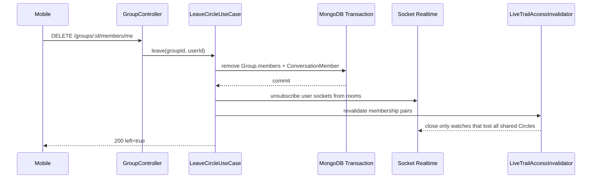

# Live Trail Privacy And Circle Exit

## 1. Mục tiêu

Đóng hai điều kiện bắt buộc trước khi bật Live Trail cho người dùng thật:

1. Người dùng có thể tạm dừng chia sẻ vị trí và mọi watcher mất quyền phải bị đóng ngay.
2. Người dùng có thể rời Circle hoặc bị admin xóa; membership của Circle, group chat và Socket rooms phải nhất quán.

Đây là task riêng sau B7 T1-T3/T5. Không thay đổi map matching và không bật feature flag production.

**Trạng thái:** hiện thực hoàn tất ngày 2026-10-19; production Live Trail vẫn tắt để chờ load gates.

## 2. Hiện trạng đã kiểm chứng

- `Group.members` chỉ là mảng `ObjectId`; chưa có leave/remove endpoint hoặc repository method.
- Join Circle cập nhật `Group` và `ConversationMember` trong cùng MongoDB transaction, sau đó subscribe các socket đang online.
- Chưa có chiều ngược lại để xóa `ConversationMember`, rời Socket group/conversation room hoặc invalidate cache Circle.
- `User` chưa có trạng thái bật/tắt chia sẻ vị trí.
- Quyền history/live trail hiện chỉ dựa trên `requester == target` hoặc `groupRepo.usersShareGroup(...)`.
- Mỗi socket giữ `socket.data.watchedTrails`; lease gọi `revalidate` mỗi 60 giây và phát `journey:trail_closed` khi mất quyền.
- Lease là fallback, không đáp ứng yêu cầu đóng ngay sau privacy/membership mutation.
- Luồng location vẫn ghi Redis/MongoDB và broadcast tới mọi Circle của user; chưa có privacy policy ở application layer.

## 3. Phương án đề xuất

### 3.1. Privacy state

Đề xuất trạng thái **toàn tài khoản** để hành vi dễ hiểu và không vô tình rò vị trí qua một Circle khác:

```text
User.locationSharing.enabled: Boolean (default true)
User.locationSharing.pausedUntil: Date | null
User.locationSharing.updatedAt: Date
```

`enabled=false` hoặc `pausedUntil > now` nghĩa là đang ẩn. Hết `pausedUntil` thì policy xem là bật lại mà không cần cron; lần đọc/ghi tiếp theo dùng thời gian hiện tại.

API đề xuất:

```http
PATCH /api/v1/privacy/location-sharing
Authorization: Bearer <accessToken>
Content-Type: application/json

{ "enabled": false, "pausedUntil": "2026-10-19T12:00:00.000Z" }
```

Khi chuyển sang ẩn, application use case cập nhật DB trước rồi gọi invalidation hook. Mọi live watch đang xem user đó nhận:

```json
{ "event": "journey:trail_closed", "reason": "sharing_paused" }
```

### 3.2. Policy dùng chung

Tạo application policy/service `locationAccessPolicy` thay vì rải điều kiện trong controller/gateway:

- `canPublishLocation(userId, at)` cho `update_location`.
- `assertCanViewLocation(requesterId, targetUserId)` cho history, journey, live trail và watch lease.
- Chính chủ luôn được đọc lịch sử của chính mình.
- Người cùng Circle chỉ được đọc khi target đang chia sẻ.

Đề xuất mạnh về privacy: khi đang ẩn, backend vẫn nhận payload để trả lỗi có cấu trúc nhưng **không ghi Redis, MongoDB, LiveTrail và không broadcast**. Client nên dừng GPS/network trước; backend là lớp enforcement cuối.

### 3.3. Immediate watch invalidation

Tạo port application `ILiveTrailAccessInvalidator` với adapter Socket.IO single-instance:

```text
revalidateForTarget(targetUserId)
revalidateForMembershipChange(userId, formerMemberIds)
```

Adapter duyệt socket registry hiện tại và gọi cùng `liveTrailWatch.revalidate` đang được lease sử dụng. Chỉ watcher thực sự mất quyền mới bị xóa khỏi room và nhận `journey:trail_closed`; nếu hai user vẫn chung Circle khác thì watch vẫn mở.

Hook được gọi **sau transaction commit**. Nếu realtime hook lỗi, mutation vẫn thành công và lease 60 giây là fallback; lỗi không log user ID/toạ độ.

### 3.4. Leave/remove Circle

API đề xuất:

```http
DELETE /api/v1/groups/{groupId}/members/me
DELETE /api/v1/groups/{groupId}/members/{userId}
```

- `members/me`: thành viên tự rời.
- `members/{userId}`: chỉ admin được xóa thành viên khác.
- Admin không được tự rời cho đến khi có transfer ownership hoặc delete Circle.
- Transaction xóa user khỏi `Group.members` và xóa `ConversationMember` của group conversation.
- Sau commit: invalidate Circle member cache; cho mọi socket của user rời group/conversation rooms; emit member-left event; revalidate watches theo cả hai chiều.
- Tin nhắn cũ vẫn giữ để bảo toàn lịch sử/audit, nhưng user đã rời không còn đọc conversation vì membership record đã bị xóa.

## 4. Sequence

### 4.1. Tạm ẩn vị trí

```mermaid
sequenceDiagram
    participant M as Mobile
    participant C as PrivacyController
    participant U as SetLocationSharingUseCase
    participant DB as MongoDB
    participant I as LiveTrailAccessInvalidator
    participant S as Watcher Socket

    M->>C: PATCH /privacy/location-sharing
    C->>U: set(userId, enabled, pausedUntil)
    U->>DB: update locationSharing
    DB-->>U: committed state
    U->>I: revalidateForTarget(userId)
    I->>S: journey:trail_closed(sharing_paused)
    I->>S: leave journey:trail room
    U-->>M: 200 current privacy state
    Note over U,I: Hook failure does not roll back DB; 60 s lease remains fallback
```

### 4.2. Rời Circle



## 5. Execution plan theo tầng

### Domain

- Thêm pure helpers xác định trạng thái sharing tại một thời điểm và validation `pausedUntil`.
- Mở rộng reason contract bằng `sharing_paused`; giữ `permission_revoked` cho membership.

### Application

- Tạo location access policy dùng chung cho history/live trail/location publish.
- Tạo set-location-sharing use case.
- Mở rộng group use cases với `leaveGroup` và `removeMember`.
- Gọi realtime/access invalidation chỉ sau commit; fail-soft về Socket nhưng không fail-soft về database consistency.

### Infrastructure

- Mở rộng User model/repository cho privacy state.
- Thêm `groupRepo.removeMember` và `conversationMemberRepo.remove` nhận transaction session.
- Cached repository invalidate `circle:members:<groupId>` sau mutation.
- Mở rộng Socket realtime adapter để user rời group/conversation rooms và revalidate watch registry.

### Presentation

- Zod DTO và REST route/controller cho privacy, leave, remove.
- Swagger + mobile API docs.
- Socket docs thêm `sharing_paused` và member-left event nếu được duyệt.

### Tests

- Privacy off không ghi cache/history/trail và không broadcast location.
- Người cùng Circle không đọc history/journey/trail khi target ẩn; chính chủ vẫn đọc được.
- Existing watch đóng ngay, rời room và nhận đúng reason; lease vẫn đóng được nếu hook bị bỏ lỡ.
- Leave/remove cập nhật Group + ConversationMember atomically và cache invalidation đúng.
- Socket user bị loại rời group/chat room ngay.
- Hai user còn chung Circle khác vẫn giữ quyền watch.
- Admin authorization, self-removal, transaction rollback và client cũ tiếp tục hoạt động.

## 6. Đánh đổi, rủi ro và rollback

- Global privacy đơn giản và tránh rò chéo Circle, nhưng kém linh hoạt hơn per-Circle privacy.
- Không lưu point trong lúc ẩn bảo vệ privacy mạnh nhất nhưng tạo khoảng trống trong lịch sử cá nhân.
- Registry/invalidation hiện single-instance; horizontal scale cần Socket.IO Redis adapter và distributed invalidation channel.
- Room update xảy ra sau commit nên có cửa sổ rất ngắn; application authorization vẫn là nguồn sự thật.
- Dữ liệu `locationSharing` additive và default `enabled=true`, nên client cũ giữ hành vi hiện tại. Rollback UI không cần migration; rollback server vẫn đọc document cũ vì field mới không phá schema trước.

## 7. Quyết định đã duyệt

1. Privacy áp dụng toàn tài khoản.
2. Khi ẩn, backend không ghi location cache/history/trail mới và không broadcast.
3. SOS rõ ràng vẫn được gửi một lần nhưng không tự bật lại sharing.
4. `pausedUntil` tối đa 7 ngày; `null` là vô thời hạn.
5. Admin không được rời Circle trước khi transfer ownership hoặc xóa Circle.

## 8. Kết quả hiện thực

- Domain helper tính effective state, tự bật lại theo thời gian và giới hạn pause bảy ngày.
- Application location access policy được dùng chung bởi realtime, batch, history, journey và live trail.
- `GET/PATCH /api/v1/privacy/location-sharing` đã có Zod, Swagger và mobile contract.
- Pause xóa last-location cache và in-memory stay/history state, đóng watch ngay với `sharing_paused`; lease 60 giây vẫn là fallback.
- Digest mới che tọa độ/duration của member đang pause; SOS explicit vẫn hoạt động.
- Leave/admin-remove xóa `Group.members` và `ConversationMember` trong một transaction, sau commit rời Socket rooms và revalidate watch hai chiều.
- Nếu hai user còn chung Circle khác, watch không bị đóng.
- `api-docs/PRIVACY_AND_CIRCLE_MEMBERSHIP_API_DOC.md` là contract canonical cho iOS.
- Verification cuối: 174/174 tests qua trong 48 suites; targeted privacy/Circle coverage có 9 tests.

