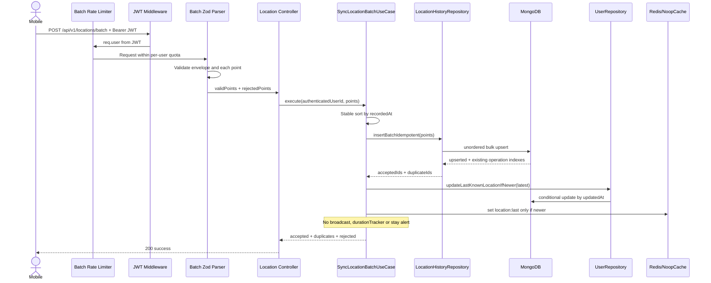

# Offline Location Batch Sync (P6)

**Status:** Implemented and verified. The observations in section 2 describe the repository before P6.

## 1. Mục tiêu và phạm vi

Thiết kế endpoint `POST /api/v1/locations/batch` để mobile đồng bộ các điểm GPS đã đệm khi mất mạng. Luồng phải:

- Xác thực người dùng bằng JWT và chỉ ghi dữ liệu cho `userId` trong token.
- Chấp nhận một phần: điểm hợp lệ vẫn được xử lý khi cùng lô có điểm sai.
- Idempotent theo `(userId, pointId)` để retry không tạo dữ liệu trùng.
- Bảo toàn thứ tự thời gian theo `recordedAt`.
- Không gọi `durationTracker`, không tạo stay alert từ dữ liệu cũ.
- Không broadcast dữ liệu batch; mobile gửi một GPS fix hiện tại qua socket sau reconnect.
- Tương thích ngược hoàn toàn với socket `update_location` hiện tại.

Ngoài phạm vi P6: sửa hành vi socket, cache Circle, ACK realtime, sửa `durationTracker`, và migration dữ liệu lịch sử cũ.

## 2. Hiện trạng trước P6 đã kiểm chứng

### HTTP và validation

- `src/presentation/http/app.js` chưa mount route `/api/v1/locations`.
- Body JSON toàn ứng dụng hiện bị giới hạn ở `100kb` bằng `express.json({ limit: '100kb' })`.
- Payload quá lớn đã được ánh xạ thành HTTP `413`, code `PAYLOAD_TOO_LARGE`.
- Middleware validation chung hiện từ chối toàn bộ request khi Zod thất bại; batch cần cơ chế phân loại từng phần tử riêng.

### Realtime location

- `src/presentation/socket/gateways/locationGateway.js` chỉ nhận event `update_location`.
- `src/presentation/dto/location.schemas.js` đã nhận `latitude`, `longitude`, `batteryLevel?`, `recordedAt?`, `accuracy?`.
- `src/application/location/locationUseCases.js` hiện có ngưỡng lịch sử `50 m / 30 s`, `durationTracker` và `lastSavedLocation` trong RAM của một tiến trình.
- P5 dùng `recordedAt` hợp lệ cho cache, broadcast và trường `LocationHistory.timestamp`; khi timestamp không hợp lệ, P5 dùng thời gian server.

### MongoDB

`LocationHistory` hiện chỉ có:

- `userId`
- `location` (GeoJSON Point)
- `timestamp`

Model chưa có các field riêng `recordedAt`, `accuracy`, `pointId`. Trong P5, `timestamp` mang ngữ nghĩa thời điểm GPS được ghi nhận. Model cũng chưa có TTL index hoặc chính sách tự động xóa lịch sử.

### Last known location và Redis

- `userRepository.updateLastKnownLocation` đã dùng điều kiện nguyên tử: chỉ cập nhật khi `updatedAt` hiện tại cũ hơn điểm mới.
- Redis hiện chỉ có helper cache tổng quát; chưa có compare-and-set theo `recordedAt`.
- Redis là tùy chọn và có `NoopCacheManager`, nên batch vẫn phải hoạt động đầy đủ khi Redis tắt.

## 3. Luồng đề xuất



## 4. Thiết kế theo Clean Architecture

### Domain

- Giữ các rule thuần: stable sort theo `recordedAt`, chọn điểm mới nhất, kiểm tra giới hạn thời gian và chuẩn hóa kết quả.
- Không phụ thuộc Express, Zod, Mongoose, Redis hay Socket.IO.
- Nếu hai điểm có cùng `recordedAt`, giữ thứ tự ban đầu trong request để kết quả xác định.

### Application

Tạo use case riêng `SyncLocationBatchUseCase` thay vì gọi lại use case realtime. Điều này đảm bảo batch không vô tình:

- cập nhật `durationTracker`;
- dùng `lastSavedLocation` trong RAM;
- phát stay alert;
- áp dụng side effect realtime ngoài thiết kế.

Use case nhận `userId` đã xác thực, các điểm đã được phân loại bởi presentation, repository ports, cache port và realtime port. Use case chịu trách nhiệm:

1. Sắp xếp điểm hợp lệ tăng dần theo `recordedAt`.
2. Ghi idempotent và phân loại `accepted`/`duplicates`.
3. Chọn điểm mới nhất trong lô để reconcile `User.lastKnownLocation` và cache.
4. Không broadcast; realtime tiếp tục thuộc riêng đường socket `update_location`.
5. Gộp kết quả persistence với `rejected` từ validation.

### Infrastructure

Mở rộng `LocationHistory`:

- `pointId?: String`
- `accuracy?: Number`
- tiếp tục dùng `timestamp` làm thời gian đo để không phá API/history hiện tại.

Index đề xuất:

```js
locationHistorySchema.index(
  { userId: 1, pointId: 1 },
  {
    unique: true,
    partialFilterExpression: { pointId: { $type: 'string' } }
  }
);
```

Không nên dùng compound `sparse: true` ở đây. `userId` luôn tồn tại nên các document cũ thiếu `pointId` vẫn có thể tham gia sparse compound index và gây xung đột. Partial index mô tả đúng yêu cầu: chỉ enforce uniqueness khi `pointId` là chuỗi.

Repository sử dụng unordered bulk insert. Lỗi duplicate key được ánh xạ theo operation index thành `duplicates`; lỗi MongoDB khác phải làm request thất bại, không được giả thành điểm bị reject.

Cache cần cập nhật theo timestamp mới hơn. Phương án chắc chắn nhất là thêm operation compare-and-set vào cache abstraction:

- Redis: Lua script đọc JSON hiện tại, so sánh `recordedAt`, set kèm TTL nếu mới hơn.
- Noop cache: trả kết quả bỏ qua, không ảnh hưởng MongoDB.

### Presentation

- Route mới: `POST /api/v1/locations/batch`.
- JWT middleware lấy danh tính; body không nhận `userId`.
- Top-level Zod kiểm tra `{ points: array }`, số lượng tối đa và lô không rỗng.
- Mỗi phần tử dùng `safeParse`; lỗi từng điểm được đưa vào `rejected`, không làm hỏng điểm tốt.
- Rate limiter riêng cho batch, ưu tiên key theo authenticated user thay vì chỉ IP.
- Controller chỉ chuyển auth context, gọi use case và định dạng response.

## 5. Hợp đồng API đề xuất

### Request

```json
{
  "points": [
    {
      "pointId": "08f68d38-6665-4f0f-8f48-bfa7cc449dc8",
      "latitude": 10.762622,
      "longitude": 106.660172,
      "recordedAt": "2026-10-14T03:30:00.000Z",
      "accuracy": 12.4,
      "batteryLevel": 76
    }
  ]
}
```

### Success response

Các trường `accepted` và `duplicates` nên là mảng `pointId`, không phải số đếm, vì mobile cần biết chính xác điểm nào có thể xóa khỏi buffer.

```json
{
  "success": true,
  "data": {
    "accepted": ["08f68d38-6665-4f0f-8f48-bfa7cc449dc8"],
    "duplicates": ["906d98d3-07ea-4aa3-8194-84bca59466ce"],
    "rejected": [
      {
        "index": 2,
        "pointId": null,
        "code": "INVALID_POINT_ID",
        "reason": "pointId must be a valid UUID"
      }
    ]
  }
}
```

Thêm `index` cho rejected là cần thiết khi chính `pointId` bị thiếu hoặc sai, để mobile vẫn đối chiếu được phần tử trong request.

### Mã lỗi đề xuất

| HTTP | Code | Khi nào |
|---|---|---|
| 400 | `VALIDATION_ERROR` | Envelope sai hoặc `points` rỗng |
| 400 | `BATCH_LIMIT_EXCEEDED` | Số điểm vượt giới hạn cấu hình |
| 401 | `UNAUTHORIZED` | Thiếu/sai/hết hạn JWT |
| 413 | `PAYLOAD_TOO_LARGE` | Body vượt `100kb` hiện tại |
| 429 | `RATE_LIMITED` | Vượt quota batch, trả `Retry-After` |
| 500 | `INTERNAL_ERROR` | Persistence failure không phải duplicate |

Mixed-validity batch vẫn trả `200`; điểm sai nằm trong `data.rejected`.

## 6. Idempotency và consistency

- Unique index là nguồn sự thật cuối cùng; không dùng `find` rồi `insert` vì có race condition.
- Nếu cùng `pointId` xuất hiện nhiều lần trong một request, đề xuất phần tử đầu được xử lý, các phần tử sau được trả trong `duplicates`.
- Retry sau khi response bị mất sẽ nhận các ID trong `duplicates` và mobile có thể xóa an toàn.
- Reconcile `lastKnownLocation` có thể chạy cho điểm mới nhất dù nó đã là duplicate. Điều này tự sửa trường hợp process chết sau khi insert history nhưng trước khi cập nhật User/cache.
- Batch không broadcast nên retry không thể tạo sự kiện realtime trùng. Sau reconnect, mobile gửi một GPS fix mới qua socket; không gửi cùng một buffered point qua cả socket và batch.

## 7. Thinning và retention

Hiện repository không có TTL index hay retention policy. P6 không nên tự thêm chính sách xóa dữ liệu mà chưa có quyết định sản phẩm.

Đề xuất cho lần này:

- Không áp ngưỡng realtime `50 m / 30 s` lên batch.
- Lưu mọi điểm hợp lệ, duy nhất trong lô tối đa 100 điểm.
- Không thinning trong P6 vì điểm bị loại vẫn cần trạng thái idempotent. Nếu chỉ bỏ qua mà không lưu dấu vết, retry có thể cho kết quả khác và mobile không biết có nên xóa điểm.
- Thiết kế retention/downsampling riêng sau P6, ví dụ giữ dữ liệu chi tiết 30-90 ngày rồi tổng hợp theo khoảng thời gian.

## 8. Rủi ro và biện pháp giảm thiểu

| Rủi ro | Biện pháp |
|---|---|
| Retry đồng thời tạo trùng | Partial unique index + unordered bulk insert |
| Điểm cũ ghi đè vị trí mới | Conditional Mongo update và Redis compare-and-set |
| Dữ liệu offline gây cảnh báo giả | Batch tuyệt đối không gọi `durationTracker`/stay alert |
| Retry hoặc reconnect phát realtime trùng | Batch không broadcast; fresh fix đi riêng qua socket |
| Batch lớn gây tải DB | Giới hạn số điểm, body `100kb`, rate limit riêng |
| Một điểm sai làm mất cả lô | Per-item `safeParse` và partial success |
| Timestamp offline bị thay bằng giờ server | Reject riêng điểm ngoài policy, không fallback timestamp |
| Mongo insert thành công nhưng cập nhật User/cache thất bại | Retry duplicate vẫn chạy bước reconcile User/cache |

## 9. Rollback

1. Gỡ mount route `/api/v1/locations/batch` để ngừng traffic mới.
2. Revert wiring/use case/repository batch; socket realtime không bị ảnh hưởng.
3. Có thể giữ các field optional và partial index vì chúng tương thích dữ liệu cũ; nếu cần xóa index, drop đúng tên index sau khi route đã tắt.
4. Mobile giữ queue cục bộ và retry khi backend được khôi phục.

## 10. Quyết định đã duyệt

| Quyết định | Giá trị đã duyệt | Lý do |
|---|---|---|
| Kích thước lô tối đa | `100` điểm | Cân bằng số request và kích thước `100kb` hiện tại |
| Broadcast | Không broadcast | Batch phục hồi lịch sử; socket chịu trách nhiệm realtime |
| Tuổi tối đa của điểm batch | `24` giờ; future skew `60` giây | Khớp giới hạn buffer P7; timestamp sai bị reject, không fallback |
| Thinning | Không thinning trong P6 | Giữ idempotency và tránh mất dữ liệu ngầm |
| Áp dụng `50 m / 30 s` realtime | Không | Đây là sync lịch sử, không phải sampling realtime |
| Retention | Không thêm TTL trong P6; tách policy sau | Hiện không có retention và chưa có yêu cầu thời hạn lưu |
| Rate limit | `30 request/phút/user`, tối đa 3.000 điểm/phút | Đủ cho reconnect nhưng chặn abuse; trả `Retry-After` |
| Same `pointId` trong một request | Phần tử đầu xử lý, phần tử sau là duplicate | Kết quả ổn định và mobile có thể xóa queue |
| `batteryLevel` ngoài 0...100 | Clamp giống realtime; sai kiểu thì reject | Nhất quán P5, chịu được sensor/client edge cases |
| Response lỗi từng điểm | Thêm `index`, `pointId`, `code`, `reason` | Đối chiếu được cả khi `pointId` không hợp lệ |
| Quan hệ với realtime | Buffered points chỉ qua batch; fresh fix sau reconnect chỉ qua socket | Tránh lưu và phát cùng một điểm qua hai đường |
