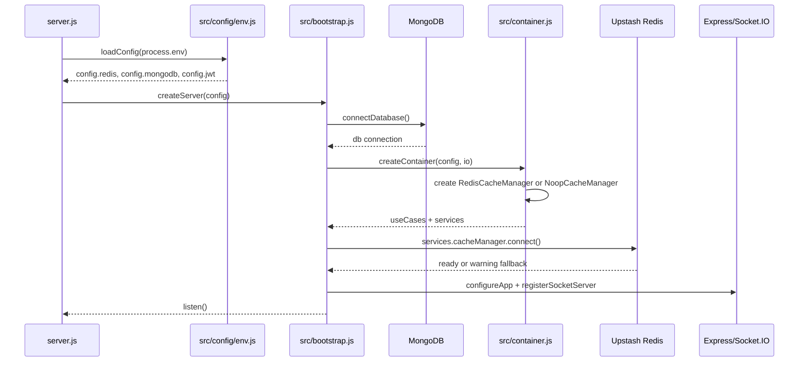
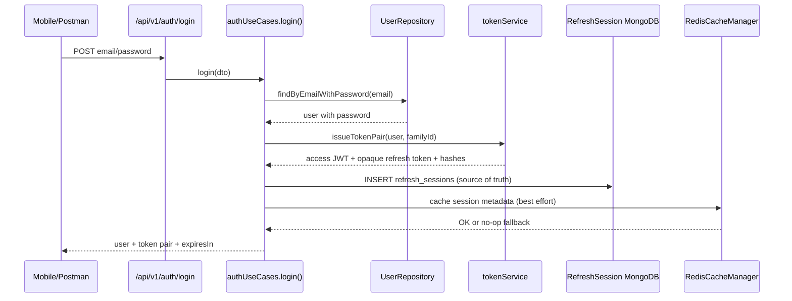
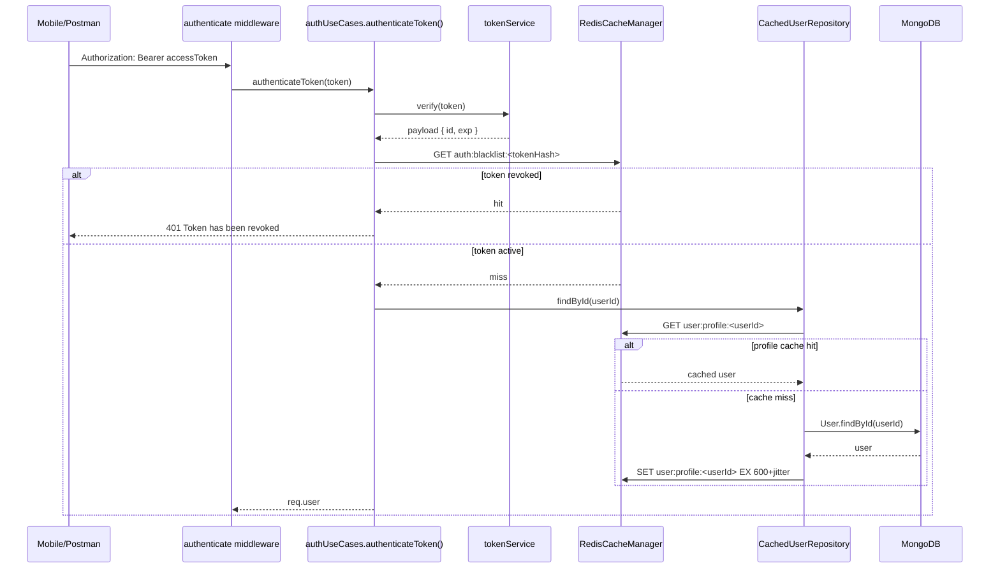
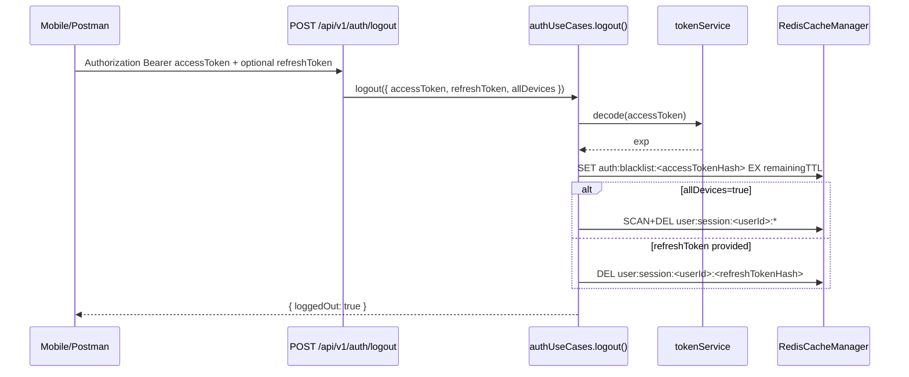
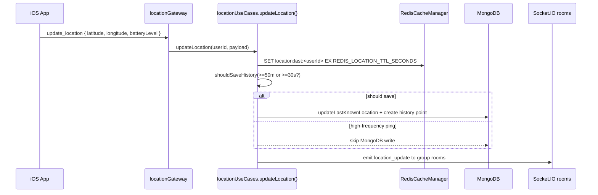
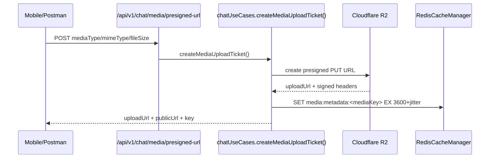

# Redis Performance And Caching Architecture

## 1. Tong quan giai phap va Data Flow

Redis se duoc dung nhu mot tang tang toc nam giua Backend Node.js/Express va MongoDB. Vai tro cua Redis trong FamilyTracker khong phai thay the MongoDB, ma la giam so lan truy van lap lai, quan ly trang thai ngan han, va xu ly du lieu realtime co tan suat cao nhu vi tri hien tai cua thanh vien.

### 1.1 Cache-Aside / Lazy Loading

Cache-Aside la chien luoc phu hop voi kien truc hien tai vi application use case van lam chu luong nghiep vu, repository van lam chu du lieu ben vung, con Redis chi la tang tang toc co the fallback.

Flow doc du lieu:

```text
Client request
  -> Controller / Gateway
  -> Use Case
  -> CacheManager.get(key)
       -> Cache hit: parse JSON va tra ve ngay
       -> Cache miss:
            -> Repository query MongoDB
            -> Neu co data: CacheManager.setWithTTL(key, data, ttl+jitter)
            -> Neu khong co data: cache null ngan han de chong penetration
            -> Tra response
```

Flow ghi du lieu:

```text
Client update
  -> Controller
  -> Use Case validate business rule
  -> Repository update MongoDB
  -> Cache invalidation:
       -> del user:profile:<userId>
       -> del circle:members:<circleId> neu profile/member thay doi
  -> Tra response moi
```

Nguyen tac quan trong: MongoDB la source of truth. Redis chi duoc xem la ban sao tam thoi, co TTL, co the mat bat cu luc nao ma khong lam he thong sai nghiep vu.

### 1.2 Token Blacklist va Session Tracking

JWT access token thuong stateless, nen neu user logout truoc khi token het han thi server can co cach chan token cu. Redis phu hop cho bai toan nay vi key co TTL tu dong het han.

Logout flow:

```text
Client POST /api/v1/auth/logout
  -> authenticate JWT
  -> Decode exp cua access token
  -> Tinh ttl = exp - now
  -> Redis SET auth:blacklist:<jti-or-tokenHash> 1 EX ttl
  -> Neu co refresh token/session id:
       -> DEL user:session:<userId>:<sessionId>
  -> Response success
```

Auth flow sau khi co Redis:

```text
Request co Authorization Bearer token
  -> Verify JWT signature nhu hien tai
  -> Kiem tra Redis auth:blacklist:<tokenHash>
       -> Co: reject 401 TOKEN_REVOKED
       -> Khong: tiep tuc
  -> Neu bat session tracking:
       -> Kiem tra user:session:<userId>:<sessionId>
       -> Khong ton tai: reject 401 SESSION_EXPIRED
```

Refresh token/session nen co TTL dai hon access token. Khi user logout all devices, co the xoa theo pattern:

```text
user:session:<userId>:*
```

### 1.3 Realtime GPS Last Known Location

Ung dung tracking co tan suat update vi tri cao. Neu moi ping vi tri deu ghi MongoDB thi database se bi tang write load nhanh, trong khi UI realtime thuong chi can vi tri moi nhat.

Flow de xuat:

```text
Socket update_location
  -> Validate user va payload
  -> Kiem tra membership circle/group
  -> Redis SET location:last:<userId> JSON EX 300
  -> Broadcast location_update cho room lien quan
  -> MongoDB write co throttle:
       -> chi ghi neu di chuyen >= 50m
       -> hoac da qua >= 30s/60s
       -> hoac batch flush theo interval
```

Redis luu vi tri hien tai de client moi reconnect co the lay nhanh:

```text
GET location:last:<userId>
```

MongoDB van luu lich su hanh trinh, stay points, moving segments, va cac ban ghi can audit/dieu tra sau nay.

## 2. Key Naming Convention va Data Structures

### 2.1 Quy chuan key

Dung namespace phan cap, lowercase, tach bang dau `:`. Key phai de doc, de xoa theo scope, va khong phu thuoc vao format database noi bo qua nhieu.

| Key | Type | TTL de xuat | Muc dich |
| --- | --- | ---: | --- |
| `auth:blacklist:<tokenHash>` | String | Bang thoi gian song con lai cua JWT | Chan access token da logout/revoked |
| `user:session:<userId>:<sessionId>` | String/Hash | 7-30 ngay | Theo doi refresh session/device |
| `user:profile:<userId>` | String JSON | 5-15 phut | Cache profile user |
| `circle:members:<circleId>` | String JSON / Set | 30-120 giay | Cache danh sach thanh vien circle |
| `conversation:members:<conversationId>` | Set/String JSON | 30-120 giay | Cache membership de check chat nhanh |
| `media:metadata:<mediaKey>` | String JSON | 1-24 gio | Cache metadata anh/voice tren R2 |
| `location:last:<userId>` | String JSON / Geo | 2-10 phut | Vi tri moi nhat cua user |
| `location:circle:<circleId>` | Geo / Sorted Set | 2-10 phut | Tra cuu vi tri thanh vien theo circle |
| `rate:auth:<ip>` | String counter | 15 phut | Rate limit login/register neu can chuyen sang Redis |

### 2.2 Data structures

#### String JSON

Phu hop cho object nho:

```json
{
  "id": "6abcd8cc8126c189eeca828f",
  "name": "Tine",
  "email": "tine@gmail.com",
  "avatarUrl": "https://..."
}
```

Dung cho:

```text
user:profile:<userId>
media:metadata:<mediaKey>
location:last:<userId>
```

#### Hash

Phu hop cho session/device setting can update tung field:

```text
HSET user:session:<userId>:<sessionId>
  refreshTokenHash <hash>
  deviceId <deviceId>
  userAgent <ua>
  createdAt <iso>
  lastSeenAt <iso>
```

#### Set

Phu hop de luu membership id:

```text
SADD conversation:members:<conversationId> <userId1> <userId2>
SISMEMBER conversation:members:<conversationId> <userId>
```

Trong phase dau co the cache JSON list de don gian. Khi can toi uu authorization check tan suat cao, chuyen sang Set.

#### Sorted Set

Phu hop cho time-series nhe, vi du queue flush vi tri:

```text
ZADD location:flush:queue <timestamp> <userId>
```

Worker co the lay cac user can flush:

```text
ZRANGEBYSCORE location:flush:queue -inf <now>
```

#### Geo

Redis Geo co the luu toa do de truy van theo ban kinh:

```text
GEOADD location:circle:<circleId> <lng> <lat> <userId>
GEORADIUS location:circle:<circleId> <lng> <lat> 500 m
```

Voi app FamilyTracker, phase dau chi can `location:last:<userId>` dang JSON la du. Geo nen them khi co feature tim thanh vien gan vi tri X hoac tinh khoang cach realtime tren server.

## 3. Architectural Highlights

### 3.1 Tai sao khong luu truc tiep file anh vao Redis?

Redis chay chu yeu tren RAM. Anh va voice note la binary co dung luong lon, neu luu vao Redis se rat ton bo nho, tang chi phi, va day eviction xay ra nhanh. Redis khong phai object storage.

Dung sai:

```text
Redis SET media:file:<id> <binary image bytes>
```

Dung dung:

```text
Cloudflare R2 luu binary
Redis cache metadata/url nho gon
```

Redis nen cache:

```json
{
  "mediaUrl": "https://pub-xxx.r2.dev/chats/...",
  "mimeType": "image/png",
  "fileSize": 177086,
  "width": 1280,
  "height": 720,
  "blurhash": "LEHV6nWB2yk8pyo0adR*.7kCMdnj"
}
```

Cloudflare R2/CDN xu ly network I/O va bandwidth. Redis chi tang toc metadata lookup.

### 3.2 Cache Invalidation / Cache Busting

Bai toan: user doi ten/anh dai dien nhung UI van hien ten/anh cu vi cache.

Nguyen tac:

1. Moi write thanh cong vao MongoDB phai xoa cache lien quan.
2. Xoa theo dependency edge, khong chi xoa object vua update.
3. TTL la lop bao ve cuoi, khong thay the invalidation.

Vi du user update profile:

```text
DEL user:profile:<userId>
DEL circle:members:<circleId1>
DEL circle:members:<circleId2>
DEL conversation:list:<userId>
```

Neu ten/avatar user hien trong chat message sender info, conversation list, member list, can xoa cac key aggregate co chua profile do.

Vi du member join/leave circle:

```text
DEL circle:members:<circleId>
DEL user:circles:<userId>
```

Vi du media metadata thay doi:

```text
DEL media:metadata:<mediaKey>
```

### 3.3 Phong chong loi caching kinh dien

#### Cache Penetration

Van de: request lap lai vao key khong ton tai, cache miss lien tuc, MongoDB bi query lien tuc.

Giai phap:

```text
Neu MongoDB tra null:
  SET user:profile:<id> "__NULL__" EX 30
```

TTL cho null cache nen ngan, vi user/colection co the duoc tao sau.

#### Cache Avalanche

Van de: nhieu key cung het han cung luc, tao spike query MongoDB.

Giai phap:

```text
ttl = baseTtl + random(0, jitter)
```

Vi du:

```text
user profile: 600s + random 0..120s
circle members: 60s + random 0..30s
```

#### Cache Stampede / Thundering Herd

Van de: mot key hot het han, hang tram request cung query MongoDB de rebuild cache.

Giai phap:

1. Distributed lock ngan han:

```text
SET lock:user:profile:<userId> 1 NX EX 5
```

Request nam lock query DB va rebuild cache; request khac co the cho nhe hoac fallback DB voi rate control.

2. Stale-while-revalidate cho du lieu khong qua nhay cam:

```text
Tra stale data trong 30s grace window
Background refresh cache
```

3. Single-flight trong process Node.js:

```text
Map<cacheKey, Promise>
```

Tranh nhieu request cung process cung query DB cho cung mot key.

## 4. Interview Preparation

### Cau 1: Su khac biet giua luu Session tren Redis va luu trong JWT Stateless?

JWT stateless cho phep server verify token ma khong can truy van database/session store, rat nhanh va de scale ngang. Diem yeu la kho revoke token truoc khi het han. Neu token bi lo, no co the dung den luc exp.

Redis session la stateful. Server co the revoke session ngay, logout all devices, theo doi device, va ap dung policy nhu max active sessions. Doi lai, moi request co the can them mot lan check Redis, va he thong phu thuoc them vao availability cua Redis.

Thuc te tot nhat cho app mobile: access token ngan han bang JWT, refresh token/session duoc track trong Redis. Logout ghi blacklist access token den luc het han va xoa refresh session.

### Cau 2: Lam the nao scale Redis khi so luong Socket va tan suat ping vi tri tang vot?

Truoc het can giam write rate bang throttle o application layer: chi cap nhat khi di chuyen >= 50m hoac sau >= 30s. Sau do dung Redis pipelining de gom lenh, dat TTL cho last location de du lieu tu het han, va tach key namespace ro rang.

Khi tai tang tiep:

```text
1. Dung Redis managed service co metrics/auto-failover.
2. Bat connection pooling hop ly, khong tao client moi moi request.
3. Scale Node.js horizontally, Redis lam shared state.
4. Neu can pub/sub socket multi-instance, dung Redis adapter cho Socket.IO.
5. Neu data qua lon, dung Redis Cluster va shard theo userId/circleId.
```

Quan trong: khong ghi moi ping vao MongoDB. MongoDB chi nhan batch/throttled writes de luu history.

### Cau 3: Eviction Policy nao toi uu cho app tracking: allkeys-lru hay volatile-ttl?

Neu Redis instance chi dung cho cache va du lieu ngan han co the mat duoc, `allkeys-lru` hoac `allkeys-lfu` phu hop vi Redis co the thu hoi bat ky key nao it dung.

Neu Redis cung luu key quan trong co TTL nhu blacklist/session, nen can than voi `allkeys-lru` vi key blacklist co the bi day ra truoc khi token het han. Khi do nen:

```text
1. Tach Redis logical DB/instance cho cache va auth/session neu co the.
2. Dung maxmemory du lon cho auth/session.
3. Dung volatile-ttl neu muon chi evict key co TTL.
4. Monitor evicted_keys va memory usage.
```

Cho FamilyTracker phase dau, khuyen nghi:

```text
Managed Redis rieng cho app.
Moi key deu co TTL.
Canh bao memory.
Neu production lon: tach auth/session va cache/location thanh instance rieng.
```

### Cau 4: Giai quyet dong bo du lieu giua Redis RAM va MongoDB Disk nhu the nao?

MongoDB la source of truth. Redis la cache/ephemeral state. Moi nghiep vu can consistency manh phai ghi MongoDB truoc, sau do xoa cache. Khi cache miss thi rebuild tu MongoDB.

Voi vi tri realtime, co the chap nhan eventual consistency:

```text
Redis: last known location moi nhat
MongoDB: history da flush/throttle
```

Neu Redis mat du lieu, app van doc last persisted location tu MongoDB va tiep tuc nhan update moi. Neu MongoDB ghi fail khi flush, can retry queue hoac ghi log de khong lam crash socket flow.

## 5. Execution Plan Theo Clean Architecture

Quy tac trien khai: giu flow hien tai `presentation -> application -> infrastructure -> database/models`, domain pure. Redis client, ioredis, retry strategy va serialization nam trong infrastructure. Use case chi goi port/cache abstraction, khong import ioredis truc tiep.

### 5.1 Infrastructure Layer

#### Package can them

```bash
npm install ioredis
```

Neu can Socket.IO multi-instance sau nay:

```bash
npm install @socket.io/redis-adapter
```

Khong can them Redis adapter trong phase dau neu chi chay mot Render instance.

#### Config

Them bien moi:

```env
REDIS_URL=redis://default:<password>@<host>:<port>
REDIS_ENABLED=true
REDIS_KEY_PREFIX=familytracker:
REDIS_DEFAULT_TTL_SECONDS=300
REDIS_CONNECT_TIMEOUT_MS=5000
REDIS_MAX_RETRIES_PER_REQUEST=2
```

Neu Redis chua cau hinh:

```text
cache service fallback sang no-op mode
server van boot binh thuong
MongoDB van xu ly nhu hien tai
```

#### Redis client

Tao:

```text
src/infrastructure/cache/redisClient.js
```

Tra ve singleton ioredis client voi:

```text
lazyConnect: true
enableOfflineQueue: false
maxRetriesPerRequest: 2
connectTimeout: 5000
retryStrategy(times): exponential backoff co max cap
```

Khi Redis error:

```text
log error ngan gon
khong throw lam crash server
mark cache unhealthy tam thoi
```

#### CacheManager

Tao:

```text
src/infrastructure/cache/CacheManager.js
```

API de xuat:

```js
get(key)
setWithTTL(key, value, ttlSeconds, options)
del(key)
delMany(keys)
delByPattern(pattern)
getOrSet(key, ttlSeconds, loader, options)
withLock(lockKey, ttlSeconds, fn)
isHealthy()
```

Behavior:

```text
get parse JSON an toan
set stringify JSON
delByPattern dung SCAN, khong dung KEYS trong production
Moi method catch Redis error va fallback null/no-op
```

#### No-op fallback

Tao:

```text
src/infrastructure/cache/NoopCacheManager.js
```

Khi Redis disabled/unavailable:

```text
get -> null
set/del -> false
getOrSet -> loader()
```

Nhu vay app van chay qua MongoDB.

#### Wiring

Cap nhat sau khi duoc duyet:

```text
src/config/env.js
src/container.js
src/bootstrap.js neu can connect/disconnect lifecycle
```

Container inject `cacheManager` vao repositories/use cases can cache.

### 5.2 Application va Repositories Layer

#### User profile cache

Muc tieu:

```text
UserRepository.findById / getUserById co cache-aside
```

Implementation plan:

```text
1. Tao CachedUserRepository decorator trong infrastructure/repositories hoac inject cache vao userRepository.
2. Key: user:profile:<userId>
3. TTL: 5-15 phut + jitter.
4. Cache null 30s neu user khong ton tai.
5. updateSocialProfile/updateProfile/create/delete -> DEL user:profile:<userId>.
```

Khuyen nghi Clean Architecture:

```text
Use case khong biet Redis.
Repository/decorator xu ly cache-aside.
```

Neu can invalidation aggregate:

```text
Sau update profile:
  del user:profile:<userId>
  delByPattern circle:members:* only if can map circles efficiently
```

Tot hon: group repository expose danh sach circle cua user, roi xoa key cu the.

#### Circle members cache

Muc tieu:

```text
Group/Circle member list doc nhieu, ghi it.
```

Key:

```text
circle:members:<circleId>
```

TTL:

```text
60-120s + jitter
```

Invalidation:

```text
create group -> none or set initial
join group -> DEL circle:members:<circleId>
leave/remove member -> DEL circle:members:<circleId>
update member profile -> DEL circle:members:<circleId> cua cac circle lien quan
```

#### Media URL/metadata cache

Muc tieu:

```text
Cache metadata nho cua media da upload len R2.
```

Key:

```text
media:metadata:<mediaKey>
```

Value:

```json
{
  "publicUrl": "https://pub-xxx.r2.dev/chats/...",
  "mimeType": "image/png",
  "fileSize": 177086,
  "width": 1280,
  "height": 720,
  "duration": null,
  "createdAt": "2026-10-11T..."
}
```

TTL:

```text
1-24 gio tuy muc do can metadata.
```

Khong cache pre-signed upload URL qua lau vi uploadUrl co TTL ngan va gan voi signed headers.

#### Auth middleware blacklist/session

Muc tieu:

```text
authenticate middleware check JWT blacklist va session validity.
```

Plan:

```text
1. TokenService them helper decodeWithoutVerify hoac verify tra ve exp/jti.
2. Khi login/social-login tao sessionId/jti neu chua co.
3. Luu refresh session vao Redis:
   user:session:<userId>:<sessionId>
4. authenticate:
   verify JWT
   check auth:blacklist:<tokenHash or jti>
   optional check user session neu token co sessionId
5. Logout endpoint:
   blacklist access token voi TTL con lai
   xoa refresh session
```

Neu token hien tai chua co `jti`, phase dau co the hash full access token:

```text
sha256(accessToken)
auth:blacklist:<hash>
```

Khuyen nghi phase sau them `jti` va `sessionId` vao JWT payload de clean hon.

#### Refresh token tracking

Neu du an co refresh token:

```text
Hash refresh token truoc khi luu Redis.
Khong luu raw refresh token.
```

Key:

```text
user:session:<userId>:<sessionId>
```

Fields:

```json
{
  "refreshTokenHash": "...",
  "deviceId": "ios-device-id",
  "createdAt": "...",
  "lastSeenAt": "..."
}
```

### 5.3 Presentation Layer va Socket

#### REST endpoints

Them sau khi duoc duyet:

```text
POST /api/v1/auth/logout
Authorization: Bearer <accessToken>
Body optional: { refreshToken?: string, allDevices?: boolean }
```

Response:

```json
{
  "success": true,
  "data": {
    "loggedOut": true
  }
}
```

Neu all devices:

```text
DEL user:session:<userId>:*
```

Dung SCAN theo prefix, khong dung KEYS.

#### Socket location update

Hien tai flow socket location nen duoc giu o gateway/controller mong:

```text
presentation/socket/gateways/locationGateway.js
  -> application/location/locationUseCases.js
  -> infrastructure/cache + repository
```

Plan cho `update_location`:

```text
1. Gateway validate payload va auth context.
2. Use case kiem tra circle/group membership nhu hien tai.
3. Ghi Redis:
   SET location:last:<userId> JSON EX 300
4. Broadcast realtime cho room.
5. Ghi MongoDB theo throttle:
   - neu distance >= 50m so voi last persisted
   - hoac elapsed >= 30s/60s
   - hoac event quan trong nhu SOS
```

Key value:

```json
{
  "userId": "6abcd8cc8126c189eeca828f",
  "lat": 10.762622,
  "lng": 106.660172,
  "accuracy": 12,
  "battery": 82,
  "speed": 1.4,
  "recordedAt": "2026-10-11T..."
}
```

#### Socket multi-instance future

Neu Render scale len nhieu instance, Socket.IO rooms trong memory se khong dong bo. Khi do them:

```text
@socket.io/redis-adapter
```

Flow:

```text
socket.io instance A emit room
  -> Redis Pub/Sub
  -> socket.io instance B nhan va broadcast den socket dang nam tren B
```

Phase dau neu chi 1 instance thi chua can.

### 5.4 Cache invalidation matrix

| Event | Keys can xoa |
| --- | --- |
| User update name/avatar | `user:profile:<userId>`, `circle:members:<circleId...>`, conversation list cache neu co |
| User logout | `auth:blacklist:<tokenHash>`, `user:session:<userId>:<sessionId>` |
| Logout all devices | `user:session:<userId>:*` |
| Join circle | `circle:members:<circleId>`, `user:circles:<userId>` |
| Leave/remove member | `circle:members:<circleId>`, `user:circles:<userId>` |
| Create media message | `media:metadata:<mediaKey>` set/update |
| Update location | `location:last:<userId>` set TTL, optional `location:circle:<circleId>` Geo update |

### 5.5 Rollout plan an toan

#### Phase 1: Infrastructure only

```text
1. Install ioredis.
2. Add Redis config.
3. Add CacheManager + Noop fallback.
4. Wire in container.
5. Health/logging only, no behavior change.
```

Expected result: app van chay neu Redis URL sai hoac Redis down.

#### Phase 2: Auth blacklist/logout

```text
1. Add logout endpoint.
2. Add token blacklist check vao authenticate.
3. Add tests:
   - logout token cannot call protected API
   - expired token blacklist TTL not negative
   - Redis down fallback policy ro rang
```

Fallback policy de xuat:

```text
Neu Redis down:
  - verify JWT nhu hien tai
  - log warning
  - khong crash
```

Security stricter production co the chon fail-closed cho admin endpoints, nhung mobile consumer API nen fail-open co logging de tranh outage lon.

#### Phase 3: Cache user profile va circle members

```text
1. Cache-aside read paths.
2. Invalidate write paths.
3. Add unit tests voi fake cache manager.
4. Add metrics/log cache hit/miss co sampling.
```

#### Phase 4: Location last known cache

```text
1. Update location use case ghi Redis.
2. Add endpoint/use case doc last locations tu Redis truoc, fallback MongoDB.
3. Throttle MongoDB writes.
4. Add tests for throttle va fallback.
```

#### Phase 5: Media metadata cache

```text
1. Cache metadata sau khi tao/gửi media message.
2. Read metadata tu Redis trong message formatting neu can.
3. Khong cache binary.
```

### 5.6 Test plan

Unit tests:

```text
CacheManager get/set/del/noop fallback
Auth logout blacklist TTL
User profile cache hit/miss/invalidation
Circle members invalidation on join/leave
Location update writes Redis and throttles MongoDB
```

Integration tests:

```text
Redis unavailable -> protected APIs still work theo fallback policy
Logout -> same token rejected
Update profile -> next get me returns fresh data
Multiple location pings -> MongoDB writes fewer records than socket events
```

Manual tests:

```text
redis-cli GET familytracker:user:profile:<userId>
redis-cli TTL familytracker:auth:blacklist:<tokenHash>
redis-cli GET familytracker:location:last:<userId>
```

### 5.7 Rủi ro cần chốt trước khi implement

1. Redis provider: Upstash, Render Redis, Railway, Cloudflare Redis-compatible, hay self-hosted.
2. Auth policy khi Redis down: fail-open hay fail-closed. De xuat fail-open cho mobile API, fail-closed cho endpoint nhay cam neu co admin sau nay.
3. JWT payload hien tai co `jti/sessionId` chua. Neu chua, phase dau dung hash token, phase sau them `jti`.
4. Location write throttle exact rule: `>= 50m or >= 30s` nen bien thanh config env.
5. Co can Socket.IO Redis adapter ngay khong. Neu Render chi 1 instance, chua can.

## 6. Ket luan

Redis nen duoc tich hop nhu tang tang toc va ephemeral state, khong phai database chinh. Cach trien khai an toan nhat la bat dau bang infrastructure co fallback no-op, sau do rollout tung mien nghiep vu: auth blacklist/logout, cache profile/member list, last known location, va media metadata. Moi logic Redis phai nam sau abstraction de use case khong phu thuoc truc tiep vao ioredis va he thong van hoat dong khi cache gap su co.

## 7. Implementation Status - 2026-10-11

Phuong an da duoc hien thuc hoa theo huong Upstash Redis + `ioredis`, co fallback no-op khi Redis chua cau hinh hoac gap loi.

### 7.1 Files da them/cap nhat

Infrastructure/cache:

```text
src/infrastructure/cache/RedisCacheManager.js
src/infrastructure/cache/NoopCacheManager.js
src/infrastructure/cache/cachedUserRepository.js
src/infrastructure/cache/cachedGroupRepository.js
```

Domain helper:

```text
src/domain/cacheKeys.js
```

Wiring/config:

```text
src/config/env.js
src/container.js
src/bootstrap.js
.env.example
render.yaml
package.json
package-lock.json
```

Auth/logout:

```text
src/application/auth/authUseCases.js
src/infrastructure/security/tokenService.js
src/presentation/http/controllers/authController.js
src/presentation/http/routes/authRoutes.js
src/presentation/dto/auth.schemas.js
```

Realtime/media caching:

```text
src/application/location/locationUseCases.js
src/application/chat/chatUseCases.js
```

### 7.2 Redis behavior da implement

1. `RedisCacheManager` dung `ioredis` voi:
   - `lazyConnect: true`
   - `enableOfflineQueue: false`
   - `maxRetriesPerRequest`
   - reconnect backoff
   - safe fallback, log warning, khong crash server.
2. `NoopCacheManager` cho phep app chay binh thuong khi `REDIS_ENABLED=false`.
3. User profile cache-aside:
   - key `user:profile:<userId>`
   - TTL 600s + jitter 120s
   - invalidate khi create, mark online/offline, update social profile, update last known location.
4. Circle members cache-aside:
   - key `circle:members:<circleId>`
   - TTL 90s + jitter 30s
   - invalidate khi create/add member/update notification interval.
5. Auth session/blacklist:
   - MongoDB `refresh_sessions` la source of truth cho opaque refresh token, rotation va reuse detection.
   - Redis `user:session:<userId>:<refreshTokenHash>` chi cache metadata; Redis down khong chan refresh.
   - `POST /api/v1/auth/logout` ghi `auth:blacklist:<accessTokenHash>` voi TTL bang thoi gian song con lai cua access token.
   - logout/logout-all revoke family trong MongoDB, sau do xoa cache va blacklist access token best effort.
6. Location last known cache:
   - moi socket `update_location` ghi `location:last:<userId>` vao Redis voi TTL `REDIS_LOCATION_TTL_SECONDS`.
   - MongoDB write duoc throttle theo rule hien co: >= 50m hoac >= 30s.
7. Media metadata cache:
   - pre-signed media ticket va send image/voice ghi metadata nho vao `media:metadata:<mediaKey>`.
   - khong cache binary image/voice trong Redis.

### 7.3 Environment variables

Local/Render co the bat Redis bang:

```env
REDIS_ENABLED=true
REDIS_URL=rediss://default:<password>@<host>:<port>
REDIS_KEY_PREFIX=familytracker:
REDIS_DEFAULT_TTL_SECONDS=300
REDIS_CONNECT_TIMEOUT_MS=5000
REDIS_MAX_RETRIES_PER_REQUEST=2
REDIS_LOCATION_TTL_SECONDS=300
```

Neu chua co Upstash Redis, giu:

```env
REDIS_ENABLED=false
```

### 7.4 Endpoint da them

```http
POST /api/v1/auth/logout
Authorization: Bearer <accessToken>
Content-Type: application/json
```

Body optional:

```json
{
  "refreshToken": "<opaque-refresh-token>",
  "allDevices": false
}
```

Response:

```json
{
  "success": true,
  "message": "Logout successful.",
  "data": {
    "loggedOut": true
  }
}
```

### 7.5 Verification

Da chay:

```bash
npm run lint
npm audit --audit-level=high
node --test tests/socialLoginUseCase.test.js
npm test
```

Ket qua:

```text
npm audit: found 0 vulnerabilities
npm test: 70/70 passed
```

## 8. Localhost Test Guide - Important Files, Setup, Runtime Flow

Phan nay la checklist thuc dung de dev/test Redis tren localhost va hieu file nao quan trong nhat trong implementation hien tai.

### 8.1 Nhung file quan trong nhat

| File | Vai tro | Khi nao can xem |
| --- | --- | --- |
| `src/config/env.js` | Parse env vars Redis/R2/JWT/MongoDB va validate required config | Khi app bao thieu env, Redis khong bat, Render config sai |
| `src/container.js` | Composition root: wire `cacheManager`, cached repositories, use cases | Khi can biet dependency nao duoc inject vao tang application |
| `src/bootstrap.js` | App lifecycle: connect MongoDB, connect Redis, close Redis khi shutdown | Khi debug server boot/close/test teardown |
| `src/infrastructure/cache/RedisCacheManager.js` | Adapter that ket noi Upstash Redis bang `ioredis`; safe fallback khi Redis loi | Khi debug Redis connection, TTL, get/set/del, SCAN pattern |
| `src/infrastructure/cache/NoopCacheManager.js` | Fallback cache khi `REDIS_ENABLED=false` hoac Redis khong cau hinh | Khi muon chay app khong can Redis |
| `src/domain/cacheKeys.js` | Dinh nghia key naming convention va token hash | Khi can xem Redis key se co ten gi |
| `src/infrastructure/cache/cachedUserRepository.js` | Cache-aside cho `user:profile:<userId>` | Khi debug `/auth/me`, profile cache, invalidation |
| `src/infrastructure/cache/cachedGroupRepository.js` | Cache-aside cho `circle:members:<circleId>` | Khi debug circle members va membership cache |
| `src/application/auth/authUseCases.js` | Tao refresh session, check blacklist, logout blacklist token | Khi test login/logout/JWT revoked |
| `src/application/location/locationUseCases.js` | Ghi `location:last:<userId>` vao Redis tren moi ping location | Khi test realtime location |
| `src/application/chat/chatUseCases.js` | Cache metadata media R2 vao `media:metadata:<mediaKey>` | Khi test image/voice upload |
| `.env` | Local secrets/config thuc te, khong commit | Khi chay localhost |
| `.env.example` | Mau env public cho developer | Khi setup may moi |
| `render.yaml` | Mau env/deploy config cho Render | Khi deploy production |

### 8.2 Localhost setup

1. Cai dependencies:

```bash
npm install
```

2. Dam bao `.env` co Redis config:

```env
REDIS_ENABLED=true
REDIS_URL=rediss://default:<password>@<host>:<port>
REDIS_KEY_PREFIX=familytracker:
REDIS_DEFAULT_TTL_SECONDS=300
REDIS_CONNECT_TIMEOUT_MS=5000
REDIS_MAX_RETRIES_PER_REQUEST=2
REDIS_LOCATION_TTL_SECONDS=300
```

3. Chay backend:

```bash
npm run dev
```

Khi Redis ket noi thanh cong, terminal se co log:

```text
Redis cache connected.
```

Neu Redis sai/down, server khong duoc crash. Backend se log warning va tiep tuc chay qua MongoDB/no-op cache.

### 8.3 Render setup

Trong Render service, vao:

```text
Dashboard -> Service -> Environment
```

Them/cap nhat:

```env
REDIS_ENABLED=true
REDIS_URL=rediss://default:<password>@<host>:<port>
REDIS_KEY_PREFIX=familytracker:
REDIS_DEFAULT_TTL_SECONDS=300
REDIS_CONNECT_TIMEOUT_MS=5000
REDIS_MAX_RETRIES_PER_REQUEST=2
REDIS_LOCATION_TTL_SECONDS=300
```

Sau do redeploy service.

Neu chua muon bat Redis tren Render:

```env
REDIS_ENABLED=false
```

### 8.4 Runtime flow - server boot



### 8.5 Runtime flow - login va session tracking



### 8.6 Runtime flow - protected API va JWT blacklist



### 8.7 Runtime flow - logout



### 8.8 Runtime flow - realtime location



### 8.9 Runtime flow - media metadata cache



### 8.10 Localhost test checklist

#### Test 1 - Redis connection on boot

```bash
npm run dev
```

Expected terminal:

```text
Redis cache connected.
```

#### Test 2 - Register/Login tao Redis session

```bash
curl -X POST 'http://localhost:3000/api/v1/auth/login' \
  -H 'Content-Type: application/json' \
  -d '{
    "email": "tine@gmail.com",
    "password": "secret123"
  }'
```

Expected response:

```json
{
  "success": true,
  "data": {
    "token": "...",
    "accessToken": "...",
    "refreshToken": "..."
  }
}
```

Check tren Upstash Console:

```text
Data Browser -> search familytracker:user:session:
```

Se thay key dang:

```text
familytracker:user:session:<userId>:<refreshTokenHash>
```

#### Test 3 - Protected API cache user profile

```bash
curl 'http://localhost:3000/api/v1/auth/me' \
  -H 'Authorization: Bearer <ACCESS_TOKEN>'
```

Check tren Upstash:

```text
familytracker:user:profile:<userId>
```

#### Test 4 - Logout blacklist token

```bash
curl -X POST 'http://localhost:3000/api/v1/auth/logout' \
  -H 'Authorization: Bearer <ACCESS_TOKEN>' \
  -H 'Content-Type: application/json' \
  -d '{
    "refreshToken": "<REFRESH_TOKEN>",
    "allDevices": false
  }'
```

Expected:

```json
{
  "success": true,
  "message": "Logout successful.",
  "data": {
    "loggedOut": true
  }
}
```

Dung lai access token cu goi `/auth/me`:

```bash
curl 'http://localhost:3000/api/v1/auth/me' \
  -H 'Authorization: Bearer <OLD_ACCESS_TOKEN>'
```

Expected:

```json
{
  "success": false,
  "code": "UNAUTHORIZED",
  "message": "Token has been revoked. Please login again."
}
```

Check tren Upstash:

```text
familytracker:auth:blacklist:<accessTokenHash>
```

#### Test 5 - Circle members cache

```bash
curl 'http://localhost:3000/api/v1/groups/<GROUP_ID>/members' \
  -H 'Authorization: Bearer <ACCESS_TOKEN>'
```

Check tren Upstash:

```text
familytracker:circle:members:<GROUP_ID>
```

#### Test 6 - Media metadata cache

```bash
curl -X POST 'http://localhost:3000/api/v1/chat/media/presigned-url' \
  -H 'Authorization: Bearer <ACCESS_TOKEN>' \
  -H 'Content-Type: application/json' \
  -d '{
    "conversationId": "<CONVERSATION_ID>",
    "mediaType": "image",
    "extension": "png",
    "mimeType": "image/png",
    "fileSize": 177086
  }'
```

Expected response contains:

```json
{
  "success": true,
  "data": {
    "uploadUrl": "...",
    "publicUrl": "...",
    "key": "chats/..."
  }
}
```

Check tren Upstash:

```text
familytracker:media:metadata:chats/<conversationId>/<userId>/<uuid>.png
```

#### Test 7 - Redis fail-soft

Set tam:

```env
REDIS_ENABLED=false
```

Restart:

```bash
npm run dev
```

Expected:

```text
Server van chay, API van doc/ghi MongoDB binh thuong, chi khong co Redis cache/session blacklist.
```

### 8.11 Final verification commands

Truoc khi push/deploy:

```bash
npm run lint
npm audit --audit-level=high
node --test tests/socialLoginUseCase.test.js
npm test
npm run context:graph
```

Expected:

```text
lint pass
audit found 0 vulnerabilities
all tests pass
codex/context/graph.html regenerated
```
