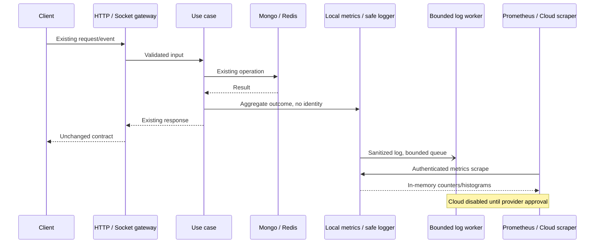

# Grafana observability: M0

## M2e Privacy, membership, media and digest metrics (2026-10-28)

| Metric (prefix `familytracker_`) | Ý nghĩa |
| --- | --- |
| `privacy_actions_total{action,outcome}` | Pause/resume chia sẻ vị trí; success chỉ sau khi cập nhật và các tác vụ hậu xử lý hoàn tất. |
| `circle_membership_actions_total{action,outcome}` | Leave/remove sau khi membership đã được cập nhật; lỗi realtime cleanup hiện được xử lý fail-soft và không đảo ngược thao tác DB. |
| `media_tickets_total{media_type,outcome}` | Kết quả cấp upload ticket image/voice, bao gồm endpoint upload ảnh legacy; không có object key/URL. |
| `job_runs_total{job,outcome}` | Kết quả mỗi lần digest job được gọi; success có thể gửi 0 digest nếu không có group đủ điều kiện. |
| `job_duration_seconds{job}` | Thời gian thực thi digest sweep theo monotonic clock; chỉ đọc clock độ phân giải cao khi metrics bật. |
| `job_schedule_delay_seconds{job}` | Độ trễ từ tick dự kiến đến lúc scheduler gọi digest job; chỉ có sample khi gọi từ scheduler, không phải khi gọi use case trực tiếp. |

Tất cả action/outcome/job/media type đều allowlist, unknown quy về `other`; HTTP 4xx thành `rejected`, exception không có status hoặc 5xx thành `error`. Không xuất actor, Circle/group/conversation ID, danh tính, nội dung chat, URL hay storage key. Metrics được ghi fail-soft và không đổi response hoặc chính sách nghiệp vụ. Delay tính `max(0, actualStart - scheduledAt)`; không đo độ trễ xử lý từng group. Group cleanup emit/unsubscribe vốn bắt lỗi và tiếp tục nên membership DB thành công vẫn là `success`.

PromQL gợi ý:

```promql
sum by (action, outcome) (rate(familytracker_privacy_actions_total[5m]))
sum by (action, outcome) (rate(familytracker_circle_membership_actions_total[5m]))
sum by (media_type, outcome) (rate(familytracker_media_tickets_total[5m]))
sum by (outcome) (rate(familytracker_job_runs_total{job="digest"}[15m]))
histogram_quantile(0.95, sum by (le) (rate(familytracker_job_duration_seconds_bucket{job="digest"}[1h])))
histogram_quantile(0.95, sum by (le) (rate(familytracker_job_schedule_delay_seconds_bucket{job="digest"}[1h])))
```

Các histogram có bucket hữu hạn 0.01, 0.1, 1, 5, 30 giây. Snapshot Compose sau test workflow ghi nhận kích thước/cadence phụ thuộc các lần gọi; trần policy hiện tại là 1.416 series/2.500. Dashboard hiện có chưa được mở rộng trong M2e; Mongo/cache/auth/privacy panels thuộc phần dashboard kế tiếp. Không cần env, migration hay thay đổi hợp đồng mobile.

## M2d Redis/cache and blacklist metrics (2026-10-28)

| Metric (prefix `familytracker_`) | Ý nghĩa |
| --- | --- |
| `cache_requests_total{key_type,operation,outcome}` | Cache hit/miss/negative-hit/success/error, hoặc disabled; key type chỉ thuộc nhóm user_profile/circle_members/location/session/blacklist/media/other. |
| `redis_commands_total{command,outcome}` | Lệnh Redis do adapter gọi: GET/SET/EVAL/DEL/SCAN; phân biệt success/error. |
| `redis_command_duration_seconds{command}` | Thời lượng lệnh adapter, đơn vị giây; lệnh disabled không được tính. |
| `redis_connection_events_total{event}` | ready/end/error từ client trong process. |
| `auth_blacklist_fail_open_total{reason}` | Check blacklist tiếp tục xác thực khi cache bị tắt hoặc unhealthy; disabled và unavailable được tách riêng. |

Mọi key được phân loại trước khi metrics ghi nhận; ID, hash, token, pattern, email và payload không đi vào nhãn/log. `NoopCacheManager` ghi cache outcome `disabled`, không tạo Redis command sample. Redis command errors và connection errors được phân biệt; cache lỗi vẫn trả fallback như trước, còn quyết định fail-open của authentication không đổi. Metrics tắt thì command wrapper không đọc đồng hồ độ phân giải cao. `get` vẫn bắt lỗi JSON decode bên trong fail-soft boundary như hành vi cũ.

PromQL gợi ý:

```promql
sum by (key_type, outcome) (rate(familytracker_cache_requests_total[5m]))
histogram_quantile(0.95, sum by (command, le) (rate(familytracker_redis_command_duration_seconds_bucket[5m])))
sum by (command) (rate(familytracker_redis_commands_total{outcome="error"}[5m]))
sum by (reason) (increase(familytracker_auth_blacklist_fail_open_total[5m]))
```

Giới hạn: ioredis command duration là thời gian gọi adapter và chịu ảnh hưởng event loop, không phải server-side Redis execution time. `SCAN`/`DEL` trong pattern delete được tính theo từng lệnh thực tế; lock được tính như SET. Current policy cardinality maximum là 1.342 series, dưới hard cap 2.500; không cần env hoặc migration mới. Local Compose smoke sau rebuild: đăng ký synthetic user trả 201, `/auth/me` trả 200, scrape bearer trả 200 với `Content-Encoding: gzip`. Snapshot có 87 sample và đo được 12.768 byte plain / 2.189 byte gzip. Redis được cố ý tắt trong stack này; vì vậy snapshot xác nhận outcome `disabled` và `auth_blacklist_fail_open_total{reason="disabled"}`, không xác nhận lệnh Redis thật. Fake-client tests bao phủ đường adapter healthy/error mà không kết nối Upstash. Redis panels/dashboard sẽ được provision cùng dashboard DB/cache sau khi hoàn tất M2e.

## M4 local benchmark result (2026-10-28)

Chạy `npm run benchmark:monitoring` trong Docker Compose local: warmup 30 giây, đo 120 giây mỗi case, ba cặp metrics-off/on, một user và hai sockets. Đây là dữ liệu synthetic trên Docker Desktop, không phải benchmark production hay capacity nhiều người dùng.

| Repeat | HTTP p95 off -> on | HTTP delta | Socket p95 off -> on | Socket delta | RSS delta on-vs-off |
| --- | ---: | ---: | ---: | ---: | ---: |
| 1 | 1502.5 -> 2293.6 ms | +52.7% | 1091.1 -> 1103.8 ms | +1.2% | -0.15 MiB |
| 2 | 1465.4 -> 1408.3 ms | -3.9% | 879.9 -> 1177.3 ms | +33.8% | +0.16 MiB |
| 3 | 1602.9 -> 1395.5 ms | -12.9% | 1396.3 -> 1184.1 ms | -15.2% | +2.18 MiB |

Chỉ repeat 3 đạt đầy đủ ngưỡng p95 <=5% cho HTTP/Socket và RSS <=20 MiB; hai repeat còn lại không đạt p95. Dao động trái chiều và số mẫu mỗi case 90-130 cho thấy độ nhiễu lớn, không thể kết luận metrics gây ra hay không gây ra chênh lệch. Gate overhead chưa được xác nhận; không bật log shipping/Cloud và không coi kết quả là bằng chứng cho Render Free. RSS chỉ lấy mẫu trước/sau, không phải peak. Safe JSON logger bật ở cả hai cấu hình nên benchmark cô lập tác động metrics, không phải toàn bộ observability.

## M2c Mongo pool và transaction outcomes (2026-10-28)

| Metric (prefix `familytracker_`) | Ý nghĩa |
| --- | --- |
| `mongo_pool_events_total{event}` | Pool/connection lifecycle và checkout failure được Mongo driver phát ra sau khi observer gắn. Không phải số connection hiện tại hay MongoDB command count. |
| `mongo_repository_operations_total{operation,outcome}` | Kết quả các phương thức repository, gom vào read/write/bulk_read/bulk_write/other và success/error. Không có nhãn tên repository hay method. |
| `mongo_repository_duration_seconds{operation}` | Thời gian đồng bộ/asynchronous của repository method, đơn vị giây; không đo network wire hoặc thời gian chờ ngoài method. |
| `mongo_transactions_total{outcome}` | Kết quả unit-of-work: success/error; `unsupported` là lần chạy fallback không transaction trên Mongo standalone. |

Repository methods được bọc tại composition root, chỉ khi metrics bật; cache hit không bị tính như Mongo call vì wrapper nằm dưới cache decorator. Classifier dùng allowlist tên method nội bộ và chỉ xuất 5 nhóm nhãn cố định. Không bật command monitoring và không đọc filter, document, query hay collection stats. Pool observer chỉ lắng nghe lifecycle/check-out event của Mongo driver; listener gắn ngay sau connect, trước model/index init và tháo trước khi Mongo client đóng. Events phát sinh trong handshake trước khi connect hoàn tất không được đếm; do đó counter là lower-bound theo process, không dùng làm gauge trạng thái pool. Lỗi telemetry fail-soft, lỗi transaction vẫn được ném lại như trước. Không migration, query bổ sung hay biến môi trường mới.

```promql
sum by (event) (rate(familytracker_mongo_pool_events_total[5m]))
sum by (operation, outcome) (rate(familytracker_mongo_repository_operations_total[5m]))
histogram_quantile(0.95, sum by (operation, le) (rate(familytracker_mongo_repository_duration_seconds_bucket[5m])))
sum by (outcome) (rate(familytracker_mongo_transactions_total[5m]))
```

Theoretical maximum from all currently defined metric label combinations is 877 series, below the 2,500 cap. Local verification sau rebuild cuối: authenticated gzip scrape có 8 `connection_created`, 8 `connection_ready`, 1 bulk-read, 22 write và 22 bulk-write repository calls; exposition có 61 series trong workload startup này. Chưa có transaction sample vì startup workload không gọi UnitOfWork transaction. Dashboard panels chi tiết Mongo sẽ được cập nhật sau khi hoàn thành phần Redis/cache metrics.

## M2b Location/Live Trail business metrics (2026-10-28)

Các chỉ số này giải thích những bước bên trong use case; không cộng chúng với số action Socket để suy ra số request. Tất cả dùng prefix `familytracker_`, bật theo `METRICS_ENABLED` hiện có và scrape qua endpoint có bearer riêng.

| Metric | Đơn vị và ý nghĩa |
| --- | --- |
| location_history_decisions_total{outcome} | Quyết định persist/throttled của realtime; persist được đếm trước khi ghi, không phải số document ghi thành công |
| location_timestamp_fallbacks_total{reason} | Timestamp quá cũ/quá tương lai bị thay bằng giờ server |
| location_batch_points_total{outcome} | Số phần tử accepted/duplicates/rejected trong kết quả batch hoàn tất; retry được đếm lại theo outcome mới |
| trail_projection_total{outcome} | success/error theo nhóm ngày được project; disabled tính theo lần gọi bị tắt hoặc không có điểm; success không khẳng định có điểm mới |
| trail_matcher_total{outcome} | matched/unmatched/error/timeout/circuit_open/cache_hit/queue_drop/coalesced/job_error; đây là các sự kiện khác đơn vị, không dùng tổng tất cả outcome làm tỷ lệ thành công |
| trail_matcher_state{state} | active/queued/pendingTriggers/circuitOpen tại lúc scrape; state theo process, không chứa trailId |
| trail_publication_errors_total{operation} | Lỗi realtime/batch/flush; flush là callback timer, được bắt lỗi để không gây uncaught exception |
| realtime_payload_bytes{channel} | Histogram kích thước JSON của mỗi emit thứ 10 theo channel; không phải kích thước trên mạng hoặc toàn bộ traffic |

Sampling chỉ chạy sau emit khi metrics bật, không log/lưu nội dung payload. Payload JSON chỉ được serialize để tính byte, không được đưa vào nhãn; lỗi serialize hoặc lỗi metrics đều bị cô lập. Lấy mỗi mẫu thứ 10 là sampling xác định, có thể bị lệch theo traffic có chu kỳ; không suy diễn băng thông chính xác từ histogram này.

Ví dụ truy vấn:

```promql
sum by (outcome) (rate(familytracker_location_batch_points_total[5m]))
sum by (reason) (rate(familytracker_location_timestamp_fallbacks_total[5m]))
sum by (operation) (rate(familytracker_trail_publication_errors_total[5m]))
histogram_quantile(0.95, sum by (channel, le) (rate(familytracker_realtime_payload_bytes_bucket[5m])))
```

Giới hạn sau M2b: 810 application series + 16 runtime = 826. Fixture điền mọi tổ hợp nhãn: 826 dòng mẫu, 71.764 byte chưa nén / 4.717 byte gzip. Đây là số đo local tổng hợp; overhead CPU/RSS/p95 chưa được chứng minh, vẫn cần M4. Không cần env mới, migration hay cập nhật mobile. Tắt metrics bằng METRICS_ENABLED=false; callback flush vẫn giữ cơ chế bắt lỗi.

## M2a Socket metrics (2026-10-28)

Enable with the existing METRICS_ENABLED and dedicated METRICS_TOKEN settings. GET /metrics remains authenticated and gzip-capable; no Cloud export is enabled by this change.

| Metric (familytracker_ prefix) | Meaning |
| --- | --- |
| socket_actions_total{event,outcome} | Completed server actions: success, rejected (validation/permission/rate limit), error (unexpected/server failure). Handshake authentication failures are rejected. |
| socket_action_duration_seconds{event} | Histogram of server action elapsed time, including awaited work; excludes network delivery. Five finite buckets: 0.01, 0.05, 0.2, 1, 5 seconds. |
| socket_connections{scope="default"} | Connected sockets in the default namespace at scrape time. |
| socket_rooms{scope="default"} | Adapter rooms, including the automatic room for each socket. |
| socket_watches{scope="default"} | Sum of watch registrations over connected sockets at scrape time. |
| socket_broadcasts_total{channel} | Successful emit calls through the realtime adapter, grouped by user/group/conversation/trail. Not recipient counts or delivery acknowledgements. |

Event labels are allowlisted. Unknown values collapse to other; IDs, room names, payloads, coordinates and token data never become labels. Gauges are collected at scrape time (O(number of sockets)); there is no socket scan on each GPS event. Lease revocation is a successful permission check; a failed revalidation is an error. Internal errors swallowed by a use case remain separate from gateway success and require M2b business instrumentation.

Example PromQL:

```promql
sum by (event, outcome) (rate(familytracker_socket_actions_total[5m]))
histogram_quantile(0.95, sum by (event, le) (rate(familytracker_socket_action_duration_seconds_bucket[5m])))
sum(rate(familytracker_socket_broadcasts_total[5m]))
```

Application maximum: 737 series; with 16 runtime series: 753. This is a cardinality bound, not an overhead benchmark. M4 must still verify p95/RSS under load. Rollback: disable METRICS_ENABLED or revert M2a; no mobile contract, schema migration or new environment variable is needed.

## Cap nhat 2026-10-28: review theo phan chuc nang

Quyet dinh moi cua chu du an: chia thay doi theo mot phan chuc nang hoan chinh, khong ap tran 8 file cung. Quy tac nay thay the gioi han file trong cac ke hoach ben duoi. Van khong tu stage/commit/push.

M3 da chuan hoa cac diem goi logger hien co trong src thanh event code co dinh. HTTP co requestId; Socket co connectionId/eventId qua AsyncLocalStorage. Context chi phuc vu lien ket log, khong luu payload, token hay toa do. Log JSON ra stdout; chua co Loki transport. Do performance Socket la M2a, benchmark overhead la M4.

| Event code Location/Live Trail | Y nghia va hanh vi hien co |
| --- | --- |
| LOCATION_TIMESTAMP_TOO_OLD / LOCATION_TIMESTAMP_FUTURE | Bo timestamp ngoai nguong, dung gio server; count la so lan fallback trong process |
| LIVE_TRAIL_PROJECTION_FAILED | Loi ghi projection; luong location hien tai tiep tuc |
| LIVE_TRAIL_MATCHER_FAILED / LIVE_TRAIL_MATCH_JOB_FAILED | Matcher/job loi; vet GPS goc van san co |
| LIVE_TRAIL_DELTA_PUBLICATION_FAILED / LIVE_TRAIL_BATCH_RESET_FAILED | Loi phat delta/reset; khong thay doi ket qua ghi vi tri |
| LIVE_TRAIL_MATCH_UPDATE_OVERSIZED | Payload vuot gioi han; phat reset de client tai lai REST |
| LIVE_TRAIL_INVALIDATION_FAILED | Revalidate ngay that bai; watch van duoc kiem tra theo lease |

Khong dinh kem error.name/error.message cua provider vao log. Rollback phan nay bang cach revert diff chuan hoa log; khong can migration DB hay doi env. Worker, log-storm/backpressure benchmark va Cloud shipping van la cac hang muc chua hoan thanh, theo gate M4/M5.

## Quyết định đã duyệt 2026-10-26

M0 đã duyệt, chưa cho phép Cloud shipping. Thứ tự mới: M3-0, M1a, M1b, M3a-c, M2a, M2b, M4, M2c-e, M5. Các đề xuất cũ bên dưới được thay thế khi xung đột với mục này.
M3-0 dùng event-code cố định trước Pino. Chia lượt tối đa khoảng 8 file kể cả tài liệu/test: xử lý connection/server/HTTP/Redis trước, socket/auth/stay/chat/digest sau. Không tự commit. M3 JSON sạch ra stdout; hoãn Loki shipping và quyết định worker đến sau benchmark M4, đo riêng CPU/RSS worker nếu dùng.
Staging chỉ Docker Compose local, không thêm Render service. C trước A; prom-client scrape 60s, bearer riêng; gzip bắt buộc trên /metrics; đo exposition nén/chưa nén ở M1b. Budget 2.000–2.500 series/env, HTTP route-group allowlist thay 60 method-route pairs, giảm buckets. requestId luôn do server sinh, bỏ X-Request-Id inbound. Không traces/Sentry; alert email, recipient chưa cấu hình. Sample payload 1/10; p95 overhead <=5%, RSS delta <=20 MB. Đo RSS baseline trước khi bật metrics; production RSS cần Render runtime access, không lấy local thay thế. M5 chờ duyệt riêng sau Terms/DPA.

Exposure connection.js:29: chỉ khi connect lỗi và allowInMemoryFallback=true. uri.split('@').pop() giữ host/IP/port/database/query sau @ cuối, bỏ userinfo trước @ trong URI chuẩn; nếu không có @ thì giữ nguyên toàn bộ chuỗi. Query/malformed URI có thể mang credentials. error.message được nối nguyên văn, có thể mang URI hoặc đầu vào driver; không đảm bảo redacted. Fallback=false vẫn throw tới server.js ghi message. Chưa kiểm tra log vận hành, không khẳng định đã lộ password. Không sao chép URI/secret vào tài liệu; chủ dự án quyết định rotation.

Ngày: 2026-10-26. Trạng thái: thiết kế chờ `approved M0`. Không sửa runtime, cài dependency, đọc secret hay xuất telemetry. Xem [cổng nhà cung cấp](grafana-options.md).

## Hiện trạng đã kiểm chứng

- `package.json`: JavaScript CommonJS, Node >=20, Express 4, Socket.IO 4, Mongoose 8, ioredis; chưa có pino/winston/prom-client/OpenTelemetry/@sentry/node. `rg` không tìm thấy tích hợp Sentry/requestId trong src/server.
- `src/bootstrap.js:15`: logger mặc định console, truyền vào container/use cases/gateways. HTTP và Socket.IO chung process; socket payload cap 100 KB.
- `src/presentation/http/app.js:28`: trust proxy 1, CORS toàn cục, parser 100 KB, limiter theo nhóm route. Chưa HTTP request timing hay correlation ID.
- `src/presentation/http/routes/systemRoutes.js:7`: `/api/health` và `/api/v1/health`, luôn HTTP 200 kể cả DB disconnected; `/health` không mount ở root. Không thay health contract; metric DB riêng cần thiết.
- `render.yaml:9`: health `/api/health`; blueprint Free/Singapore/TZ. UptimeRobot là thông tin chủ dự án cung cấp, không có bằng chứng cấu hình tài khoản trong source.
- `server.js:37`, `src/bootstrap.js:62`: SIGTERM/SIGINT, dừng scheduler/matcher/publisher/socket/cache/DB; cần bounded flush telemetry sau khi dừng nhận công việc, không kéo dài shutdown vô hạn.
- `RedisCacheManager.js`: lazy connection, offline queue tắt, safe fallback; Noop khi tắt. `get()` trả null cả cache miss/lỗi/negative sentinel, nên instrumentation phải ở adapter để phân biệt, không thay semantics.
- Live Trail, batch, privacy, Circle exit có use case/repository riêng; default flags trong repo không xác nhận production. Matcher Mapbox đã có trong source hiện tại; không thay map matching trong task này.
- Lint hiện là `node --check`; chưa style lint. M0 không tuyên bố regression test đã chạy.

### Log cần xử lý trước shipping (chỉ vị trí code, không sao chép giá trị)

| File:dòng | Dữ liệu/rủi ro |
| --- | --- |
| `src/presentation/socket/socketServer.js:25,41,44,59` | Tên, user ID, reason/error string |
| `src/presentation/socket/gateways/locationGateway.js:26,37,41` | Tên, user ID trong SOS và lỗi location |
| `src/presentation/socket/gateways/chatGateway.js:25,79` | user ID và raw Error có thể chứa payload |
| `src/application/location/locationUseCases.js:204` | Tên người và nhóm trong stay alert |
| `src/application/digests/digestUseCases.js:92` | Tên nhóm |
| `src/application/auth/authUseCases.js:205` | user/family ID, IP, user-agent |
| `src/infrastructure/database/connection.js:29` | Phần URI DB và error.message; có thể lộ query/credentials |
| `src/infrastructure/cache/RedisCacheManager.js:33,41` | Raw error.message |
| `src/presentation/http/middleware/errorHandler.js:22` | Raw Error, có thể chứa document/query/token |
| `server.js:11,19,45` | Raw startup/shutdown error.message |

Chưa thấy log tọa độ trực tiếp trên happy path mỗi GPS ping. Không kết luận an toàn: raw Error từ driver có thể chứa dữ liệu. Warning timestamp fallback có thể lặp mỗi điểm; lỗi transport có thể gây log storm. Không log payload làm bằng chứng.

## Kiến trúc đề xuất

Metrics/Logger port trong `src/application/ports/`, Noop implementation khi tắt; adapter trong `src/infrastructure/observability/`, wire ở `src/container.js` và bootstrap. Domain giữ pure. Gateway đo validation/transport; use case đo outcome nghiệp vụ; repository đo persistence. Không thêm await network vào update_location.



Flags đề xuất: `METRICS_ENABLED=false`, `LOG_SHIPPING_ENABLED=false`; structured safe stdout không nên rollback về log PII. `METRICS_TOKEN` riêng, không app JWT. `/metrics` mount trước CORS/body parser, GET only, auth constant-time, rate limit riêng đề xuất 10/min/instance, disabled trả 404; không Swagger, không DB query. Không chấp nhận token trong URL. Serialize registry async nhưng vẫn đo CPU serialization, timeout/byte cap.

## Danh mục metrics

Tất cả tên prefix `familytracker_`. Histogram latency đơn vị seconds; bytes và count riêng. Histogram tối đa 8 finite buckets (+Inf, sum, count = 11 series/labelset). Không ghép toàn bộ nhãn vào mọi metric.

| Nhóm / tên gợi ý | Nhãn hữu hạn / vị trí đo |
| --- | --- |
| `http_requests_total`, `http_request_duration_seconds`, `http_rate_limited_total` | Approved method-route pairs, status_class chỉ counter; app middleware finish/close, unmatched 404 = `unmatched`; không raw URL |
| `process_*`, `nodejs_*`, `event_loop_delay_seconds` | Default runtime prefix, CPU/RSS/heap/GC/handles/uptime/start; monitorEventLoopDelay reset theo cửa sổ |
| `socket_connections`, `socket_connections_total`, `socket_events_total`, `socket_auth_failures_total`, `socket_rooms` | Whitelist event/direction/reason; socketServer, gateways, realtime adapter; không room name |
| `location_updates_total`, `location_history_decisions_total`, `location_receive_to_emit_seconds`, `stay_alerts_total` | outcome/reason enum; locationUseCases; timestamp fallback là accepted + fallback, không gọi rejected |
| `location_batch_points_total`, `location_batch_size`, `location_batch_duration_seconds` | accepted/duplicate/rejected + bounded code; `syncLocationBatchUseCase.js` |
| `trail_watches`, `trail_events_total`, `matcher_duration_seconds`, `matcher_results_total`, `matcher_circuit_open` | watch/publisher/matching service; reset/closed lý do enum |
| `payload_bytes`, `broadcast_recipients`, `socket_session_events`, `socket_session_bytes`, `socket_session_duration_seconds` | Chỉ location event/batch whitelist; aggregate histogram, không connection ID label |
| `mongo_operation_duration_seconds`, `mongo_errors_total`, `mongo_transactions_total`, `mongo_pool_connections`, `mongo_pool_waiters` | Repository operation allowlist + driver pool events; không command document/filter |
| `collection_documents`, `collection_storage_bytes`, `collection_stats_last_success_seconds` | Chỉ history/trail collection allowlist; cached stats mỗi 15 phút, timeout; không countDocuments full scan |
| `cache_requests_total`, `redis_command_duration_seconds`, `redis_commands_total`, `redis_errors_total`, `auth_blacklist_fail_open_total` | Logical key type và command enum; never raw key. Phân biệt disabled với unavailable |
| `auth_attempts_total`, `auth_refresh_total`, `auth_sessions_revoked_total` | Flow/outcome bounded; authUseCases; số phiên thực bị revoke |
| `privacy_actions_total`, `circle_membership_actions_total` | pause/resume/leave/remove + result; không actor |
| `job_duration_seconds`, `job_runs_total`, `job_schedule_delay_seconds` | digestScheduler, due vs actual start, không group |
| `media_tickets_total` | image/voice + outcome; chat/storage adapter, không URL/key |
| `telemetry_dropped_total`, `telemetry_queue_bytes`, `telemetry_measurement_seconds`, `telemetry_series` | fixed component/reason, không recursive log lỗi telemetry |

Mongo stats/pool fields phụ thuộc Atlas permissions và driver; kiểm chứng command khả dụng trên staging. Nếu không khả dụng, ghi unavailable, không báo zero giả. Redis commands đếm thực tế adapter, kể cả SCAN/DEL/EVAL; quota billable của Upstash có thể tính khác, đối chiếu dashboard. Không sửa chính sách blacklist fail-open; chỉ đếm đúng nhánh check bị bypass khi cache unavailable.

### Cardinality và ngân sách

Allowlist route/event/operation trong code; unknown -> `other`, URL không match -> `unmatched`. Không dùng error.message/name tùy ý làm label. Cấm user/group/trail/point ID, IP, email, tọa độ, token. Env chỉ dev/staging/production; service cố định. Commit version chỉ ở một `build_info`, không nhân version vào mọi series; Loki version là structured field.

Ước tính trần/instance: HTTP 60 method-route pairs x (5 counter classes + 11 histogram series) = 960; socket 350; location/trail/payload 900; DB/cache 700; auth/privacy/job/media 250; runtime/self 300 = 3.460. Budget test 4.000/instance; 2 env <=8.000, dành phần còn lại cho platform series/churn. Đây là dự toán, phải enumerate thực tế ở M1/M2; không preinitialize Cartesian product method x route x reason.

60 giây scrape, 3.460 series ~4,98 triệu samples/ngày. Nếu exposition 0,6 MB/lần thì ~864 MB/ngày egress chưa nén; phải đo size thật, giảm bucket/nhãn nếu quá budget. Log giả định 0,5 KB/event x 1 event/s x 30 ngày ~1,30 GB/tháng; 10/s ~13 GB. Quota không phải mục tiêu sử dụng.

### Đo băng thông và overhead

Sample Bernoulli p=0,1 trước JSON.stringify; đo Buffer.byteLength một lần/sample. Histogram sampled không nhân bucket theo N; nếu ước lượng tổng byte dùng riêng weighted counter bytes/p với nhãn sampling method hữu hạn. Không serialize thêm toàn bộ batch nếu đã có byte length hợp lệ từ parser.

Số receiver là socket devices, không phải unique users; đọc local adapter rooms và trừ exceptSocket, không fetchSockets/network ở hot path. Multi-Circle emit trùng được tính theo actual emit, không suy ra số người. Per-connection counters chỉ RAM, không key định danh xuất ra; disconnect observe totals + duration; phân phối event/hour cần histogram ratio mỗi session có duration >0, không chia hai histogram. Crash mất các session chưa disconnect, ghi rõ bias.

JSON bytes không gồm Engine.IO/WebSocket/TLS/ping/nén/retry, không phải hóa đơn 4G mobile. Đo timing từ server receive đến emit, không lấy recordedAt làm processing latency.

## Safe logging

Đề xuất pino + worker transport; chưa cài dependency. Fixed schema level/time/msg/requestId/route/statusCode/durationMs/event/errorCode. msg là template allowlist, không nhận arbitrary strings; logger chuyển call cũ sang event code. Không log body/header/Error nguyên bản. Sanitizer recursive có cap depth/size/cycles, bỏ sensitive keys trong object/mảng; Error chỉ code và sanitized stack frames không error message/query. Quét JWT/UUID/coordinate-like values là lớp phụ, không thể nhận diện chắc mọi tên/tọa độ bằng regex.

Request ID do server sinh; không tin X-Request-Id tùy ý vì có thể chứa PII. Đề xuất bỏ header inbound và trả ID mới (cần chốt); nếu nhận phải validate chặt và tách correlation untrusted. connectionId/eventId server sinh, chỉ log field không Loki label; whitelist generated IDs được phép, không vô tình redact chính correlation UUID. ALS scope riêng cho mỗi socket callback, không tái dùng HTTP handshake context cho mọi event.

Log label chỉ env/service/level; requestId route/version là fields. Không hash user ID mặc định. Chặn log lặp theo bounded event-code token bucket; tổng hợp số dropped mỗi phút. Worker queue đề xuất 1 MB/1.000 records, truncate record 4 KB, timeout HTTP 2 giây, batch tối đa 64 KB; ưu tiên warn/error nhưng vẫn có trần. Sanitize trước worker; worker lỗi không fallback sang raw Error/console. Worker chuyển JSON/HTTP khỏi hot path nhưng sanitation/IPC vẫn tốn CPU, cần benchmark.

## Dashboard, alert và runbook dự kiến

7 dashboard: RED, Runtime, Socket, Location/Trail + bytes, Mongo/Redis, Auth/privacy, sanitized Loki logs. Env/service selectors hữu hạn; không identity selectors. Provision datasource UID, dashboards JSON, Grafana-managed alert provisioning YAML nhất quán; local Loki shipper cần Alloy container đọc sanitized stdout/file local, không thêm collector vào Render.

| Alert giả thuyết | Điều kiện/for | Runbook hành động ban đầu |
| --- | --- | --- |
| HTTP errors / slow | 5xx >2% với >=100 requests/5m, p95 >1s / 10m | So sánh rollout, DB latency, rollback change |
| Location slow | receive-to-emit p95 >500ms / 10m | DB/CPU/queue, đối chiếu overhead |
| Event loop / memory | lag p99 >100ms / 5m; RSS >80% cap / 10m | Heap/GC/queue, giảm telemetry; không log payload |
| DB/cache degraded | lỗi >5/5m hoặc unavailable 5m | Connectivity/pool/quota, phân biệt Redis disabled |
| Blacklist fail-open | tăng >0 / 5m | Kiểm tra Redis và Mongo session enforcement |
| Refresh reuse / 429 | reuse >5/5m; 429 >10% và đủ traffic / 10m | Kiểm tra client refresh single-flight/rate policy, không tra user log |
| Socket drop | giảm >50% baseline và baseline >=10 / 5m | Deploy/network/reset, không dùng static zero |
| Job late/error | lỗi hoặc last success >3 kỳ | Scheduler overlap, DB, event-loop |
| Quota | Redis projected >80% quota; storage >80% quota hoặc tăng nhanh / 15m | Kiểm chứng provider usage, retention/index |
| No data | scrape/heartbeat mất >20m | Render sleep/cold start, token scrape, provider outage; warning trước |
| Telemetry | series >3.500, queue drop hoặc ingest projection >80% quota / 10m | Giảm label/bucket/log, tắt shipping |

Mỗi rule severity/runbook_url cố định; warning email đề xuất, critical cần chủ dự án chọn. SLO giả thuyết availability 99%, p95 HTTP 1s, location 500ms; Render Free chưa có SLA này. `rate/increase` dùng range >=4 scrape intervals; no-data khác zero, không coi thiếu traffic là thành công. Cảnh báo quota chỉ bật khi biết quota thật. Runbook chi tiết từng rule ở M5.

## Execution Plan để duyệt

M2/M3/M4 vượt 8 file nếu làm nguyên khối: đề xuất tách dưới đây, chờ chủ dự án duyệt cách tách. Mỗi subphase tối đa 8 file tính cả PROGRESS/test, đề xuất commit message riêng nhưng không tự commit. Nếu inventory vượt trần sẽ dừng báo trước.

| Giai đoạn | File tạo/sửa dự kiến (nhóm lớn sẽ tách tiếp trước sửa) | Kiểm chứng |
| --- | --- | --- |
| M1a | package.json/lock, application/ports/metrics, infrastructure/observability registry + Noop/labels, config/env, unit test, PROGRESS | bounded registry, flag off; `feat: add metrics foundation` |
| M1b | HTTP metrics middleware/route, app, container, bootstrap, integration test, PROGRESS | auth, no CORS/Swagger, route template, abort/404; `feat: instrument HTTP metrics` |
| M2a | socketServer, location/chat/liveTrail gateways, realtime adapter, socket tests, PROGRESS | handshake/events/rooms/watch and fail-soft |
| M2b | locationUseCases, syncLocationBatchUseCase, projection/publisher/matcher, tests, PROGRESS | counters, timestamp fallback, bytes sampling |
| M2c | Mongo observer, connection, unitOfWork, repository hooks (split nếu >8), tests, PROGRESS | pool/transaction/stats không query payload |
| M2d | Redis adapter/Noop, authUseCases, telemetry port additions, tests, PROGRESS | commands, miss/error/disabled, fail-open |
| M2e | privacy/groups/chat/digests use cases, digestScheduler, tests, PROGRESS | privacy/membership/job/upload outcomes |
| M3a | package.json/lock, Logger port, safe logger, sanitizer/ALS, tests, PROGRESS | nested privacy canaries, bounded sanitizer |
| M3b | HTTP context/error middleware, app/bootstrap/server, tests, PROGRESS | requestId propagation, shutdown, exceptions |
| M3c | socket gateways/server, location/digest logs, tests, PROGRESS | socket ALS, không PII happy/error paths |
| M3d | auth/database/Redis logs, worker/transport, tests, PROGRESS | queue saturation, slow/dead worker, log storm |
| M4a | compose, Prometheus/Loki/Alloy config, datasource/dashboard provisioning, ops doc, PROGRESS | local-only ports, health, ingestion |
| M4b | 7 dashboard JSON + PROGRESS | import/render panels, PromQL/LogQL against synthetic data |
| M4c | alert provisioning, rules tests, overhead benchmark, results doc, PROGRESS | alert fire/recovery, load comparison |
| M5a | provider config/transport, env example/render/README, tests, PROGRESS | ONLY chosen provider; staging failure drill |
| M5b | ops metrics doc, runbooks, interview notes, PROGRESS | token rotation, recovery, rollout gate |

Dependencies đề xuất: prom-client (M1), pino (M3); Loki transport tự dùng HTTP worker chuẩn có bounded queue, hoặc library sẽ phải đánh giá trước cài. OpenTelemetry SDK/exporter chỉ nếu chủ dự án chọn push. Dev Docker Grafana/Prometheus/Loki/Alloy pin versions khi M4; chưa tải image lúc M0.

## Test và benchmark gate

Mỗi subphase runtime: full npm test tuần tự + lint + diff check, contract Swagger/socket regression. Cardinality stress URLs/IDs/error strings không allowlisted -> số series <=budget, không xuất input. Privacy tests tạo canary trong RAM (không fixture PII hardcode), capture tất cả stdout/stderr/log/metrics, assertion không echo secret/canary khi fail; deep arrays/cycles/Error/header/requestId.

Load benchmark Mongo in-memory replica set + real sockets và REST: cùng synthetic workload/seed, warmup 30s, đo 120s x3; configurations off, metrics only, sample 1/10, sample 1/1, logger+slow transport. Đo p50/p95 receive-to-emit/HTTP, process.cpuUsage, RSS/heap, event-loop, payload bytes, exposition bytes, dropped logs. Khởi điểm gate overhead p95 <=5%, RSS tăng <=20 MB, không mất nghiệp vụ; cần chủ dự án duyệt, chưa có số đo. Không dùng benchmark in-process cũ làm kết quả này. Staging lặp cùng kịch bản trước M5; không stress production thật.

## Rủi ro, rollback, chưa biết

- M0 chưa có quyền/dashboard provider để xác nhận Atlas tier/pool/stat permissions, Upstash quota, Render runtime flags, UptimeRobot interval, Grafana region/limits hay email recipients. Kiểm chứng trên staging/dashboard, không yêu cầu gửi secret vào chat.
- Metrics exceptions bị swallow nhưng không nuốt lỗi nghiệp vụ; disabled dùng Noop trước khi serialize/sample.
- Không thay payload/API/business errors. Tắt METRICS_ENABLED đóng endpoint/observers/timers; tắt LOG_SHIPPING_ENABLED ngừng network và bỏ queue theo timeout. Giữ safe logger sau rollback, không phục hồi PII log.
- Không buffering vô hạn, không durability promise khi Render sleep/kill; mất delta counter giữa scrape là giới hạn đã biết.
- Approval cần chốt: 9 lựa chọn trong grafana-options; chia subphase <=8 file; ID inbound policy; ngân sách series/queue và benchmark gate. Sau đó mới M1. Source log risks được ghi nhận, chưa sửa ở M0 theo yêu cầu.
