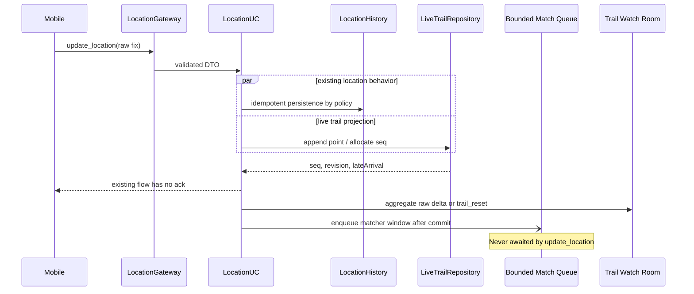

# B7-0 - Live Trail Backend

## 1. Trạng thái

Đây là tài liệu đọc code và thiết kế đã được duyệt ngày 2026-10-18. Chưa có production code cho live trail hoặc map matching.

Mục tiêu là tạo vệt theo `(userId, localDate)`, cho phép người có quyền đăng ký xem và nhận delta gần realtime. Raw GPS luôn được giữ để kiểm chứng/fallback. Map-matched geometry chỉ là suy luận, chạy bất đồng bộ và không được làm chậm hoặc làm hỏng `update_location`.

## 2. Hiện trạng đã kiểm chứng

### 2.1. Realtime location

Luồng hiện tại:

```text
socket update_location
  -> locationGateway: Zod validation
  -> locationUseCases.updateLocation
     -> resolve recordedAt (future <= 60 s, age <= 24 h)
     -> durationTracker in-memory dùng giờ server
     -> Redis location:last:<userId> nếu timestamp mới hơn
     -> history persistence policy
     -> User.lastKnownLocation nếu không phải late arrival
     -> LocationHistory upsert idempotent
     -> query các Circle của sender
     -> emit location_update vào toàn bộ group room
     -> có thể emit location_stay_alert
```

Các điểm quan trọng:

- `update_location` không có ack.
- Zod nhận `latitude`, `longitude`, `batteryLevel?`, `recordedAt?`, `accuracy?`, `pointId?`, `motionState?`.
- Legacy history lưu khi đã qua 30 giây hoặc di chuyển 50 m. Dense mode dùng policy cấu hình và mặc định đang tắt trên `render.yaml`.
- `LocationHistory` chống trùng bằng `(userId, pointId)` và `(userId, dedupeKey)`; dedupe key băm timestamp + tọa độ.
- Redis last-location fail-soft; MongoDB/User vẫn là durable state.
- `lastSavedLocation` và `durationTracker` chỉ sống trong RAM của một process.
- `location_update` hiện phát cho mọi socket trong từng Circle, trừ socket gửi.
- Stay alert chứa tọa độ nhưng log hiện chỉ ghi tên user/group; task B7 không mở rộng logging này.

### 2.2. Offline batch

- `POST /api/v1/locations/batch` xác thực JWT, giới hạn theo user/phút và tối đa 100 điểm mặc định.
- Điểm được validate riêng, sort theo `recordedAt`, dedupe, rồi upsert idempotent.
- Last-known Mongo/Redis chỉ cập nhật nếu timestamp mới hơn.
- Batch không gọi `durationTracker`, không phát `location_update`, không phát stay alert.
- Batch HTTP schema và repository đều đã nhận/lưu optional `motionState`.

Live trail không được phá nguyên tắc trên. Batch cũ chỉ có thể tạo `journey:trail_reset` hoặc historical trail delta; nó không được giả làm current-location broadcast.

### 2.7. Privacy gate bắt buộc

Live trail **không được bật cho người dùng thật** cho đến khi có đủ hai task riêng:

1. **Tạm ẩn vị trí:** setting bền vững, use case/API cập nhật, mọi location/trail read và watch đều tôn trọng; khi chuyển sang ẩn phải đóng watch ngay.
2. **Rời Circle/xóa thành viên:** cập nhật membership và conversation nhất quán, cho socket rời Circle/trail rooms, phát `journey:trail_closed` ngay cho watcher mất quyền.

Hai task phải cung cấp application-level hook cho live trail, không đặt logic quyền trong gateway. T1-T3 vẫn được triển khai để test nhưng sau cờ mặc định tắt.

### 2.3. Journey B2-B6

- B2-B5 và B6a-B6d đã có trong source.
- Geometry mode trả `points`, `gaps`, stable moving `segmentId`, distance và thinning metadata.
- B6a trả top-level `timeZone` và `geometryPolicy.version = 2`.
- B6b đã thêm stable stay `segmentId`, `confidence`, `containsDataGap`, `maxGapSeconds`, `observedStaySeconds` và `unobservedSeconds` theo hybrid gap policy dùng chung.
- B6c hỗ trợ `includePath=false`; mobile có thể dùng `points` làm source duy nhất và tránh payload tọa độ trùng.
- Route gap trong geometry mode chỉ được công bố khi interval vượt ngưỡng và hai biên xa hơn stay radius; same-region silence được giữ thành inferred stay.

Live trail không phụ thuộc journey builder để lưu point/seq, nhưng phải tái sử dụng semantics hybrid gap đã khóa trong B6b.

### 2.4. Socket, auth và room

- Handshake dùng JWT tại `socket.handshake.auth.token`; token được kiểm tra qua auth use case.
- Socket join room riêng theo user/session, rồi async join toàn bộ Circle và conversation rooms.
- `session:ready` xác nhận danh sách room đã join.
- `usersShareGroup` query trực tiếp MongoDB bằng `$all`; chưa có Circle cache ở đường này.
- Socket payload tối đa hiện là 100 KB.
- Chat có sliding-window limiter theo connection; location events chưa có socket rate limiter.
- Disconnect tự rời Socket.IO rooms; app chưa có registry watch riêng.
- Chưa có Socket.IO Redis adapter. Room, subscriptions, limiter và runtime state hiện chỉ đúng trong một process.

### 2.5. Permission và privacy controls

- History/Journey cho phép chính user hoặc hai user còn chung ít nhất một Circle; ngoài ra trả `403`.
- Source hiện không có endpoint rời Circle/xóa thành viên.
- Source hiện không có setting tắt chia sẻ vị trí.
- Vì vậy chưa có lifecycle event để phát `trail_closed` cho hai lý do trên. T2 chỉ có thể chuẩn bị port/hook; behavior đầy đủ cần feature membership/privacy tương ứng.

### 2.6. Capacity hiện tại

- `render.yaml` cấu hình một Free web service; Free plan không horizontal scale và filesystem không bền vững.
- Không có worker process, durable queue hoặc pub/sub adapter.
- Render không áp hard limit WebSocket chung, nhưng sức chịu tải phụ thuộc CPU/RAM của instance.
- Chưa có load-test result cho số socket, watcher hoặc event/giây. Không thể công bố capacity number.
- HTTP rate limiter và socket chat limiter là in-memory/per-process.

## 3. Mô hình dữ liệu đề xuất

Không nhét toàn bộ point array vào một Mongo document vì giới hạn document, contention và pagination. Dùng projection riêng:

### `LiveTrail`

```text
_id / trailId
userId
localDate
timeZone
revision
lastSeq
maxRecordedAt
expiresAt?
createdAt / updatedAt
```

Unique index: `{ userId: 1, localDate: 1 }`.

### `LiveTrailPoint`

```text
trailId, userId, seq
location: GeoJSON Point
recordedAt
accuracy?
motionState?
pointId?
dedupeKey
expiresAt?
createdAt
```

Indexes:

- unique `{ trailId: 1, seq: 1 }`;
- unique partial `{ trailId: 1, pointId: 1 }`;
- unique `{ trailId: 1, dedupeKey: 1 }`;
- `{ trailId: 1, recordedAt: 1, seq: 1 }`;
- TTL trên `expiresAt` nếu retention được duyệt.

### `LiveTrailMatch`

```text
trailId, revision, segmentId
fromSeq, toSeq
status: provisional | final | unmatched
geometry?: { encoding: polyline6, data }
matcher: { provider, version }
confidence?
sourceRevision
expiresAt?
createdAt / updatedAt
```

Provisional range được replace/upsert; final range là immutable trừ khi revision đổi do late point.

### Vì sao không chỉ đọc `LocationHistory`?

- Trail cần insertion cursor `seq`, revision và provisional/final state mà history hiện không có.
- Dense history có thể tắt và policy có thể bỏ point mà live trail muốn giữ.
- Trail có retention/quality policy riêng, nhưng vẫn có thể rebuild best-effort từ history khi projection lỗi.
- Đổi lại sẽ tốn thêm storage; vì thế retention là quyết định bắt buộc.

## 4. Semantics của seq và revision

### Vấn đề contract

`seq` là thứ tự chèn, còn hình học phải theo thời gian đo. Điểm offline đến muộn sẽ có `seq` lớn nhưng `recordedAt` nằm giữa các point cũ. Không thể vừa giữ seq bất biến, vừa dùng seq làm thứ tự đường đi.

### Đề xuất

- `seq` là **event cursor tăng đơn điệu**, không phải path order.
- `lastSeq` là seq lớn nhất đã cấp.
- Hình học/snapshot được sắp theo `(recordedAt, seq)` sau khi client tải đủ pages.
- REST pagination và `afterSeq` vẫn đi theo `seq`.
- Append có `recordedAt >= maxRecordedAt`: cấp seq mới, revision giữ nguyên, có thể phát delta.
- Late insert có `recordedAt < maxRecordedAt`: cấp seq mới, tăng revision **một lần cho transaction/batch**, invalidate match bị ảnh hưởng và phát `trail_reset`; không phát old point như current location.
- Duplicate không cấp seq và không đổi revision.

Nếu yêu cầu seq cũng là path order thì phải renumber suffix sau late insert, làm hỏng cursor và client recovery. Không đề xuất.

Production MongoDB có transaction; T1 dùng atomic counter + transaction để tránh seq hole. Standalone local fallback phải được test và không được quảng bá là production-safe.

## 5. REST contract đề xuất

```http
GET /api/v1/history/:userId/journey/trail
  ?date=YYYY-MM-DD
  &afterSeq=123
  &revision=4
  &limit=200
```

Response:

```json
{
  "success": true,
  "trailId": "trail-id",
  "userId": "target-user-id",
  "date": "2026-10-17",
  "timeZone": "Asia/Ho_Chi_Minh",
  "revision": 4,
  "lastSeq": 140,
  "points": [],
  "gaps": [],
  "matched": [],
  "hasMore": false,
  "nextAfterSeq": null
}
```

Quy tắc:

- Không `afterSeq`: snapshot paginated từ đầu.
- Có `afterSeq`: trả insertion events có seq lớn hơn cursor.
- Nếu client gửi revision cũ: trả `409 TRAIL_REVISION_CHANGED` cùng current revision/trailId; client bỏ local geometry và tải lại.
- `points` của từng page tăng theo seq. Client chỉ dựng chronological path sau khi sort `(recordedAt, seq)`.
- Live gaps dùng stable boundary `{ fromSeq, toSeq, seconds, meters }`, không dùng array index vì pagination và late insert làm index không ổn định.
- `matched` tham chiếu `fromSeq/toSeq`, không thay thế raw points.
- `400` query sai, `401` auth, `403` không còn quyền, `409` revision đổi, `429` có `Retry-After`.
- Rate limit phải theo requester, không theo target user.

## 6. Socket watch contract

### Client -> server

```text
journey:watch { userId, date? }
ack { ok, trailId, revision, lastSeq, error? }

journey:unwatch { userId, date? }
ack { ok, removed }
```

Đề xuất ack chỉ có metadata; snapshot luôn lấy qua REST. Cách này giữ ack nhỏ, dùng chung pagination/recovery và không vượt `maxHttpBufferSize`.

### Server -> client

```text
journey:trail_delta {
  userId, trailId, revision, afterSeq,
  fromSeq, toSeq,
  points[], matchedUpdates[]
}

journey:trail_reset { userId, trailId, revision }
journey:trail_closed { userId, trailId, reason }
```

### Watch room

- Room riêng: `journey:trail:<trailId>`.
- Chỉ socket đã `journey:watch` thành công mới join.
- Authorization query MongoDB tại thời điểm watch, không dựa vào room Circle đã join từ connect.
- `socket.data.watchedTrails` giữ registry per connection và tự mất khi disconnect.
- Dùng watch lease/revalidation định kỳ; hook membership/privacy phải đóng room ngay khi feature tương ứng tồn tại.
- Delta gom theo trail và flush tối đa N giây/lần, có cap point/bytes.
- `afterSeq` là cursor ngay trước delta. Client chỉ áp delta khi `afterSeq` bằng local cursor và revision khớp; nếu không thì gọi REST catch-up/reset.
- Không yêu cầu seq phải liền kề: transaction retry hoặc future migration có thể tạo lỗ. Recovery dựa vào `afterSeq`, không dựa vào phép so sánh `fromSeq === lastSeq + 1`.

## 7. Write path và bất đồng bộ map matching



Map matcher chạy sau durable append:

1. Mỗi user tối đa một matcher job đang chạy.
2. Queue toàn cục có giới hạn; job provisional cũ cùng trail có thể coalesce/drop.
3. Đủ K point hoặc T giây thì tạo window, chồng lấn O point.
4. Gap/accuracy/speed quality gate chạy trước provider.
5. Tail còn thiếu M future points là provisional.
6. Khi có context mới, replace provisional; phần đủ cũ chuyển final.
7. Provider timeout/circuit open/queue full => unmatched/raw fallback.
8. Restart có thể mất in-memory jobs; snapshot/reconciliation có thể enqueue lại eligible unmatched windows. Raw trail không mất.

## 8. Permission revalidation

T2 single-instance proposal:

- Watch authorization ngay lúc join.
- Watch lease đề xuất 60 giây; hết lease server query `usersShareGroup` lại trước khi gia hạn.
- Khi không còn quyền: `socketsLeave`, emit `journey:trail_closed`, xóa registry/buffer.
- Khi có future remove-member/share-off use case, gọi hook đóng ngay thay vì đợi lease.

Không query DB cho từng raw point/watcher. Permission latency tối đa bằng lease là đánh đổi cần duyệt.

Tuy nhiên lease không thay privacy hooks: khi share-off hoặc membership thay đổi, use case tương ứng phải đóng watch ngay. Lease 60 giây chỉ là lớp phòng vệ cho thay đổi ngoài luồng.

## 9. Multi-instance

Hiện chỉ an toàn ở một process:

- watcher room và buffer nằm trong RAM;
- event tạo ở instance A không tới socket trên instance B;
- per-process limiter/concurrency không phải global;
- runtime matcher queue không shared.

Khi scale ngang cần tối thiểu `@socket.io/redis-adapter`, sticky-session strategy cho polling, Redis TLS/ACL và channel isolation. Redis adapter chỉ pub/sub packet, không thay durable queue. Task này chưa tự thêm adapter; Free Render cũng không scale nhiều instance.

## 10. Storage measurement và capacity formula

Ngày đo: **2026-10-17**. Dùng `bson.calculateObjectSize()` với candidate documents tổng hợp:

| Candidate | Raw BSON bytes |
| --- | ---: |
| `LiveTrail` metadata | 187 |
| Một `LiveTrailPoint` đầy đủ | 271 |
| Một `LiveTrailMatch` có polyline 1,000 ký tự | 1,294 |
| 1,000 point documents | 271,000 |

Con số này chưa gồm index, WiredTiger compression, allocation overhead và replication. T1 phải đo `collStats`/`$bsonSize` trên model thật trước khi chọn retention.

Ví dụ công thức, không phải capacity claim:

- 4 giờ/ngày, một point/30 giây = 480 point = khoảng 130,080 raw BSON bytes/user-day.
- 1,000 active users, 30 ngày = khoảng 3.90 GB raw point BSON, chưa gồm index/replication.
- Match storage phụ thuộc encoded polyline length và final chunk count; phải đo fixture thật ở T3.

## 11. Failure và rollback

| Failure | Behavior | Rollback |
| --- | --- | --- |
| Trail Mongo write lỗi | giữ location flow hiện tại; metric/error không chứa coordinate | tắt live trail flag |
| Matcher chậm/lỗi | raw delta tiếp tục; unmatched/circuit open | tắt matcher flag |
| Queue đầy | coalesce/drop provisional job, không drop raw point | matcher disabled |
| Late batch | revision++, reset watcher, không location broadcast | client reload snapshot |
| Socket delta mất | client phát hiện cursor/revision và REST catch-up | REST-only mode |
| Permission mất | close watch sau hook/lease | disable watch |
| Redis/adapter lỗi | single-instance local delivery; không tuyên bố cluster-safe | scale về 1 instance |

## 12. Execution plan sau khi duyệt

Do giới hạn khoảng 8 file/commit, T1 cần chia nhỏ. Đề xuất:

### T1a - Domain và persistence projection

**Trạng thái:** Hoàn tất ngày 2026-10-18, vẫn sau `LIVE_TRAIL_ENABLED=false`.

- Trail/point domain rules, models, repository, seq/revision transaction.
- Integrate realtime + batch append without matcher.
- Synthetic tests cho append, late point, duplicate và date boundary.
- Dùng MongoDB in-memory replica set cho integration test transaction.
- Trước khi bật flag: xác nhận MongoDB production plan/topology hỗ trợ transaction, đo p50/p95 write latency và tải transaction; lỗi trail write vẫn không làm hỏng `location_update` hiện tại.

Kết quả triển khai và xác minh:

- `LiveTrail`/`LiveTrailPoint` có unique cursor, point/fingerprint dedupe, chronological index và TTL tuyệt đối 7 ngày.
- Realtime và offline batch cùng đi qua projection; accuracy lớn hơn 100 m không được giữ trong live trail.
- Transaction test chạy trên MongoDB Memory Replica Set thật; concurrent append cấp đúng `seq=1...10`, không trùng hoặc mất cursor.
- Duplicate không cấp seq; late insertion tăng revision đúng một lần trong transaction.
- Forced trail repository failure vẫn cho phép `location_update` hiện tại broadcast thành công; log không chứa userId/toạ độ.
- Baseline local ngày 2026-10-18, 20 transaction một điểm tuần tự trên in-memory replica set: p50 `6.02 ms`, p95 `8.95 ms`. Đây không phải capacity/SLA production.
- Production startup đã dùng `hello` để bắt buộc replica set hoặc mongos. Việc xác nhận Atlas plan, connection/transaction quotas và đo tải trên Render thật vẫn là deployment gate trước khi đổi flag sang `true`.

### T1b - REST snapshot/catch-up

**Trạng thái:** Hoàn tất ngày 2026-10-18, endpoint vẫn chịu gate `LIVE_TRAIL_ENABLED`.

- Query schema, use case, controller/route, limiter.
- Pagination/revision/gap contract và authorization tests.

Kết quả triển khai:

- `GET /api/v1/history/:userId/journey/trail` hỗ trợ `date`, `afterSeq`, `revision`, `limit`; mặc định 200 và tối đa 500 point/trang.
- `points` page tăng theo insertion `seq`; client phải sort toàn bộ dữ liệu đã tải theo `(recordedAt, seq)` để dựng path.
- `afterSeq` bắt buộc có `revision`; mismatch trả `409 TRAIL_REVISION_CHANGED` kèm `trailId`, `currentRevision`, `lastSeq`.
- Hybrid gaps dùng stable `{ fromSeq, toSeq, seconds, meters }`; same-region silence không được công bố là route gap.
- Authorization dùng cùng `assertCanView` với history; limiter 60 request/phút mặc định, key theo requester.
- Feature off trả 503, ngày chưa có trail trả 404; `matched` hiện luôn rỗng vì T3 chưa triển khai.
- Implementation T1b hiện đọc chronological point set của cả trail để tính gap ổn định rồi trả cùng gap set trên mỗi page. Đây là O(n) theo point/day; phải benchmark và cân nhắc materialized gaps trước rollout tải lớn.

### T2 - Socket watch/delta

- Gateway, watch use case, trail rooms, bounded aggregator, disconnect cleanup.
- Permission/watch/rate/delta integration tests.

### T3 - Matcher port/fakes/windowing

- `MapMatcher`, `NoopMatcher`, fake adapter, quality/window/finalization domain.
- Bounded in-process queue, circuit breaker và persisted match results.
- Không network/provider thật; dùng `NoopMatcher`/`FakeMatcher`, feature flag mặc định off.

### T4 - Provider adapter (hoãn)

Chỉ cân nhắc sau khi đánh giá raw trail trên dữ liệu thật. Nếu cần map matching, POC OSRM trước; chỉ đánh giá Valhalla khi OSRM không đạt privacy hoặc accuracy. Không dùng Mapbox với `MKMapView`.

### T5 - Docs/deployment

- `api-docs/LIVE_TRAIL_API_DOC.md`, Swagger, socket docs, Journey/Location docs.
- README, `.env.example`, `render.yaml`, study interview notes, context graph, progress.
- Load smoke test và số đo thật.

Mỗi split chạy full `npm test`, `npm run lint`, `git diff --check`; commit riêng, không push nếu chưa được yêu cầu.

## 13. Cần tôi quyết định

Các quyết định sau đã được duyệt ngày 2026-10-18:

1. `seq` là insertion cursor; path order dùng `(recordedAt, seq)`.
2. Live gaps dùng `fromSeq/toSeq`, không dùng array index.
3. Watch ack metadata-only rồi REST snapshot.
4. Initial limits: **5 watches/socket**, 30 watch actions/phút, 50 point/delta, 64 KB/delta, flush 2 giây; benchmark trước rollout.
5. Watch permission lease 60 giây, cộng hook immediate từ share-off/leave Circle.
6. Trail/match retention 7 ngày; Journey/LocationHistory vẫn là historical source.
7. T1 chia T1a/T1b vì file budget.
8. FakeMatcher test defaults: K=5, T=30 giây, overlap=2, M=2; không phải production tuning.
9. Trail giữ point có accuracy <=100 m; matcher chỉ dùng <=50 m; history cũ không bị xóa.
10. T1-T3 giữ một instance, chưa thêm Redis adapter; phải thêm trước horizontal scale.
11. Delta có `afterSeq`; client không suy luận mất event từ lỗ seq.
12. T1-T3 chọn phương án chưa khớp đường, tất cả live-trail flags mặc định tắt.

