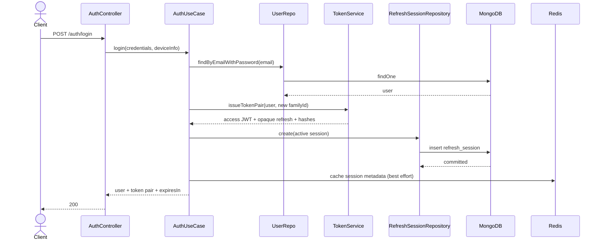
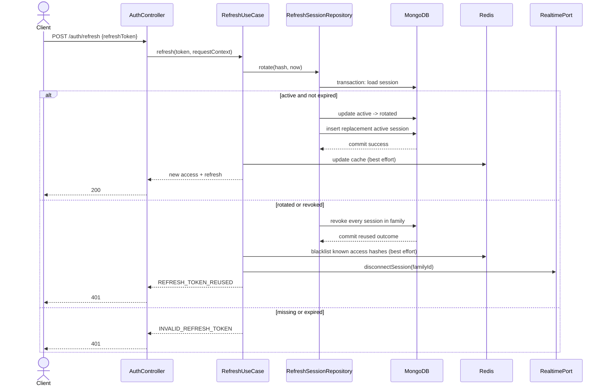

# Refresh Token Rotation Architecture

## 1. Muc tieu

FamilyTracker can mot co che phien dang nhap an toan cho mobile:

- Access token la JWT song ngan, mac dinh 15 phut.
- Refresh token la chuoi ngau nhien opaque, chi duoc dung mot lan.
- Moi lan refresh tao cap token moi va vo hieu refresh token cu ngay lap tuc.
- Neu token cu bi dung lai, toan bo token family cua thiet bi bi revoke.
- MongoDB la source of truth. Redis chi la cache, blacklist va kenh toi uu.
- Redis mat ket noi khong lam login/refresh/logout crash server.

## 2. Hien trang truoc khi implementation

### 2.1 Token hien tai

`src/infrastructure/security/tokenService.js` dang ky ca access token va refresh token bang cung `JWT_SECRET`:

```js
function signRefreshToken(user) {
  return jwt.sign(
    { id: user._id.toString(), email: user.email, type: 'refresh' },
    secret,
    { expiresIn: refreshExpiresIn }
  );
}
```

`signAuthTokens` tra ve:

```json
{
  "token": "<access JWT>",
  "accessToken": "<access JWT>",
  "refreshToken": "<refresh JWT>"
}
```

`token` la alias cua `accessToken` de giu tuong thich voi mobile hien tai.

### 2.2 Refresh session hien tai

`src/application/auth/authUseCases.js` luu hash cua refresh JWT vao Redis:

```text
user:session:<userId>:<sha256(refreshToken)>
```

Gia tri co TTL lay tu claim `exp` cua refresh JWT. Redis dang la noi duy nhat ghi nhan refresh session; MongoDB chua co model session.

### 2.3 Endpoint hien tai

Co:

- `POST /api/v1/auth/register`
- `POST /api/v1/auth/login`
- `POST /api/v1/auth/social-login`
- `POST /api/v1/auth/logout`
- `GET /api/v1/auth/me`

Chua co:

- `POST /api/v1/auth/refresh`
- endpoint doi mat khau
- endpoint logout tat ca thiet bi rieng

Logout hien tai blacklist access token trong Redis den khi token het han. Neu request kem refresh token, backend xoa Redis key tuong ung; `allDevices=true` xoa moi Redis session key cua user.

### 2.4 HTTP va Socket authentication

- HTTP middleware `src/presentation/http/middleware/authenticate.js` lay Bearer token va goi `auth.authenticateToken`.
- `authenticateToken` verify JWT, kiem tra Redis blacklist, sau do tai user.
- Socket middleware trong `src/presentation/socket/socketServer.js` cung goi `auth.authenticateToken` khi handshake.
- Socket hien chi luu `user.id`, `name`, `batteryLevel`; chua luu `familyId`/`sessionId` nen chua the ngat rieng socket cua mot phien.

### 2.5 Redis failure hien tai

`RedisCacheManager` bat exception, log warning va tra fallback. `NoopCacheManager` cung cho phep app chay khong Redis. Do do blacklist hien tai la fail-open: neu Redis khong san sang, access token da logout van co the dung den luc JWT het han.

### 2.6 Database va transaction

Production bat buoc MongoDB replica set. `createUnitOfWork` dung Mongoose transaction; test dung `MongoMemoryReplSet`. Day la nen tang phu hop de rotate token atomic ma khong can Redis lock.

## 3. Thiet ke de xuat

### 3.1 Token model

#### Access token

Access token van la JWT HS256, them claim phien:

```json
{
  "id": "<userId>",
  "email": "user@example.com",
  "familyId": "<UUID>",
  "type": "access",
  "iat": 0,
  "exp": 0
}
```

- TTL: `JWT_ACCESS_EXPIRES_IN`, mac dinh `15m`.
- `token` van la alias cua `accessToken` trong response.
- JWT cu khong co `familyId` van duoc middleware chap nhan den khi het han de tranh buoc mobile dang nhap lai ngay.

#### Refresh token

Refresh token khong con la JWT:

```js
crypto.randomBytes(48).toString('base64url')
```

- 384 bit entropy, khong the doan.
- TTL: `REFRESH_TOKEN_TTL_DAYS`, mac dinh 30 ngay.
- Plaintext chi ton tai trong request/response memory va tren Keychain cua mobile.
- Database chi luu `SHA-256(refreshToken)`.
- Khong log request body, raw token hay token hash.

`expiresIn` trong response la so giay con lai cua access token, de mobile len lich refresh.

### 3.2 RefreshSession model

Tao collection `refresh_sessions` voi moi document dai dien mot generation trong token family:

```text
userId                 ObjectId, required
familyId               String UUID, required
tokenHash              String SHA-256 hex, required, unique
status                 active | rotated | revoked
expiresAt              Date, required, TTL index
createdAt              Date
updatedAt              Date
rotatedAt              Date | null
revokedAt              Date | null
replacedByTokenHash     String | null
deviceInfo.userAgent   String | null
deviceInfo.ip          String | null
deviceInfo.name        String | null
lastUsedAt              Date | null
accessTokenHash         String SHA-256 hex | null
accessTokenExpiresAt    Date | null
revokeReason            String | null
```

Indexes:

```js
{ tokenHash: 1 }                    // unique
{ expiresAt: 1 }                    // expireAfterSeconds: 0
{ userId: 1, familyId: 1 }
{ familyId: 1, status: 1 }
```

`accessTokenHash` cho phep backend dua access token gan nhat cua tung generation vao Redis blacklist khi revoke family. Day la best effort vi Redis khong phai source of truth.

### 3.3 Domain rules

Domain se cung cap cac ham thuan, khong import Mongoose, Express, JWT hay Redis:

- `generateRefreshToken(randomBytes)` tao opaque token.
- `hashRefreshToken(token)` tao SHA-256.
- `safeTokenHashEquals(a, b)` dung `crypto.timingSafeEqual` tren Buffer co cung do dai.
- `createTokenFamilyId(randomUUID)` tao family ID.
- `classifyRefreshSession(session, now)` tra `active`, `expired`, `reused` hoac `invalid`.

Crypto co the duoc dong goi trong infrastructure adapter neu muon domain tuyet doi khong phu thuoc Node API; business rule ve trang thai van nam trong domain/application.

### 3.4 Login, register va social login

Moi lan login thanh cong:

1. Tao `familyId` moi cho thiet bi.
2. Tao opaque refresh token va hash.
3. Ky access JWT co `familyId`.
4. Trong MongoDB, tao `RefreshSession(status=active)`.
5. Best effort cache session metadata trong Redis.
6. Tra `{ user, token, accessToken, refreshToken, expiresIn }`.

Register va Google social login dung chung mot service/use case cap token, nen hop dong response giong login thuong.

### 3.5 Refresh rotation atomic

Endpoint:

```http
POST /api/v1/auth/refresh
Content-Type: application/json

{
  "refreshToken": "<opaque token>"
}
```

Khong yeu cau Bearer access token.

Thuat toan trong MongoDB transaction:

1. Hash token request.
2. Tim session theo `tokenHash` trong transaction.
3. So sanh hash bang `timingSafeEqual`.
4. Neu session `active` va chua het han, tao refresh token moi.
5. Atomic update token cu voi filter `{ _id, status: 'active' }` thanh `rotated`, dat `rotatedAt`, `lastUsedAt`, `replacedByTokenHash`.
6. Neu update khong match, doc lai session va xu ly nhu reuse.
7. Tao session generation moi cung `userId` va `familyId`, status `active`.
8. Ky access token moi co cung `familyId`; luu hash/access expiry vao generation moi.
9. Commit transaction, sau do cap nhat Redis best effort va tra cap token moi.

Viec danh dau token cu va insert token moi cung transaction dam bao khong co trang thai nua voi: token cu da rotated nhung token moi khong ton tai, hoac hai token moi cung duoc tao.

### 3.6 Race condition policy

Lua chon de xuat: **strict single-use, khong grace window**.

Hai request refresh dong thoi cung token:

- Mot transaction update `active -> rotated` va tao token moi thanh cong.
- Transaction con lai bi write conflict/retry, sau do thay token `rotated`.
- Request thu hai duoc xem la reuse, revoke toan family va tra `401 REFRESH_TOKEN_REUSED`.
- Token moi cua request dau tien cung bi revoke trong MongoDB.

Uu diem:

- Quy tac bao mat don gian, deterministic va dung nghia single-use.
- Khong can Redis distributed lock, van dung khi Redis down.
- Khong co cua so ma token bi danh cap va client hop le cung nhan cung mot cap token.

Danh doi:

- Mobile phai single-flight refresh. Hai request refresh song song co the buoc user dang nhap lai.
- API mobile doc phai yeu cau mot actor/task duy nhat refresh, cac request 401 khac cho chung ket qua.

Khong chon grace window 10-30 giay vi no lam phuc tap viec phan biet retry hop le va replay tan cong, dong thoi co nguy co tra plaintext replacement token hoac phai luu no tren server.

### 3.7 Reuse detection

Neu token tim thay co `status=rotated` hoac `status=revoked`:

1. Trong transaction, update moi session cung `{ userId, familyId }` thanh `revoked`.
2. Ghi `revokedAt` va `revokeReason=refresh_token_reused`.
3. Commit truoc khi nem application error.
4. Best effort blacklist moi `accessTokenHash` con han cua family trong Redis.
5. Goi realtime port de disconnect moi socket cua `familyId`.
6. Log security event gom `userId`, `familyId`, IP, user-agent va timestamp; khong log token/hash.
7. Tra:

```json
{
  "success": false,
  "code": "REFRESH_TOKEN_REUSED",
  "message": "Refresh token is no longer valid. Please sign in again."
}
```

Token khong ton tai, sai dinh dang, het han hoac family da revoke tra cung mot response chung:

```json
{
  "success": false,
  "code": "INVALID_REFRESH_TOKEN",
  "message": "Refresh token is invalid or expired."
}
```

Khong lam ro token co ton tai hay trang thai chi tiet, ngoai tru reuse code theo yeu cau.

### 3.8 Logout va logout all

`POST /auth/logout`:

- Neu access token con han: blacklist hash trong Redis den `exp` (best effort).
- Neu co refresh token: tim session bang MongoDB va revoke **toan family**.
- Disconnect socket cua family.
- Response idempotent de logout lap lai khong tiet lo token.

`POST /auth/logout-all` neu duoc duyet:

- Yeu cau Bearer access token.
- Revoke moi active family cua user trong MongoDB.
- Best effort blacklist access token da biet.
- Disconnect moi socket cua user.

### 3.9 Doi mat khau

Repository hien chua co endpoint doi mat khau. De dat acceptance test bat buoc, de xuat them:

```http
POST /api/v1/auth/change-password
Authorization: Bearer <accessToken>

{
  "currentPassword": "...",
  "newPassword": "..."
}
```

Sau khi verify mat khau cu va update hash, revoke moi family cua user, blacklist access token hien tai va disconnect moi socket. Client phai dang nhap lai.

### 3.10 Redis policy

| Chuc nang | Source of truth | Khi Redis down | Policy |
|---|---|---|---|
| Refresh validation/rotation | MongoDB | Van refresh duoc | Fail-open voi Redis, fail-closed voi MongoDB |
| Reuse/family revoke | MongoDB | Van revoke duoc | Fail-closed voi MongoDB |
| Access blacklist check | Redis | JWT con han co the tiep tuc dung | Fail-open, log warning |
| Session cache | Redis | Query MongoDB | Fail-open |
| Socket disconnect cung process | Socket.IO adapter | Van ngat duoc | Best effort |

Redis adapter hien da log warning khi operation loi. Phan auth se them security-context log de khong nuot loi mot cach im lang. Khong dua Redis vao transaction correctness cua rotation.

### 3.11 Socket lifecycle

Access JWT moi chua `familyId`. Khi handshake thanh cong:

```js
socket.data.user = { id, name, batteryLevel };
socket.data.familyId = authContext.familyId || null;
socket.join(`session:${familyId}`);
```

Realtime port bo sung:

- `disconnectSession(familyId)`
- `disconnectUser(userId)`

Logout/reuse/password change goi port tu application use case. Legacy access JWT khong co family ID van ket noi duoc den khi het han, nhung chi co the bi ngat theo user hoac khi socket reconnect.

Socket handshake tiep tuc goi cung access-token authentication nen van kiem tra Redis blacklist. Trong mot deployment nhieu instance, disconnect xuyen instance can Socket.IO Redis adapter; day la gioi han hien tai va khong nen nham voi Redis cache client.

### 3.12 Production safety

`loadConfig` se tu choi khoi dong production neu:

- `JWT_SECRET` thieu.
- `JWT_SECRET === 'change_me'` hoac nam trong danh sach gia tri mac dinh khong an toan.
- MongoDB khong ho tro transaction (da co).

Khong log authorization header, refresh token, access token, token hash hay toa do.

## 4. Cac phuong an da can nhac

### 4.1 Refresh token JWT

Khong chon. JWT tu xac minh nhung rotation/revoke van can server state. Opaque token ngan gon hon ve semantics va khong mang PII/claims co the decode.

### 4.2 Redis la source of truth

Khong chon. Redis dang optional va co fail-open fallback. Session co the mat khi eviction/restart; reuse history cung khong ben vung.

### 4.3 Mot document cho moi family

Co the cap nhat mot `currentTokenHash`, nhung mat audit trail cua token cu hoac phai luu mang generation. Mot document moi generation phu hop TTL, unique hash va reuse detection ro rang hon.

### 4.4 Redis lock theo family

Khong chon lam correctness primitive vi refresh phai hoat dong khi Redis down. MongoDB transaction va conditional update du de xu ly race.

### 4.5 Grace window

Khong chon mac dinh. Strict single-flight la giao thuc de kiem thu va bao mat ro rang hon. Co the bo sung sau neu telemetry cho thay mobile thuong gui duplicate refresh do retry mang.

## 5. Rui ro va bien phap giam thieu

| Rui ro | Tac dong | Giam thieu |
|---|---|---|
| Mobile refresh song song | Family bi revoke | Single-flight actor tren iOS; tat ca request cho cung task |
| Response refresh bi mat sau commit | Client giu token cu va lan sau bi reuse | Client retry khong an toan trong strict mode; yeu cau dang nhap lai, co the can nhac idempotency key sau |
| Redis down | Access token logout van dung den khi het han | Access TTL 15 phut, log/canh bao; Mongo session van revoke chinh xac |
| MongoDB down | Khong refresh/login/logout chinh xac | Fail-closed, tra 503/500 phu hop; khong cap token khong co session |
| TTL cleanup cham | Document het han con ton tai | Luon kiem `expiresAt` trong use case; TTL index chi la cleanup |
| Multi-instance Socket.IO | Khong ngat socket o instance khac | Them Socket.IO Redis adapter trong mot task scale rieng |
| Legacy access JWT 7 ngay | Khong co family claim | Chap nhan den expiry; migration forward-only |
| DB tang do moi generation | Tang storage | TTL index, chi metadata/hash, monitor collection size |

## 6. Sequence diagrams

### 6.1 Login va tao family



### 6.2 Rotation va reuse



## 7. Execution Plan sau khi duoc duyet

### Phase 1 - Domain

Tao/sua:

- `src/domain/refreshTokens.js`: status constants, hashing/equality helpers va pure state rules.
- `src/domain/errors.js`: typed errors `INVALID_REFRESH_TOKEN`, `REFRESH_TOKEN_REUSED`.

Khong import Express, Mongoose, Redis hoac Socket.IO vao domain.

### Phase 2 - Database va repositories

Tao/sua:

- `src/infrastructure/database/models/RefreshSession.js`: schema va indexes.
- `src/infrastructure/database/connection.js`: register model truoc `model.init()`.
- `src/infrastructure/repositories/refreshSessionRepository.js`: create, find by hash, atomic rotate trong transaction, revoke family/user, list active access hashes.
- `src/infrastructure/repositories/userRepository.js`: them update password hash neu endpoint doi mat khau duoc duyet.

Khong can migration script cho collection moi; Mongoose tao collection/index. Production deploy can quyen tao index va MongoDB replica set.

### Phase 3 - Security adapters

Sua:

- `src/infrastructure/security/tokenService.js`: chi JWT access token; opaque refresh token 48 bytes; `familyId`; `expiresIn`; legacy verify support.
- `src/config/env.js`: `JWT_ACCESS_EXPIRES_IN=15m`, `REFRESH_TOKEN_TTL_DAYS=30`; validate production secret.
- `.env.example` va `render.yaml`: bien moi, ghi chu bien JWT cu bi deprecated.

Khong them dependency; dung `node:crypto` va package `jsonwebtoken` hien co.

### Phase 4 - Application use cases

Refactor/tao:

- `src/application/auth/authUseCases.js`: login/register/social login dung chung token issuer; refresh; logout family; logout-all; change-password; legacy access compatibility.
- Co the tach `src/application/auth/refreshTokenUseCases.js` neu `authUseCases.js` vuot qua quy mo hop ly.
- Inject `refreshSessionRepo`, `unitOfWork`, `realtime`, `logger` qua `src/container.js`.

Application se commit Mongo outcome truoc khi emit socket/log/Redis side effects. Security log khong chua token/hash.

### Phase 5 - Presentation

Sua:

- `src/presentation/dto/auth.schemas.js`: refresh, device info, change password/logout-all schemas.
- `src/presentation/http/controllers/authController.js`: mapping request context (`user-agent`, `req.ip`, device name) va response.
- `src/presentation/http/routes/authRoutes.js`: `/refresh`, optional `/logout-all`, `/change-password`, Swagger va deprecated alias `token`.
- `src/presentation/http/middleware/rateLimiter.js`: refresh limiter rieng.
- `src/presentation/http/app.js`: wire limiter.
- `src/presentation/socket/socketServer.js`: luu family ID trong socket data/join session room.
- `src/infrastructure/realtime/socketRealtime.js`: disconnect session/user.

Controller chi validate/map request va goi use case; khong chua rotation logic.

### Phase 6 - Tests

Tao `tests/refreshTokenRotation.test.js` va cap nhat helper/tests cu:

1. Login/register/social login tra `token`, access, opaque refresh, expiresIn.
2. Refresh thanh cong va token cu thanh rotated.
3. Reuse token cu tra `REFRESH_TOKEN_REUSED`, replacement cung khong refresh duoc.
4. Token sai, het han, revoked tra `INVALID_REFRESH_TOKEN`.
5. Hai refresh song song: mot 200, mot 401 reuse; family bi revoke theo strict policy.
6. Logout revoke family.
7. Change password revoke moi family.
8. No-op Redis van refresh thanh cong.
9. Socket cua family disconnect sau logout/reuse.
10. Legacy access JWT khong family van dung den expiry.
11. Production tu choi `JWT_SECRET=change_me`.
12. Chay `npm run lint`, `npm test`, `npm audit --audit-level=high`, `npm run context:graph`.

### Phase 7 - Documentation

Sau khi code pass:

- Tao `docs/REFRESH_TOKEN_MOBILE_API_DOC.md` voi Swift single-flight refresh guidance.
- Cap nhat `README.md`, Swagger, `API_INTEGRATION_IOS.md` neu hop dong trung lap.
- Cap nhat `Study/CORE_FLOWS_BACKEND.md`, `Study/CORE_FLOWS_MOBILE.md`, `Study/REDIS_PERFORMANCE_AND_CACHING_ARCHITECTURE.md`.
- Cap nhat `PROGRESS.md` va regenerate Graphtify bang `npm run context:graph`.

## 8. Quyet dinh da duoc duyet

1. Co endpoint rieng `POST /api/v1/auth/logout-all`; `allDevices=true` duoc giu de migration.
2. Strict single-use, khong grace window; mobile bat buoc single-flight.
3. Toi da 10 active device families; family cu nhat bi revoke khi vuot gioi han.
4. `deviceName` optional, toi da 100 ky tu; server luu them user-agent va IP.
5. Co `POST /api/v1/auth/change-password`; thanh cong revoke moi family.

### 8.1 Trang thai implementation

Da hien thuc model, repository, transaction rotation, reuse detection, session limit, HTTP endpoints, Socket disconnect, production secret guard va mobile contract. Integration tests nam trong `tests/refreshTokenRotation.test.js`.

## 9. Dieu kien nghiem thu

Implementation chi duoc coi la hoan thanh khi:

- MongoDB luu hash, khong luu plaintext refresh token.
- Moi refresh token chi rotate thanh cong mot lan.
- Reuse revoke toan family.
- Rotation atomic tren MongoDB replica set.
- Redis down khong chan refresh.
- Logout/reuse ngat socket cua family trong instance hien tai.
- Access JWT cu van hop le den expiry.
- Tat ca test cu va test moi pass voi `--test-concurrency=1`.
- Swagger, mobile contract, README, Study docs, Progress va graph duoc cap nhat.
