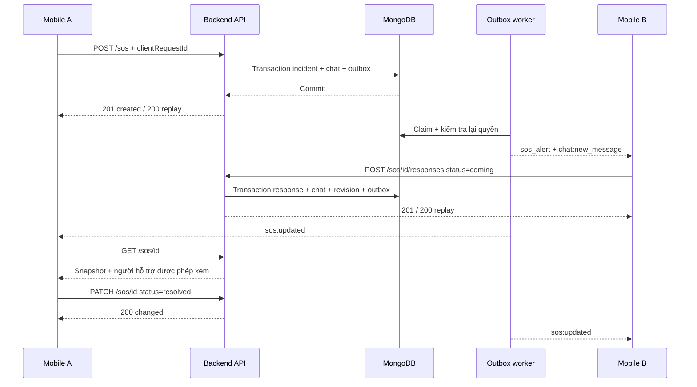

# SOS & “Tôi sẽ đến ngay” — Mobile Integration

Contract kiểm chứng từ backend ngày 2026-10-29. Dành cho iOS/Swift và các client khác.

## Mục lục

1. [Setup và phạm vi](#setup-và-phạm-vi)
2. [Luồng tích hợp](#luồng-tích-hợp)
3. [REST API](#rest-api)
4. [Socket events](#socket-events)
5. [Quyền và phục hồi](#quyền-và-phục-hồi)
6. [Swift DTO](#swift-dto)
7. [Checklist kiểm thử](#checklist-kiểm-thử)

## Setup và phạm vi

| Mục | Giá trị |
| --- | --- |
| Dev | `http://localhost:3000` (Simulator trên cùng máy); iPhone thật dùng IP LAN của máy backend |
| Production | `https://life360-backend-6v9n.onrender.com` |
| REST prefix | `/api/v1` |
| Socket.IO | Cùng origin; path mặc định `/socket.io/`; dùng Socket.IO client, không dùng raw WebSocket |
| REST authentication | `Authorization: Bearer <backendAccessToken>` |
| JSON request | `Content-Type: application/json` |
| Swagger | `/api-docs` |

Backend cần `SOS_API_ENABLED=true`, `SOS_OUTBOX_ENABLED=true` và MongoDB replica set/transaction.
Mặc định hai cờ đều **false**. Deploy code không tự bật tính năng. Khi API tắt/không có transaction,
request hợp lệ có JWT trả `503 SERVICE_UNAVAILABLE`. Kiểm tra cấu hình môi trường thực trước khi test.

Phạm vi đã có: lưu SOS, tin chat trong mọi Circle tại thời điểm tạo, nhận hỗ trợ, đóng SOS,
realtime cho thiết bị đang kết nối và REST phục hồi. **Chưa có APNs/FCM**: không đảm bảo banner,
âm thanh hoặc đánh thức app khi background/terminated. Không có tự hết hạn, rút lại hỗ trợ,
xác nhận “đã tới nơi”, định tuyến đường bộ hay gọi cứu hộ tự động.

Success: `{ "success": true, "data": ... }`.
Error: `{ "success": false, "code": "FORBIDDEN", "message": "...", "errors": [{"field":"body.status","message":"..."}] }`.
`errors` chỉ xuất hiện khi có chi tiết validation. ID là string; thời gian là ISO-8601.

## Luồng tích hợp



Mobile mới nên dùng **REST cho thao tác ghi**, Socket cho cập nhật. Giữ một request đang chạy
cho mỗi thao tác; không gọi đồng thời REST và Socket để tạo cùng một SOS.
Sau `201`, hiển thị “Đã gửi yêu cầu”; chỉ hiển thị B đang đến sau response/GET đã commit.
`coming` là lời xác nhận hỗ trợ, không chứng minh người đó đang di chuyển hay chắc chắn sẽ đến.

## REST API

Tất cả endpoint dưới đây yêu cầu Bearer token. Request body strict: không thêm `userId`, `ownerId`,
`responderId`, `sos` metadata; identity lấy từ JWT. Tổng body tối đa 100 KB.

### 1. Tạo SOS — `POST /api/v1/sos`

| Field | Kiểu | Bắt buộc | Quy tắc |
| --- | --- | --- | --- |
| clientRequestId | string UUID | Có | Sinh một lần cho mỗi ý định SOS; giữ nguyên khi retry |
| message | string | Không | Trim, tối đa 500 ký tự; mặc định chuỗi rỗng |
| latitude | number | Không | -90..90, phải đi cùng longitude |
| longitude | number | Không | -180..180, phải đi cùng latitude |
| recordedAt | string ISO-8601 | Không | Chỉ có khi có tọa độ; bỏ qua field thì dùng giờ tạo trên server |

Không lấy vị trí riêng tư từ cache để tự điền. SOS vẫn được phép khi người dùng pause chia sẻ vị trí.
Timestamp SOS hiện chỉ validate định dạng, chưa giới hạn tuổi/độ lệch tương lai; Mobile phải gửi thời điểm đo thực.
`batteryLevel` là field tương thích Socket, chưa được nhận trong body REST này.

```json
{"clientRequestId":"a041da4e-17d2-4ef4-b868-cf75d6258c0c","message":"Tôi cần hỗ trợ","latitude":10.77,"longitude":106.69}
```

`201` khi tạo, `200` khi replay:

```json
{"success":true,"data":{"created":true,"incident":{"id":"000000000000000000000001","ownerId":"000000000000000000000002","status":"active","revision":1,"groupCount":2,"recipientCount":3,"createdAt":"2026-10-29T10:00:00.000Z"}}}
```

`recipientCount` đếm người nhận duy nhất trong snapshot; `groupCount` đếm Circle lúc tạo,
**không phải số người đã nhận/đã đọc**. Cùng UUID replay cả sau khi đóng; không mở lại SOS.
UUID khác khi đã có SOS active trả `409`; dùng list/get để mở SOS đó, không tự tạo UUID liên tục.
Replay không sửa message/location. Chỉ một SOS active mỗi tài khoản.

### 2. Danh sách phục hồi — `GET /api/v1/sos`

| Query | Mặc định | Quy tắc |
| --- | --- | --- |
| status | active | active, resolved, cancelled, expired, all |
| limit | 50 | integer 1..100 |
| cursor | Không | Dùng nguyên `nextCursor` của trang trước, ObjectId string |

Response `200`: `data = { items: [IncidentSnapshot], hasMore: boolean, nextCursor: string|null }`.
`items` có cùng cấu trúc `incident` ở GET detail bên dưới. Trang rỗng: `items:[]`, `hasMore:false`, `nextCursor:null`.
Thứ tự **ID giảm dần**, cursor exclusive; không phải thứ tự GPS recordedAt.
Lọc quyền trước phân trang; không cung cấp total count toàn hệ thống. `expired` dự phòng, chưa có job tự expire.

### 3. Chi tiết — `GET /api/v1/sos/:id?limit=50&afterId=...`

`:id` là SOS ID 24 ký tự hex. `limit` 1..100; `afterId` dùng `nextAfterId` của trang responder trước.
Responder theo ID tăng dần. Không dùng cursor danh sách incident cho `afterId`.

```json
{"success":true,"data":{
  "incident":{"id":"000000000000000000000001","ownerId":"000000000000000000000002","status":"active","revision":2,"message":"Tôi cần hỗ trợ","location":{"latitude":10.77,"longitude":106.69,"recordedAt":"2026-10-29T10:00:00.000Z"},"groupIds":["000000000000000000000003"],"createdAt":"2026-10-29T10:00:00.000Z","closedAt":null},
  "responders":[{"id":"000000000000000000000004","responderId":"000000000000000000000005","name":"B","avatar":null,"status":"coming","respondedAt":"2026-10-29T10:01:00.000Z"}],
  "hasMore":false,"nextAfterId":null
}}
```

`location` có thể null. `name/avatar` của responder có thể null nếu profile không còn.
`groupIds` chỉ chứa các Circle hiện có quyền; owner đã rời hết nhóm vẫn thấy incident, với `groupIds:[]`.
`revision` tăng khi có người mới nhận hỗ trợ hoặc khi đóng; retry không tăng revision.

### 4. “Tôi sẽ đến ngay” — `POST /api/v1/sos/:id/responses`

Body bắt buộc: `{"status":"coming"}`. Không cần clientRequestId cho thao tác này.

```json
{"success":true,"data":{"created":true,"sosId":"000000000000000000000001","revision":2,"response":{"id":"000000000000000000000004","responderId":"000000000000000000000005","status":"coming","respondedAt":"2026-10-29T10:01:00.000Z"}}}
```

`201` lần đầu; `200`, `created:false` nếu cùng người đã nhận hỗ trợ. Unique theo SOS/người,
kể cả nhiều thiết bị. Tin “B: Tôi sẽ đến ngay” được lưu ở những Circle B đủ quyền.
Owner không tự hỗ trợ (`400`). Sau khi đóng: nhận hỗ trợ mới `409`; response đã commit vẫn replay
`200` nếu người đó còn quyền. Không suy ra SOS vẫn active chỉ từ replay response — hãy GET detail.

### 5. Đóng — `PATCH /api/v1/sos/:id`

Body `{"status":"resolved"}` (đã an toàn) hoặc `{"status":"cancelled"}` (hủy).
Chỉ owner. `200`: `data = { changed: boolean, incident: CreationSummary + closedAt }`.
CreationSummary là các field trong response create (id, ownerId, status, revision, groupCount,
recipientCount, createdAt). Không phải IncidentSnapshot: không có message/location/groupIds.
Lặp cùng trạng thái trả changed=false; đổi sang trạng thái đóng khác trả `409`. Không reopen.

### Mã lỗi và retry

| HTTP/code | Xử lý Mobile |
| --- | --- |
| 400 VALIDATION_ERROR/BAD_REQUEST | Sửa payload; cũng gồm chưa có Circle hoặc tự nhận hỗ trợ |
| 401 UNAUTHORIZED | Refresh qua cơ chế single-flight chung; retry cùng UUID |
| 403 FORBIDDEN | Mất quyền/không phải owner; dừng retry, bỏ dữ liệu không còn quyền |
| 404 NOT_FOUND | ID không tồn tại; bỏ card/cache tương ứng |
| 409 CONFLICT | GET/list lại; không tự mở SOS mới |
| 413 PAYLOAD_TOO_LARGE | Giảm body |
| 429 RATE_LIMITED | REST tuân thủ Retry-After (giây); backoff có jitter |
| 503 SERVICE_UNAVAILABLE | Feature/transaction/capacity chưa sẵn sàng; không báo đã gửi |
| 500 INTERNAL_ERROR hoặc mất response | Retry hữu hạn với cùng UUID/operation; GET/list để đối chiếu |

REST mặc định 60 request/tài khoản/phút, chung cả read/write của SOS; cấu hình `SOS_RATE_LIMIT`.
Giới hạn fanout thử nghiệm: 10 Circle, 100 người duy nhất, 300 outbox events/operation.
Vượt capacity: rollback toàn bộ, không âm thầm bỏ bớt nhóm. Giới hạn thực phụ thuộc env server.

## Socket events

Handshake: `auth: { token: "<backendAccessToken>" }`. Đợi `session:ready` trước thao tác.
Client không tự join room SOS. Backend quản lý user room; mọi thiết bị đang kết nối của cùng tài khoản nhận sự kiện.

### Client → Server: `sos_alert` (tương thích client cũ)

Payload optional/null/{} vẫn hợp lệ. Fields: `message?`, `latitude?`, `longitude?`, `batteryLevel?`,
`clientRequestId?` UUID, `recordedAt?` ISO. Battery clamp về 0..100. Field lạ bị bỏ qua;
identity vẫn lấy từ handshake. Nếu thiếu một tọa độ, luồng mới lưu location=null để tương thích client cũ.
RecordedAt không có cặp tọa độ cũng không được lưu. Mobile mới nên gửi đủ cặp hoặc bỏ cả hai.

Không có callback ack: nghe `sos_confirmed` hoặc `error`. Khi feature bật:

```json
{"message":"SOS alert sent to all your groups.","groupCount":2,"sosId":"000000000000000000000001","status":"active","revision":1,"created":true}
```

Giữ nguyên message cũ để tương thích; ý nghĩa là **đã commit và enqueue**, không phải receipt.
Không có UUID: retry dùng lại SOS active; sau khi đóng một lần gửi mới sẽ tạo SOS mới.
Vì vậy Mobile mới phải giữ UUID để xử lý mất response an toàn.
Socket có quota riêng theo tài khoản trong một tiến trình, cùng `SOS_RATE_LIMIT` mỗi 60 giây,
chia sẻ giữa các socket/reconnect. Socket error không có HTTP Retry-After.
Quota HTTP và Socket độc lập; chưa phải distributed limiter giữa nhiều server.

Khi feature **tắt**, socket cũ vẫn broadcast-only, không lưu SOS/tin chat; sos_confirmed chỉ có message/groupCount.
Không coi thiếu sosId là một SOS đã persist. REST khi đó trả 503.

### Server → Client

| Event | Payload / cách dùng |
| --- | --- |
| sos_alert | Cảnh báo mới cho người nhận, ví dụ bên dưới |
| sos:updated | `{eventId,sosId,revision}`; GET detail lại, không chứa responder list |
| chat:new_message | Message DTO hiện có + `eventId` và `sos:{id,kind:"alert"}` hoặc `sos:{id,kind:"assistance",responderId}` |
| error | Lỗi nghiệp vụ `{code,message}`; lỗi validation `{message,errors}`; lỗi bất ngờ chỉ message |

```json
{"eventId":"000000000000000000000006","sosId":"000000000000000000000001","revision":1,"type":"SOS","userId":"000000000000000000000002","ownerId":"000000000000000000000002","name":"A","message":"Tôi cần hỗ trợ","latitude":10.77,"longitude":106.69,"batteryLevel":75,"timestamp":"2026-10-29T10:00:00.000Z","groupId":"000000000000000000000003","groupName":"Gia đình","status":"active","location":{"latitude":10.77,"longitude":106.69,"recordedAt":"2026-10-29T10:00:00.000Z"},"createdAt":"2026-10-29T10:00:00.000Z"}
```

Tọa độ/battery optional; location có thể null. `timestamp` là createdAt, không phải recordedAt.
groupId/groupName đại diện cho **một** Circle hợp lệ trong các nhóm chung, không phải toàn bộ audience.
Một urgent event/người cho mỗi SOS dù nhiều nhóm chung; mỗi nhóm vẫn có tin chat riêng.
Owner không nhận urgent event của chính mình, nhưng có chat và sos:updated khi được hỗ trợ/đóng.

Sự kiện có thể trùng, đến trễ hoặc khác thứ tự giữa worker; dedupe eventId, tin chat theo message.id,
popup theo sosId. Revision là phiên bản incident, không phải số thứ tự liên tục của stream.
Không ghi đè snapshot mới bằng revision cũ; với sos:updated mới hãy GET, có thể debounce/single-flight.
Worker bỏ urgent alert nếu SOS đã đóng trước lúc xử lý. Tin chat lịch sử vẫn có thể đến sau closure.

## Quyền và phục hồi

- Owner xem tất cả người đã nhận hỗ trợ, kể cả lịch sử khi người đó rời nhóm.
- Người khác phải thuộc audience gốc **và** hiện còn cùng đúng Circle với owner. Chỉ thấy responders trong Circle hợp lệ.
- Vào nhóm sau không cấp quyền incident cũ. Rời nhóm/owner rời nhóm có thể mất quyền;
  nếu còn Circle gốc hợp lệ khác thì vẫn được xem qua Circle đó.
- Quy tắc trên áp dụng API/notification SOS. Lịch sử text chat thông thường vẫn theo quyền chat hiện có.
- Sau session:ready/foreground/reconnect: tải list active từ trang đầu, lấy hết trang; GET detail
  các incident đã lưu để phát hiện closed hoặc 403/404. Không dựa vào việc “không thấy trong một page”.
- `status=all` hỗ trợ xem lịch sử; mỗi page là snapshot riêng, không phải change feed/tombstone.
  Dedupe items theo id, upsert revision; thay đổi membership/status giữa các page là có thể xảy ra.
- Sau logout/đổi account, xóa cache SOS, request UUID đang chờ và listener của tài khoản cũ.
- Socket emit không đảm bảo người nhận đã đọc, nhận notification OS hoặc đồng ý giúp đỡ.
  Khi offline, nguồn khôi phục là REST và chat lưu trong DB; không hứa phát lại mọi event đã delivered.

## Swift DTO

Date để String trong DTO bên dưới giúp giữ nguyên ISO có/không fractional seconds. UI tự parse bằng formatter phù hợp.
Mô hình summary create/close khác snapshot detail/list; không decode chung một struct bắt buộc mọi field.

```swift
struct APIResponse<T: Decodable>: Decodable {
    let success: Bool
    let data: T?
    let code: String?
    let message: String?
}
struct SOSLocation: Codable {
    let latitude: Double
    let longitude: Double
    let recordedAt: String?
}
struct SOSIncident: Decodable, Identifiable {
    let id: String
    let ownerId: String
    let status: String
    let revision: Int
    let message: String
    let location: SOSLocation?
    let groupIds: [String]
    let createdAt: String
    let closedAt: String?
}
struct SOSResponder: Decodable, Identifiable {
    let id: String
    let responderId: String
    let name: String?
    let avatar: String?
    let status: String
    let respondedAt: String
}
struct SOSDetail: Decodable {
    let incident: SOSIncident
    let responders: [SOSResponder]
    let hasMore: Bool
    let nextAfterId: String?
}
struct SOSPage: Decodable {
    let items: [SOSIncident]
    let hasMore: Bool
    let nextCursor: String?
}
struct SOSSummary: Decodable {
    let id: String
    let ownerId: String
    let status: String
    let revision: Int
    let groupCount: Int
    let recipientCount: Int
    let createdAt: String
    let closedAt: String?
}
struct SOSCreated: Decodable { let created: Bool; let incident: SOSSummary }
struct SOSClosed: Decodable { let changed: Bool; let incident: SOSSummary }
struct SOSResponseRecord: Decodable {
    let id: String
    let responderId: String
    let status: String
    let respondedAt: String
}
struct SOSAssistanceResult: Decodable {
    let created: Bool
    let sosId: String
    let revision: Int
    let response: SOSResponseRecord
}
struct SOSUpdated: Decodable {
    let eventId: String
    let sosId: String
    let revision: Int
}
```

Chuyển cập nhật state UI về MainActor. Không hiển thị nút nhận hỗ trợ khi viewer là owner hoặc status khác active.
Client không tự gửi tin chat SOS sau POST: backend đã lưu tin, gửi thêm sẽ tạo nội dung thừa.

## Checklist kiểm thử

1. Bật hai cờ trên local replica set. A/B cùng Circle, đăng nhập hai client và đợi session:ready.
2. A POST SOS với UUID; kiểm tra 201, tin chat, B nhận một popup dù có hai nhóm chung.
3. Retry cùng UUID qua REST/Socket: không thêm incident/tin; UUID khác lúc active -> 409.
4. B POST coming: A thấy sos:updated; GET detail có B. Retry không thêm response/tin.
5. A PATCH resolved: GET cập nhật trạng thái; người mới nhận hỗ trợ bị 409.
6. Tắt mạng B, A tạo/đóng SOS, B reconnect: REST phục hồi đúng trạng thái; không đòi replay toàn bộ socket.
7. Người lạ, người mới vào nhóm, người rời nhóm: kiểm tra 403/không lọt list/notification.
8. Pause location rồi gửi SOS: chỉ tọa độ chủ động trong request được chia sẻ.
9. Cờ tắt -> REST 503, socket legacy vẫn chạy; không thông báo giả rằng incident đã lưu.

Đây là hợp đồng backend đã triển khai; chưa xác nhận build iOS hay APNs/FCM trên thiết bị thật.
