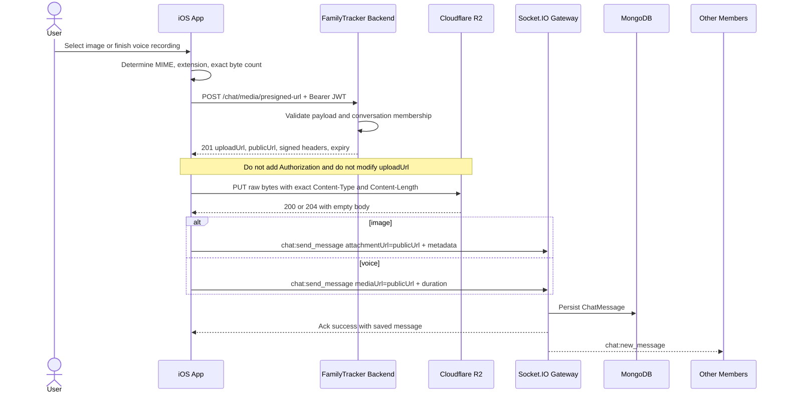

# Cloudflare R2 Media Upload - Mobile Integration Guide

Tai lieu nay la hop dong tich hop danh cho iOS Swift. Mobile co the upload image va voice note truc tiep len Cloudflare R2 ma khong gui binary qua backend.

## Table of Contents

1. [Overview](#1-overview)
2. [URLs and Authentication](#2-urls-and-authentication)
3. [Complete Upload Flow](#3-complete-upload-flow)
4. [Supported Media](#4-supported-media)
5. [Request Presigned URL](#5-request-presigned-url)
6. [Upload Binary to R2](#6-upload-binary-to-r2)
7. [Send Image Message](#7-send-image-message)
8. [Send Voice Message](#8-send-voice-message)
9. [Receive Media Messages](#9-receive-media-messages)
10. [Swift Models and Service](#10-swift-models-and-service)
11. [Error Handling](#11-error-handling)
12. [Postman and cURL Testing](#12-postman-and-curl-testing)
13. [Integration Checklist](#13-integration-checklist)

## 1. Overview

Media upload uses three independent requests:

```text
1. Mobile -> Backend: request a short-lived presigned PUT URL
2. Mobile -> Cloudflare R2: PUT raw file bytes directly
3. Mobile -> Backend Socket/REST: persist and broadcast the chat message
```

The backend never receives the image or audio binary. It only:

- authenticates the user;
- checks conversation membership;
- validates MIME type and file size;
- creates an R2 object key owned by the user and conversation;
- signs a short-lived PUT URL;
- validates the returned public URL when the message is sent.

Important distinction:

| Value | Purpose | Send as chat URL? |
| --- | --- | --- |
| `uploadUrl` | Temporary signed R2 URL used only for HTTP PUT | No |
| `publicUrl` | Permanent public URL used to display/play the media | Yes |
| `key` | R2 object path used for diagnostics and ownership | No |

## 2. URLs and Authentication

Development REST base URL:

```text
http://localhost:3000/api/v1
```

Production REST base URL:

```text
https://life360-backend-6v9n.onrender.com/api/v1
```

Production Socket.IO URL:

```text
https://life360-backend-6v9n.onrender.com
```

The presigned-ticket request requires the FamilyTracker access token:

```http
Authorization: Bearer <accessToken>
```

The direct PUT request to `uploadUrl` does **not** use a Bearer token. Authorization is already encoded in the URL signature.

## 3. Complete Upload Flow



Do not send step 3 before step 2 succeeds. The backend validates URL ownership but does not receive the uploaded bytes.

## 4. Supported Media

### Images

| MIME type | Required extension |
| --- | --- |
| `image/jpeg` | `jpg` |
| `image/png` | `png` |
| `image/webp` | `webp` |
| `image/heic` | `heic` |
| `image/heif` | `heif` |
| `image/gif` | `gif` |

Default maximum image size: **10 MB**. The actual Render configuration is controlled by `R2_IMAGE_MAX_BYTES`.

### Voice notes

| MIME type | Required extension |
| --- | --- |
| `audio/m4a` | `m4a` |
| `audio/mp4` | `m4a` |
| `audio/aac` | `aac` |
| `audio/mpeg` | `mp3` |
| `audio/ogg` | `ogg` |
| `audio/webm` | `webm` |
| `audio/wav` | `wav` |

Default maximum voice file size: **25 MB**. The actual Render configuration is controlled by `R2_VOICE_MAX_BYTES`.

Maximum voice duration accepted by the chat message API: **900 seconds**.

The extension is not trusted independently. It must exactly match the backend mapping for `mimeType`. For example, `audio/mp4` must use `m4a`, not `mp4`.

## 5. Request Presigned URL

### Endpoint

```http
POST /api/v1/chat/media/presigned-url
Authorization: Bearer <accessToken>
Content-Type: application/json
```

### Request fields

| Field | Type | Required | Description |
| --- | --- | --- | --- |
| `conversationId` | String | Yes | 24-character MongoDB ObjectId; user must be a member |
| `mediaType` | String | Yes | `image` or `voice` |
| `extension` | String | Yes | Lowercase extension matching `mimeType` |
| `mimeType` | String | Yes | One of the supported MIME values above |
| `fileSize` | Integer | Yes | Exact binary byte count, greater than zero |

Get the exact byte count after compression/encoding:

```swift
let fileSize = mediaData.count
```

Do not use the original file size if the app resizes an image or re-encodes audio before uploading.

### Image request

```json
{
  "conversationId": "6abd08616b11f579de6eee9e",
  "mediaType": "image",
  "extension": "png",
  "mimeType": "image/png",
  "fileSize": 177086
}
```

### Voice request

```json
{
  "conversationId": "6abd08616b11f579de6eee9e",
  "mediaType": "voice",
  "extension": "m4a",
  "mimeType": "audio/mp4",
  "fileSize": 123456
}
```

### Response `201 Created`

```json
{
  "success": true,
  "data": {
    "uploadUrl": "https://<account>.r2.cloudflarestorage.com/life360/chats/...?...signature...",
    "method": "PUT",
    "headers": {
      "Content-Type": "image/png",
      "Content-Length": "177086"
    },
    "key": "chats/6abd08616b11f579de6eee9e/6abcd8cc8126c189eeca828f/uuid.png",
    "publicUrl": "https://pub-....r2.dev/chats/6abd08616b11f579de6eee9e/6abcd8cc8126c189eeca828f/uuid.png",
    "expiresIn": 300,
    "expiresAt": "2026-10-12T08:15:00.000Z"
  }
}
```

The default presigned URL lifetime is 300 seconds. Always upload before `expiresAt`. A new ticket is required after expiration.

## 6. Upload Binary to R2

Use exactly the method, URL, and headers returned by the backend:

```http
PUT <data.uploadUrl>
Content-Type: <data.headers.Content-Type>
Content-Length: <data.headers.Content-Length>

<raw binary bytes>
```

Rules:

- Body must be raw image/audio bytes, not JSON and not `multipart/form-data`.
- Do not add `Authorization: Bearer` to the R2 request.
- Do not append, remove, decode, or reorder query parameters in `uploadUrl`.
- `Content-Type` must exactly match the signed value, including letter casing of the value.
- Binary byte count must exactly equal the signed `Content-Length`.
- A successful R2 response commonly has status `200` or `204` and an empty body. An empty response is normal.

Do not use `publicUrl` for the PUT request. Do not use `uploadUrl` in the chat message.

## 7. Send Image Message

After the PUT succeeds, emit `chat:send_message`:

```json
{
  "conversationId": "6abd08616b11f579de6eee9e",
  "type": "image",
  "attachmentUrl": "<ticket.publicUrl>",
  "content": "Optional caption",
  "metadata": {
    "width": 1170,
    "height": 2532,
    "blurhash": "LEHV6nWB2yk8pyo0adR*.7kCMdnj",
    "mimeType": "image/png",
    "size": 177086
  }
}
```

Image constraints:

| Field | Required | Rules |
| --- | --- | --- |
| `attachmentUrl` | Yes | Must be the exact `publicUrl` issued to this user and conversation |
| `content` | No | Caption, maximum 2,000 characters |
| `metadata.width` | Yes | Integer `1...20000` |
| `metadata.height` | Yes | Integer `1...20000` |
| `metadata.blurhash` | Yes | Valid BlurHash string, 6-100 characters |
| `metadata.mimeType` | No | Supported image MIME |
| `metadata.size` | No | Positive integer byte count |

Socket acknowledgement:

```json
{
  "success": true,
  "data": {
    "id": "670000000000000000000001",
    "conversationId": "6abd08616b11f579de6eee9e",
    "senderId": "6abcd8cc8126c189eeca828f",
    "senderName": "Alice",
    "type": "image",
    "content": "Optional caption",
    "attachment": {
      "url": "<ticket.publicUrl>",
      "mimeType": "image/png",
      "size": 177086,
      "width": 1170,
      "height": 2532,
      "blurhash": "LEHV6nWB2yk8pyo0adR*.7kCMdnj"
    },
    "createdAt": "2026-10-12T08:16:00.000Z"
  }
}
```

### REST fallback

The same image can be sent without Socket.IO:

```http
POST /api/v1/conversations/{conversationId}/messages
Authorization: Bearer <accessToken>
Content-Type: application/json
```

The REST body is the same image object but omits `conversationId`, because it is already in the URL. Success returns `201` and also broadcasts `chat:new_message`.

## 8. Send Voice Message

After the audio PUT succeeds:

```json
{
  "conversationId": "6abd08616b11f579de6eee9e",
  "type": "voice",
  "mediaUrl": "<ticket.publicUrl>",
  "duration": 12.4,
  "fileSize": 123456,
  "mimeType": "audio/mp4"
}
```

Voice constraints:

| Field | Required | Rules |
| --- | --- | --- |
| `mediaUrl` | Yes | Exact `publicUrl` issued to this user and conversation |
| `duration` | Yes | Seconds, greater than 0 and at most 900 |
| `fileSize` | Yes | Exact positive byte count |
| `mimeType` | Yes | Supported voice MIME |

Socket acknowledgement:

```json
{
  "success": true,
  "data": {
    "id": "670000000000000000000002",
    "conversationId": "6abd08616b11f579de6eee9e",
    "senderId": "6abcd8cc8126c189eeca828f",
    "senderName": "Alice",
    "type": "voice",
    "content": "",
    "attachment": null,
    "mediaUrl": "<ticket.publicUrl>",
    "duration": 12.4,
    "fileSize": 123456,
    "mimeType": "audio/mp4",
    "createdAt": "2026-10-12T08:16:00.000Z"
  }
}
```

The REST fallback is also `POST /api/v1/conversations/{conversationId}/messages`, with `conversationId` omitted from the body.

## 9. Receive Media Messages

Listen for:

```text
chat:new_message
```

The receiver gets the same normalized message object returned in the sender acknowledgement.

Rendering rules:

- `type == "image"`: read `attachment.url`, dimensions, BlurHash, MIME, and size.
- `type == "voice"`: read `mediaUrl`, `duration`, `fileSize`, and `mimeType`.
- `attachment` is `null` for voice messages.
- `content` may be empty.

Message history uses the same model:

```http
GET /api/v1/conversations/{conversationId}/messages?limit=30&before=<messageId>
Authorization: Bearer <accessToken>
```

## 10. Swift Models and Service

### Codable models

```swift
struct APIEnvelope<T: Decodable>: Decodable {
    let success: Bool
    let data: T
}

struct PresignedMediaRequest: Encodable {
    let conversationId: String
    let mediaType: String
    let fileExtension: String
    let mimeType: String
    let fileSize: Int

    enum CodingKeys: String, CodingKey {
        case conversationId, mediaType, mimeType, fileSize
        case fileExtension = "extension"
    }
}

struct PresignedMediaTicket: Decodable {
    let uploadUrl: URL
    let method: String
    let headers: [String: String]
    let key: String
    let publicUrl: URL
    let expiresIn: Int
    let expiresAt: Date
}

struct ChatAttachment: Decodable {
    let url: URL
    let mimeType: String?
    let size: Int?
    let width: Int
    let height: Int
    let blurhash: String
}

struct ChatMessage: Decodable, Identifiable {
    let id: String
    let conversationId: String
    let senderId: String
    let senderName: String?
    let type: String
    let content: String
    let attachment: ChatAttachment?
    let mediaUrl: URL?
    let duration: Double?
    let fileSize: Int?
    let mimeType: String?
    let createdAt: Date
}
```

Configure `JSONDecoder` for backend ISO-8601 timestamps, including milliseconds:

```swift
let decoder = JSONDecoder()
decoder.dateDecodingStrategy = .custom { decoder in
    let container = try decoder.singleValueContainer()
    let value = try container.decode(String.self)
    let formatter = ISO8601DateFormatter()
    formatter.formatOptions = [.withInternetDateTime, .withFractionalSeconds]
    guard let date = formatter.date(from: value) else {
        throw DecodingError.dataCorruptedError(
            in: container,
            debugDescription: "Invalid ISO-8601 date: \(value)"
        )
    }
    return date
}
```

### Request the ticket

```swift
enum MediaUploadError: Error {
    case invalidResponse
    case backend(status: Int, body: Data)
    case uploadFailed(status: Int, body: Data)
    case ticketExpired
    case fileSizeMismatch(expected: Int, actual: Int)
}

struct R2MediaUploadService {
    let baseURL: URL
    let session: URLSession
    let decoder: JSONDecoder

    func requestTicket(
        accessToken: String,
        conversationId: String,
        mediaType: String,
        fileExtension: String,
        mimeType: String,
        data: Data
    ) async throws -> PresignedMediaTicket {
        let endpoint = baseURL.appending(path: "chat/media/presigned-url")
        var request = URLRequest(url: endpoint)
        request.httpMethod = "POST"
        request.setValue("Bearer \(accessToken)", forHTTPHeaderField: "Authorization")
        request.setValue("application/json", forHTTPHeaderField: "Content-Type")
        request.httpBody = try JSONEncoder().encode(
            PresignedMediaRequest(
                conversationId: conversationId,
                mediaType: mediaType,
                fileExtension: fileExtension.lowercased(),
                mimeType: mimeType,
                fileSize: data.count
            )
        )

        let (responseData, response) = try await session.data(for: request)
        guard let http = response as? HTTPURLResponse else {
            throw MediaUploadError.invalidResponse
        }
        guard http.statusCode == 201 else {
            throw MediaUploadError.backend(status: http.statusCode, body: responseData)
        }
        return try decoder.decode(APIEnvelope<PresignedMediaTicket>.self, from: responseData).data
    }
}
```

`baseURL` must include `/api/v1`, for example:

```swift
URL(string: "https://life360-backend-6v9n.onrender.com/api/v1/")!
```

### PUT raw bytes to R2

```swift
extension R2MediaUploadService {
    func upload(data: Data, using ticket: PresignedMediaTicket) async throws {
        guard ticket.expiresAt > Date() else {
            throw MediaUploadError.ticketExpired
        }
        if let signedLength = ticket.headers["Content-Length"].flatMap(Int.init), signedLength != data.count {
            throw MediaUploadError.fileSizeMismatch(expected: signedLength, actual: data.count)
        }

        var request = URLRequest(url: ticket.uploadUrl)
        request.httpMethod = ticket.method

        // Apply only the exact signed headers returned by the backend.
        for (name, value) in ticket.headers {
            request.setValue(value, forHTTPHeaderField: name)
        }

        // Do not add the FamilyTracker Bearer token to this request.
        let (responseData, response) = try await session.upload(for: request, from: data)
        guard let http = response as? HTTPURLResponse else {
            throw MediaUploadError.invalidResponse
        }
        guard (200...299).contains(http.statusCode) else {
            throw MediaUploadError.uploadFailed(status: http.statusCode, body: responseData)
        }
    }
}
```

### Full image flow

```swift
let ticket = try await mediaUpload.requestTicket(
    accessToken: accessToken,
    conversationId: conversationId,
    mediaType: "image",
    fileExtension: "jpg",
    mimeType: "image/jpeg",
    data: jpegData
)

try await mediaUpload.upload(data: jpegData, using: ticket)

let payload: [String: Any] = [
    "conversationId": conversationId,
    "type": "image",
    "attachmentUrl": ticket.publicUrl.absoluteString,
    "content": caption,
    "metadata": [
        "width": pixelWidth,
        "height": pixelHeight,
        "blurhash": blurhash,
        "mimeType": "image/jpeg",
        "size": jpegData.count
    ]
]

socket.emitWithAck("chat:send_message", payload).timingOut(after: 10) { ack in
    // Decode ack[0], confirm success, then replace optimistic message.
}
```

### Full voice flow

```swift
let ticket = try await mediaUpload.requestTicket(
    accessToken: accessToken,
    conversationId: conversationId,
    mediaType: "voice",
    fileExtension: "m4a",
    mimeType: "audio/mp4",
    data: audioData
)

try await mediaUpload.upload(data: audioData, using: ticket)

let payload: [String: Any] = [
    "conversationId": conversationId,
    "type": "voice",
    "mediaUrl": ticket.publicUrl.absoluteString,
    "duration": durationSeconds,
    "fileSize": audioData.count,
    "mimeType": "audio/mp4"
]

socket.emitWithAck("chat:send_message", payload).timingOut(after: 10) { ack in
    // Decode ack[0] as the standard socket acknowledgement.
}
```

## 11. Error Handling

### Backend ticket errors

| HTTP | Code | Meaning | Mobile action |
| --- | --- | --- | --- |
| `400` | `VALIDATION_ERROR` | Invalid ObjectId, enum, type, extension, or size | Fix request; do not retry unchanged |
| `400` | `BAD_REQUEST` | MIME/extension mismatch or exceeds configured limit | Re-encode/compress or show error |
| `401` | `UNAUTHORIZED` | Access token missing, invalid, expired, or revoked | Run single-flight token refresh, retry once |
| `403` | `FORBIDDEN` | User is not a conversation member | Close composer or refresh conversation state |
| `503` | `SERVICE_UNAVAILABLE` | R2 is not configured on backend | Show temporary service unavailable state |

Standard error body:

```json
{
  "success": false,
  "code": "BAD_REQUEST",
  "message": "extension must be \"m4a\" for audio/mp4."
}
```

### R2 PUT errors

| Symptom | Common cause | Resolution |
| --- | --- | --- |
| `SignatureDoesNotMatch` | Header, size, method, URL, or request time differs from signature | Request a new ticket and send exact values |
| `403` after waiting | Presigned URL expired | Request a new ticket |
| `ECONNRESET` / connection lost | Network interruption or duplicate/conflicting Postman headers | Retry with a new ticket after confirming exact bytes |
| `200/204` with empty body | Normal successful upload | Continue to send the chat message |
| Public URL returns `404` | PUT did not succeed or wrong URL used | Do not send message; upload again |

### Socket acknowledgement errors

```json
{
  "success": false,
  "status": 400,
  "code": "BAD_REQUEST",
  "message": "mediaUrl must be the publicUrl of an upload ticket issued to you for this conversation."
}
```

Never replace `publicUrl` with another user's URL, another conversation's URL, a URL with extra query parameters, or a third-party URL. Ownership validation rejects it.

## 12. Postman and cURL Testing

### Step 1: request an image ticket

```bash
curl -X POST 'http://localhost:3000/api/v1/chat/media/presigned-url' \
  -H 'Authorization: Bearer <ACCESS_TOKEN>' \
  -H 'Content-Type: application/json' \
  -d '{
    "conversationId": "6abd08616b11f579de6eee9e",
    "mediaType": "image",
    "extension": "png",
    "mimeType": "image/png",
    "fileSize": 177086
  }'
```

### Step 2: PUT the file

```bash
curl -X PUT '<UPLOAD_URL_FROM_STEP_1>' \
  -H 'Content-Type: image/png' \
  -H 'Content-Length: 177086' \
  --data-binary '@/absolute/path/image.png'
```

Postman configuration:

1. Method: `PUT`.
2. URL: paste the complete `uploadUrl` without editing.
3. Authorization: `No Auth`.
4. Headers: use exact `Content-Type` and `Content-Length` from the ticket.
5. Body: `binary`, then select the exact file.
6. Do not create duplicate Content-Type or Content-Length headers.

### Step 3: persist through REST for testing

```bash
curl -X POST 'http://localhost:3000/api/v1/conversations/6abd08616b11f579de6eee9e/messages' \
  -H 'Authorization: Bearer <ACCESS_TOKEN>' \
  -H 'Content-Type: application/json' \
  -d '{
    "type": "image",
    "attachmentUrl": "<PUBLIC_URL_FROM_STEP_1>",
    "content": "Postman test",
    "metadata": {
      "width": 1170,
      "height": 2532,
      "blurhash": "LEHV6nWB2yk8pyo0adR*.7kCMdnj",
      "mimeType": "image/png",
      "size": 177086
    }
  }'
```

The production app should normally use Socket.IO for step 3 so it receives an acknowledgement and other members receive `chat:new_message` immediately.

## 13. Integration Checklist

- [ ] Access token is used only for backend REST and Socket.IO, not for R2 PUT.
- [ ] `fileSize` is calculated after final compression/encoding.
- [ ] MIME type and extension use the exact supported mapping.
- [ ] Ticket request succeeds with `201`.
- [ ] PUT uses raw bytes and every returned signed header.
- [ ] PUT completes before `expiresAt` and returns `2xx`.
- [ ] Image payload includes valid dimensions and BlurHash.
- [ ] Voice payload includes duration, exact file size, and MIME type.
- [ ] Message uses `publicUrl`, never `uploadUrl`.
- [ ] Socket acknowledgement is checked before marking an optimistic message as sent.
- [ ] `chat:new_message` and history decode both image and voice fields.
- [ ] Failed/expired uploads request a new ticket instead of reusing the old URL.
