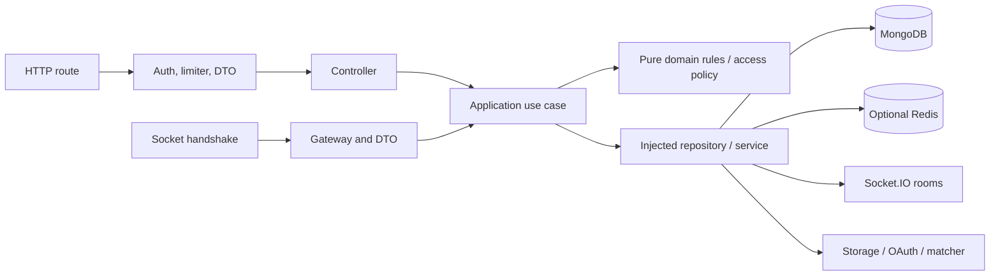

# Kiến trúc và luồng backend

**Trạng thái:** Kiến trúc dùng chung; mô tả hiện trạng và DEC-ARCH-01 đã chấp thuận. Xem [feature map](../README.md).

Source survey 2026-11-11; [source inventory](source-inventory.md). Detailed business flows belong to the relevant [feature](../README.md). Configuration, dependencies and validation are shared system documents.

## Cấu trúc

`src/bootstrap.js` kết nối MongoDB, tạo Express/Socket.IO, container, đăng ký HTTP, socket và scheduler. `src/container.js` nối repositories, cache, storage, realtime, policies và use cases. Luồng chuẩn:

```text
HTTP route → middleware/DTO → controller → application use case → repository → Mongoose model
socketServer → gateway/DTO → application use case → repository / realtime service
                                   ↘ domain helpers (pure)
```

Các nhóm `src/application/`: auth, chat, digests, groups, history, location, places, privacy và sos; ports mô tả metrics/logger/map matcher. `src/infrastructure/` cung cấp MongoDB, repositories, Redis/no-op cache, OAuth, security, storage, matching, realtime và observability. `src/config/` khai báo cấu hình và Swagger. File inventory đầy đủ ở [source-inventory.md](source-inventory.md).

## Feature boundaries

See the [feature ownership/read map](../README.md). Shared lifecycle below wires features; each business flow and contract has its own feature owner.

## Vận hành và rủi ro

- Production yêu cầu MongoDB replica set hoặc mongos có transaction; development có thể fallback in-memory khi không kết nối được.
- Redis là tùy chọn; cache fail-soft không thay thế MongoDB làm nguồn dữ liệu phiên refresh. Xem `src/application/auth/authUseCases.js` cho giới hạn blacklist khi cache không sẵn sàng.
- Watch rooms, hàng đợi delta và matching chứa trạng thái trong process; cần thiết kế/kiểm chứng thêm trước khi mở rộng nhiều instance.
- Graphify trong `graphify-out/backend/` chỉ phân tích AST cục bộ, có cạnh suy luận; không thay thế việc đọc code, không đại diện cho cấu hình hoặc dữ liệu production.
- Không có migration hay thay đổi runtime trong bộ tài liệu này.

## State and reliability boundaries

- MongoDB owns user/group/conversation membership, refresh sessions, history/trail, chat/SOS/outbox/digests/places. Redis caches and blacklists are optional; process-local Maps own stay/history-throttle state, pending deltas, matcher work and socket watch registrations.
- HTTP is not imported into application use cases; infrastructure supplies token/password/storage/database implementations. Presentation request/socket context directly uses observability infrastructure; composition root and bootstrap intentionally orchestrate across layers.
- Production requires replica-set/mongos support. Development unit-of-work fallback runs with null session and loses transaction atomicity; SOS explicitly refuses such writes. Do not generalize transaction tests into a standalone-database guarantee.
- Ordinary chat message/last-message/read-pointer writes and digest emit/persistence are separate; only SOS mutation fanout is committed as a unit with its outbox. Socket emit success never establishes client receipt.
- Redis is not used as a Socket.IO distributed adapter. Match queue/watch invalidation/limiters are process scoped; no multi-instance delivery/privacy guarantee was validated.
- Existing monitoring config can export runtime data when started/configured; survey only reviewed files and ran isolated tests. UI/mobile/background delivery and third-party account state remain outside this backend's source boundary.


## Entry points and lifecycle

`server.js` loads dotenv, initializes optional tracing, validates config and calls `createServer`. `bootstrap.js` connects MongoDB and initializes registered model indexes; constructs Express/HTTP/Socket.IO; creates the container; connects cache; backfills group conversations/memberships; registers HTTP/socket and starts digest/SOS jobs. Listen binds `0.0.0.0`. SIGINT/SIGTERM initiate shutdown with a ten-second process deadline.

Shutdown closes metrics, stops digest scheduling, drains the active SOS worker, waits for matching workers, discards pending delta queues, closes sockets/cache/database and then tracing. Digest `stop()` clears its interval; it does not explicitly drain a running digest. Startup backfill is a database write, so merely starting a server is not a read-only survey operation.



The diagram describes runtime calls; the composition root intentionally imports all layers to wire them. Static imports alone cannot prove authorization or delivery.
