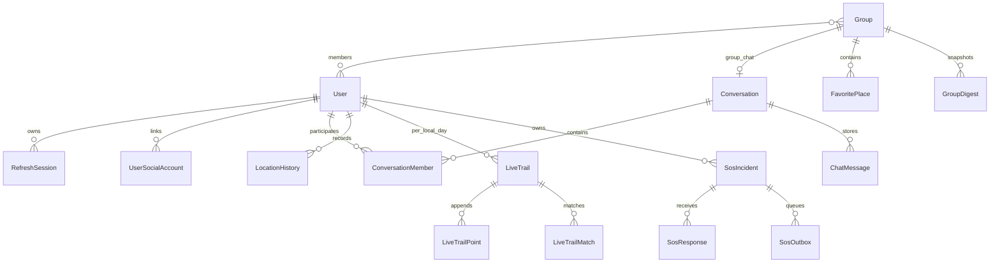

# Shared data conventions and model ownership

Sinh từ Mongoose schema trong source, không đọc MongoDB thực tế. Các đường dẫn là schema paths cấp cao; object con có thể chứa thêm trường, xem model để biết validation, default, ref và subdocument. `_id`/`__v` không liệt kê. `unique` là khai báo index, không phải kết quả kiểm tra index trên server.

Tọa độ GeoJSON dùng `[longitude, latitude]`. TTL index chạy bất đồng bộ; không dùng thời điểm TTL xóa làm kiểm tra quyền.

Status: Current behavior, survey 2026-11-11. The original review covered all 14 model source files and 16 Mongoose models/collections (`LiveTrail.js` exports three). Each full model/schema/index block lives only in its owner below. Cross-feature references are ObjectId refs, not database-enforced foreign keys.

| Model | Owning feature |
|---|---|
| User | [authentication](../features/authentication/data-model.md) |
| RefreshSession | [authentication](../features/authentication/data-model.md) |
| UserSocialAccount | [authentication](../features/authentication/data-model.md) |
| Group | [circles](../features/circles/data-model.md) |
| Conversation | [chat](../features/chat/data-model.md) |
| ConversationMember | [chat](../features/chat/data-model.md) |
| ChatMessage | [chat](../features/chat/data-model.md) |
| FavoritePlace | [favorite-places](../features/favorite-places/data-model.md) |
| GroupDigest | [group-digests](../features/group-digests/data-model.md) |
| LocationHistory | [location-history](../features/location-history/data-model.md) |
| LiveTrail | [live-trail](../features/live-trail/data-model.md) |
| LiveTrailPoint | [live-trail](../features/live-trail/data-model.md) |
| LiveTrailMatch | [live-trail](../features/live-trail/data-model.md) |
| SosIncident | [sos](../features/sos/data-model.md) |
| SosResponse | [sos](../features/sos/data-model.md) |
| SosOutbox | [sos](../features/sos/data-model.md) |

Motion state: stationary/walking/running/cycling/automotive/unknown. DTO validation and authorization are separate from model/index validation. No production migration/index audit is implied.

The complete User schema is owned by authentication; User privacy/location field behavior is owned by location-sharing. Group schema is owned by circles; digest settings behavior is owned by group-digests. Chat owns persisted media fields; media-upload owns presigned keys and object storage. SOS references ChatMessage via server-owned metadata but does not duplicate its schema.

