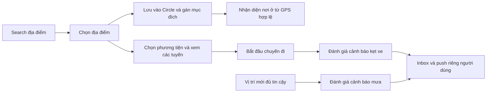

# Thiết kế mở rộng bản đồ và cảnh báo theo ngữ cảnh

Date: 2026-11-12 | **P1a search/history implemented; các feature khác còn Proposed/P0**.

Đây là roadmap phối hợp, không gom contract/model của các feature vào một spec.
Các mục được yêu cầu dưới đây có authority từ cuộc trao đổi; giải pháp kỹ thuật,
ngưỡng, route API và chính sách chi tiết vẫn là Proposed.

User đã nói “Tôi đồng ý với đề xuất của bạn” sau đề xuất cụ thể về lưu thông báo,
cache history và nhiều phương tiện/tuyến. Approval được ghi ở owner:
[DEC-SEARCH-01](../features/place-search/decisions.md) và
[DEC-ALERT-01](../features/context-alerts/decisions.md). Không cần hỏi duyệt lại
policy đã được xác nhận. Provider/maps/region/budget và numerical thresholds chưa
được chọn chỉ từ sự đồng ý khảo sát Google Routes.

Chức năng đầu tiên theo thứ tự roadmap là **place-search và history cache**.
User đã xác nhận, và khảo sát chỉ đọc xác minh app dùng **native Swift/SwiftUI,
Apple MapKit, iOS 16** tại `../Mobile`. Plan search được điều chỉnh sang
MKLocalSearchCompleter/MKLocalSearch + cache local; **không cần tạo backend search
API hoặc yêu cầu Google key cho slice này**. DEC-SEARCH-03 sau đó đã cho phép implementation native search/history trong Mobile;
slice này đã build/test, không cần sửa backend runtime. Không claim đã khảo sát hết
mobile hoặc đã xác nhận coverage quốc gia. Xem file/luồng/tests cụ thể ở search plan.

**Quyết định phạm vi mới nhất — 2026-11-12:** sau DEC-SEARCH-02 design-only,
user yêu cầu “Hãy hiện thực full chức năng đầu tiên đi” (DEC-SEARCH-03). Native
search/history P1a đã triển khai và build/test; xem [evidence](../features/place-search/plan.md).
P1b purpose/geofence và routing/alerts/push vẫn là roadmap tương lai, không được
coi là đã hoàn thành từ search. Không cần xin lại scope Mobile cho cùng feature.

## Yêu cầu đã xác nhận

| ID | Intent | Authority |
|---|---|---|
| REQ-MOB-01 | Cảnh báo khả năng sắp mưa ở nơi người dùng đang ở. | Yêu cầu người dùng 2026-11-12 |
| REQ-MOB-02 | Cảnh báo nguy cơ kẹt xe khi đi một tuyến đường. | Cùng yêu cầu |
| REQ-MOB-03 | Thanh search tìm địa điểm mới và tìm đường đến địa điểm đã chọn. | Cùng yêu cầu |
| REQ-MOB-04 | Lưu địa điểm theo mục đích như Nhà, Công ty, Đi chơi. | Cùng yêu cầu |
| REQ-MOB-05 | Cảnh báo cần hoạt động cả khi app đóng. | Trả lời trực tiếp: “Cần thông báo cả khi app đóng” |
| REQ-MOB-06 | Chia sẻ địa điểm trong Circle và tự hiển thị nơi người dùng đang ở. | Trả lời trực tiếp: “Chia sẻ trong Circle và tự hiển thị nơi đang ở” |
| REQ-MOB-07 | Thiết kế/lên plan trước implementation. | Yêu cầu ban đầu đã đáp ứng; sau đó DEC-SEARCH-03 cho phép thực hiện search/history P1a |
| REQ-MOB-08 | Ưu tiên chỉ đường xe máy trong bản đầu. | Trả lời trực tiếp: “Xe máy trước”, 2026-11-12 |
| REQ-MOB-09 | Chỉ thông báo khi có điều kiện thời tiết/giao thông đáng chú ý; không thông báo trời bình thường/nắng đẹp. | Ràng buộc bổ sung của user, 2026-11-12; loại hiện tượng/ngưỡng cụ thể vẫn cần chốt |
| REQ-MOB-10 | Có lịch sử tìm kiếm, chỉ lưu cache; không lưu lịch sử này vào database. | Cùng ràng buộc bổ sung |
| REQ-MOB-11 | Người dùng chọn phương tiện, gồm xe máy/ô tô/đi bộ, và chọn trong các tuyến thay thế khi có. | Cùng yêu cầu bổ sung; mở rộng scope xe máy trước của REQ-MOB-08, không xóa lịch sử quyết định |
| REQ-MOB-12 | Giữ nearby/text search trong scope; provider/maps nền/quốc gia/ngân sách và radius/POI fields giải quyết tại P0. | User đồng ý hướng xử lý Q-MOB-01/02; chưa cung cấp lựa chọn vendor/quốc gia/ngân sách cụ thể |

REQ-MOB-05 là yêu cầu sản phẩm; không phải cam kết OS cho phép định vị/push liên tục.
Acceptance định lượng và các ngoại lệ vận hành bên dưới cần duyệt trước thực hiện.

## Hiện trạng đã đối chiếu

- [Favorite places](../features/favorite-places/spec.md): Circle-only create/list; category hiện có restaurant/entertainment/cafe/shopping/other; chưa CRUD đầy đủ, purpose hoặc geofence.
- [Location sharing](../features/location-sharing/spec.md): realtime/batch, timestamp ordering và pause toàn tài khoản. Batch không phải nguồn cảnh báo realtime. Cần mở rộng có chủ ý nếu tính năng mới nhận vị trí lúc nền.
- [Live trail](../features/live-trail/spec.md): Mapbox hiện dùng để khớp vệt GPS đã đi; không cung cấp search hoặc tìm tuyến tương lai.
- Backend không chứa mobile source hay push-device registry/weather/search/routing adapters. Đã truy cập Mobile lân cận chỉ đọc; xác minh MapKit, không suy ra maps nền từ matcher backend. Đây là bổ sung cho khảo sát backend trước, không phải full mobile audit.
- HEAD lúc khảo sát `0c42dc669daa64f233a7b2e8f619e3dc9bbddb55`; graph ghi commit cũ `ddf5c58d`. So sánh 218 hash và danh sách 136 src JS: không đổi/thêm/xóa. Dùng graph định hướng, kết luận đã kiểm tra source; không regenerate cho tài liệu.

## Trải nghiệm đề xuất

1. Mở bản đồ: search ở trên; shortcut Nhà/Công ty/Địa điểm đã lưu; thẻ cảnh báo còn hiệu lực. Nếu thiếu quyền GPS, vẫn cho tìm địa điểm và nhập điểm xuất phát bằng tay.
2. Gõ “quán cà phê…”: suggestions có debounce, chọn kết quả → xem chi tiết → Lưu hoặc Chỉ đường. Search bar có lịch sử tìm kiếm từ cache, xóa từng mục/toàn bộ; không ghi DB, không trộn tài khoản. Mất mạng/quota hiển thị rõ, không trả kết quả từ request cũ.
3. Chỉ đường: chọn điểm xuất phát, điểm đến, phương tiện xe máy/ô tô/đi bộ; xem các tuyến thật provider trả về với thời gian/khoảng cách và đoạn đông xe khi mode có dữ liệu. Đổi mode tính lại tuyến, không tái sử dụng ETA/traffic mode cũ. Ví dụ minh họa: “Tuyến A dự kiến chậm hơn khoảng 12 phút”. Không hứa luôn có nhiều tuyến.
4. Nhấn **Bắt đầu chuyến đi** mới tạo active trip cho theo dõi/cảnh báo nền. Chỉ xem trước tuyến không mặc nhiên theo dõi; kết thúc/hủy/timeout dừng giám sát. Không tự đoán người dùng sắp đi đường nào từ lịch sử.
5. Lưu địa điểm: chọn Circle, tên, purpose và vùng nhận diện. Purpose mô tả địa điểm; ví dụ quán cafe có category `cafe`, purpose `leisure`. Không suy ra hoạt động thực của người dùng chỉ từ loại POI.
6. Circle hiển thị “Ở Nhà — cập nhật 1 phút trước” khi GPS đủ tin cậy nằm trong vùng. Khi mất freshness, hiện “Chưa xác định”, không giữ nhãn như vị trí trực tiếp. Cảnh báo mưa/kẹt xe gửi riêng chủ tài khoản, không mặc định phát cả Circle.
7. Cài đặt: quyền OS, loại cảnh báo, giờ yên lặng, bật/tắt nhận diện địa điểm và nội dung màn hình khóa. Tap push mở chi tiết qua API có xác thực lại.

## Chia ownership

| Feature | Sở hữu | Artifacts |
|---|---|---|
| Place search | Autocomplete/detail/nearby, provider attribution/session | [spec](../features/place-search/spec.md), [plan](../features/place-search/plan.md), [tasks](../features/place-search/tasks.md) |
| Routing | Route preview, traffic, active trip và lifecycle | [spec](../features/routing/spec.md), [plan](../features/routing/plan.md), [tasks](../features/routing/tasks.md) |
| Favorite places | Circle places/purpose, per-member label, geofence presence | [extension plan](../features/favorite-places/plan.md), [tasks](../features/favorite-places/tasks.md) |
| Context alerts | Weather rules, cảnh báo traffic từ routing, preferences, inbox, push/worker | [spec](../features/context-alerts/spec.md), [plan](../features/context-alerts/plan.md), [tasks](../features/context-alerts/tasks.md) |

## Lưu trữ và điều kiện thông báo — cập nhật ràng buộc

- **Đã yêu cầu:** lịch sử tìm kiếm có ở cache, không DB; thời tiết bình thường không tạo notification. Nearby/text search vẫn trong scope.
- **Đã duyệt DEC-SEARCH-01:** history cache trên mobile theo tài khoản, tối đa 20 mục/30 ngày, có xóa, không sync nhiều thiết bị bản đầu. Redis sync là scope mở rộng, chưa chọn ngầm. User query khác với nội dung POI provider; không cache raw detail tự do.
- **Đã duyệt DEC-ALERT-01:** DB chỉ giữ logical alert đạt điều kiện và delivery state tối thiểu, retention 7 ngày; không lưu mọi lần weather poll hay báo trời đẹp. Provider snapshot dùng cache ngắn hạn được phép; durable context/worker phục vụ scheduling không phải kho thời tiết lịch sử.
- “Hiện tượng lạ” cần vocabulary/ngưỡng: mưa sắp tới đã nằm trong scope, mưa lớn/dông/gió mạnh/nóng bất thường là đề xuất mở rộng cần nguồn/threshold được duyệt. Giao thông chỉ báo bất lợi cho mode/tuyến đang chọn; không báo “hết kẹt” hoặc “thời tiết đẹp lại” mặc định.
- Chống spam theo đợt hiện tượng + cooldown; chỉ gửi thêm khi mức độ tăng đáng kể và rule cho phép. Loại cảnh báo mới không tự bật chỉ vì provider có trường tương ứng.

## Thứ tự triển khai và cổng nghiệm thu

| Giai đoạn | Kết quả kiểm chứng | Điều kiện để đi tiếp |
|---|---|---|
| P0 — Quyết định/khảo sát mobile | Duyệt thiết kế, vùng phục vụ, phương tiện, maps SDK/provider/budget, privacy và thresholds. Spike bằng tọa độ tổng hợp, không dùng dữ liệu người thật. | Có mobile repo được chỉ định; coverage và quyền lưu/hiển thị dữ liệu phù hợp; không gọi dịch vụ trả phí khi chưa được phép. |
| P1 — Search + lưu địa điểm | P1a native MapKit search/history trước; P1b Circle purpose CRUD sau, tương thích client cũ. | P1a cần quyền sửa Mobile và native tests/localization; P1b có backend contract/authorization tests. Chưa tuyên bố đã có cảnh báo nền. |
| P2 — Tuyến đường | Preview và active trip; ETA/traffic có freshness, trạng thái không hỗ trợ rõ ràng. | Thử thực địa đúng phương tiện tại vùng phục vụ sau khi được phép; không thay xe máy bằng ô tô âm thầm. |
| P3 — Định vị nền + push nền tảng | Thiết bị đăng ký/refresh/revoke; worker durable; mobile nhận push test khi background/khóa màn hình. | Test trên iOS/Android thật, battery/permissions/force-stop/offline matrix. Đây là phần bắt buộc của REQ-MOB-05. |
| P4 — Nhận diện + cảnh báo hoàn chỉnh | Geofence ổn định, mưa gần hạn, cảnh báo tuyến đang active, rate/dedupe, pause/leave/revocation. | Acceptance từng feature và E2E; P1/P2 riêng lẻ chưa hoàn thành mục tiêu. |
| P5 — Rollout | Feature flags tắt mặc định đến khi cấu hình/coverage/cost/privacy được xác nhận; pilot rồi mở rộng. | Metrics/quota cap, rollback, retention jobs và hoạt động worker liên tục. |

Sau khi xác minh MapKit, P1a native search có thể viết/test với fake services mà
không phải chờ Google key hoặc ngân sách routing/weather. Service area cần chốt
cho live coverage/pilot; không tự ép country filter chưa được yêu cầu. Quyền ghi/build-test Mobile cho search đã được DEC-SEARCH-03 giải quyết.
Manual device coverage/target country vẫn cần kiểm chứng riêng.

Không ước lượng ngày hoàn thành khi chưa xem mobile và chưa chốt provider. Có thể
phát triển độc lập search/place sau P0; các phần nền phụ thuộc mobile và hạ tầng worker.

## Lựa chọn kỹ thuật đề xuất

- Nền bản đồ đã xác minh là Apple MapKit; ưu tiên search native Apple, không đề xuất đổi nền Google chỉ để search. Routing xe máy/traffic server, weather và push là lựa chọn riêng chưa cấu hình/chốt. Google Routes chỉ là ứng viên nếu coverage và quyền hiển thị trên Apple Map được xác nhận; không mặc định trộn provider.
- Không cần LLM để dự đoán mưa hay kẹt xe: dùng forecast/traffic của provider và rule xác định, có timestamp và nguồn. Không tự tạo phần trăm confidence không có dữ liệu.
- Backend giữ keys web-service, quota, auth, rules và durable state. Mobile giữ map rendering, search UX, GPS/background permissions và trình bày notification. Public SDK key phải hạn chế theo ứng dụng; không đưa server key vào app.
- MongoDB durable; optional Redis chỉ cache/rate-limit khi hợp lệ theo điều khoản. Worker có lease và atomic dedup, chạy được sau restart; không tạo vòng gọi API cho mọi điểm GPS.
- Theo dõi runtime cần dịch vụ luôn hoạt động hoặc worker/scheduler độc lập; cấu hình deployment hiện tại không chứng minh worker sẽ thức khi app đóng.

## Các quyết định chưa chốt

| ID | Cần duyệt | Đề xuất để thảo luận |
|---|---|---|
| Q-MOB-01 | Partially resolved: Maps SDK; open: thị trường/coverage từng mode | Mobile Apple MapKit/SwiftUI/iOS16 đã xác minh, không hỏi chọn lại maps SDK. Quốc gia chưa trả lời; xe máy không có mode riêng trong MKDirectionsTransportType công bố, cần đánh giá provider/capability riêng. |
| Q-MOB-02 | Provider và ngân sách/tháng, requests/day cap | Chọn sau spike; dùng công thức chi phí ở research, không mặc định dịch vụ miễn phí. |
| Q-MOB-03 | Pause ảnh hưởng dịch vụ riêng như thế nào | Mặc định không dùng GPS cũ để nhận diện/cảnh báo nền; xem tuyến bằng điểm nhập tay vẫn được. Nếu muốn self-only GPS khi pause, phải có mục đích/quyền riêng, không lách pause hiện hữu. |
| Q-MOB-04 | Ai sửa/xóa nơi chung; Nhà/Công ty của ai | Creator hoặc admin sửa địa điểm chung; từng người gán shortcut cá nhân trên nơi chung. Không mặc định tất cả thành viên có chung công ty. |
| Q-MOB-05 | Freshness, geofence, cooldown, quiet hours và retention | Giá trị đề xuất có trong feature plans; cần duyệt/tune thực địa. |
| Q-MOB-06 | Dẫn đường trong app tới mức nào | Bản đầu preview + theo dõi chuyến/cảnh báo; giọng nói/turn-by-turn đầy đủ cần navigation SDK và scope riêng. |
| Q-MOB-07 | Resolved: history cache placement/TTL/limit | DEC-SEARCH-01: mobile theo account, 20 mục/30 ngày, xóa, không multi-device sync. Thư viện/native lifecycle cần khảo sát mobile. |
| Q-MOB-08 | Partially resolved: DB alert; open: loại “thời tiết lạ” | DEC-ALERT-01 đã duyệt DB alert/delivery 7 ngày, không normal-weather record. Chưa chốt danh sách hiện tượng/ngưỡng; không cần duyệt lại persistence. |

Người dùng đã yêu cầu background push và Circle/autopresence; hai mục này **không** còn là lựa chọn tùy ý bỏ khỏi scope. Chỉ chi tiết thực hiện và các ngoại lệ cần duyệt.

## Phạm vi file hiện tại và tương lai

Giai đoạn thiết kế ban đầu chỉ tạo docs: roadmap/research, ba feature spec/plan/tasks,
favorite-places extension và registry/progress. Sau DEC-SEARCH-03, search/history
đã thực hiện trong Mobile, có native spec .spec/013, production code/test/CI và
resource changes. Backend vẫn chỉ cập nhật docs, không sửa runtime/config/schema.
Các feature khác giữ plan tại owner; không tạo native code trong backend.

## Bằng chứng và giới hạn

Đã refresh context skeleton; đọc specs liên quan, graph report, places use case/repo/model,
route/DTO/controller tương ứng, privacy policy/update, matcher port và các đoạn test liên quan.
Không thực hiện lại full survey. Design-only stage không gọi provider hoặc runtime
tests; implementation stage sau đó chạy 21 search tests, build/localization/lint
và native MapKit smoke bằng địa điểm công cộng. Chi tiết/giới hạn ở search plan.
Nghiên cứu capability bằng tài liệu chính thức trong [research](mobility-research.md).
